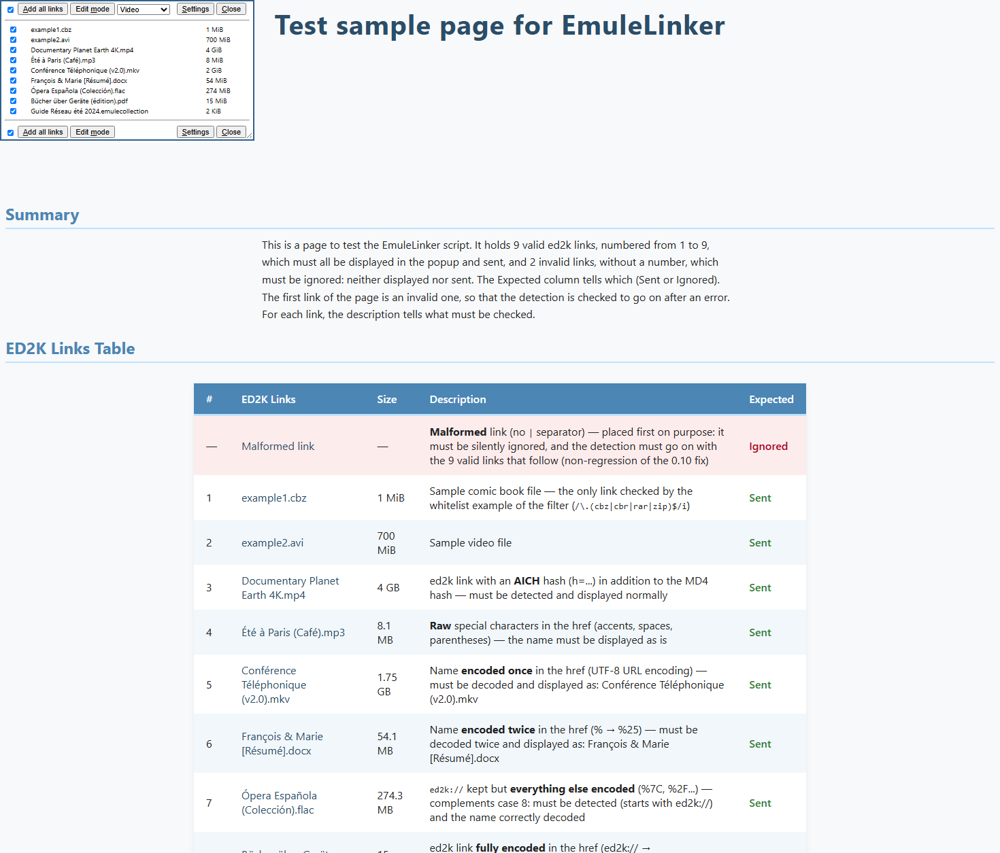
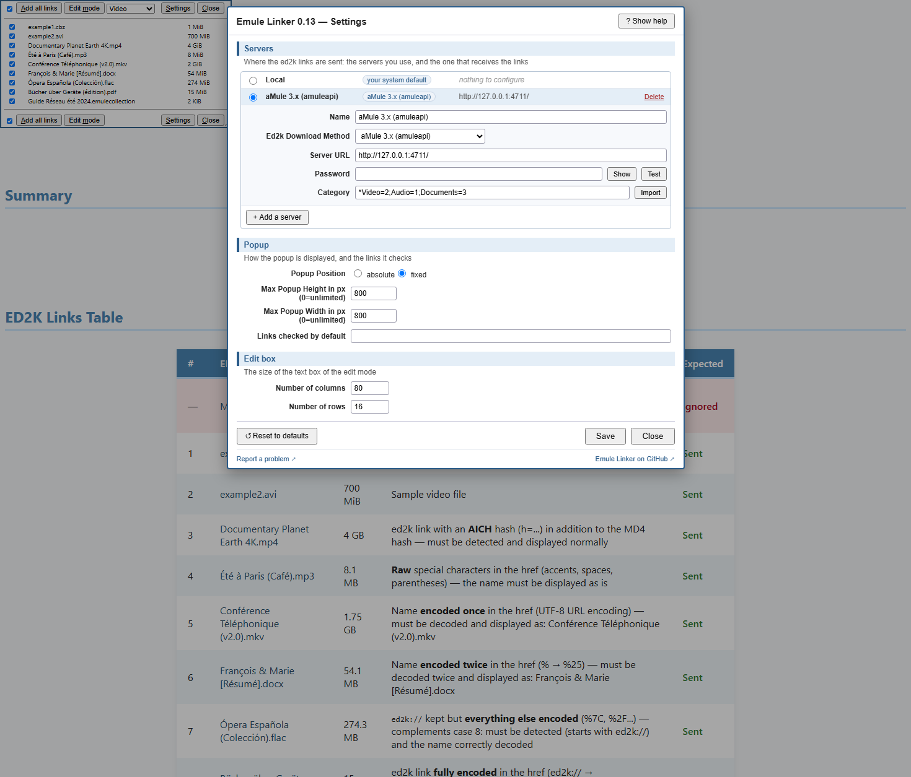

# GM_EmuleLinker

## Presentation

**GM_EmuleLinker** is a [Tampermonkey](https://tampermonkey.net/) script that adds all the [ed2k](https://en.wikipedia.org/wiki/EDonkey2000) links of a page, in one click, to [eMule](https://www.emule-project.com), [aMule](https://www.amule.org/), [MLDonkey](https://github.com/ygrek/mldonkey), or any application installed on your system that handles ed2k links.

It parses the current page and displays all the ed2k links found in a popup box, in a corner of the window (the top left one by default).



Then you can add all of them in one click to your eMule, aMule or MLDonkey application.

The script provides a settings screen to match your configuration and customize the popup box.



The changes of each version are listed in [CHANGELOG.md](CHANGELOG.md).

## How to install

1. Install the [Tampermonkey](https://tampermonkey.net/) extension in your browser.

   On Chrome and the other Chromium-based browsers, Tampermonkey also needs the **Allow User Scripts** toggle, on its details page (`chrome://extensions`): without it, no script runs. See the [Tampermonkey FAQ](https://www.tampermonkey.net/faq.php).

   This script was originally developed for [Greasemonkey](https://www.greasespot.net/), but Tampermonkey is now recommended. [Violentmonkey](https://violentmonkey.github.io/) works too: the script was tested with it on Chrome. Greasemonkey 4 and later are not supported: their programming interface is no longer the one the script uses.

2. To send the links to eMule, aMule or MLDonkey, enable the web server of this application, even when it runs on the same computer. Only the **Local (your system default)** method (step 5) works without it.
   1. In eMule, go to Options → Web Interface → \[x\] Enabled
      - set a port number (4711 is the default)
      - and, optionally, a password
   2. With aMule 3.1 or later, enable its web interface and REST API (amuleapi, port 4711 by default): see the aMule documentation.
   3. With an older aMule or with MLDonkey, see the documentation of its web interface.

3. Install the script: open [GM_EmuleLinker.user.js](https://raw.githubusercontent.com/alo0/GM_EmuleLinker/master/GM_EmuleLinker.user.js). Tampermonkey shows its installation page: click **Install**.

   Installed before version 0.10? Nothing to do: Tampermonkey moves your installation to this new file at its next update check, and keeps your settings.

4. Open a page with ed2k links: the settings dialog opens by itself the first time.

   To try the script, download the [test sample page](https://raw.githubusercontent.com/alo0/GM_EmuleLinker/master/test_sample.html) (Save As) and open it from your disk. On Chrome, Tampermonkey runs on local files only with the **Allow access to file URLs** toggle of its details page.

   Later, the **Settings** button of the popup (⚙), or `Ctrl+Alt+S`, opens the dialog again. The **?** button, at the top right, shows the explanation under every field (the ✕ next to it closes the dialog); while they are hidden, the explanation of a field appears as a tooltip when the mouse stays over it; only the fields that the method of a server uses are shown under it. A wrong value is shown in red under its field, and nothing is saved until it is corrected. **Reset to defaults** sets every field back to its default value and marks the fields it changed, without saving them: **Undo** brings the previous values back. **Escape** closes the dialog without saving.

5. Set your configuration. The **Servers** section lists Local and your servers: check the one that receives the links. **+ Add a server** adds one: give it a name, choose its **Ed2k Download Method**, then its settings. Each server keeps its own settings, several servers of the same kind included (two aMule for instance): **Edit** shows those of a server without checking it, **Delete** removes it (with Undo). **Disable**, on the row of Local, leaves it out when your system has no ed2k application (**Enable** offers it again). The methods:
   - **Local (your system default)** uses the application installed on your computer that handles ed2k links by default
   - **eMule (web)** sends the links to the web server of eMule, local or remote
   - **aMule 3.x (amuleapi)** sends the links to aMule 3.1 or later, local or remote, through its REST API
   - **aMule 2.x (amuleweb)** sends the links to the web server of aMule 2.x, local or remote
   - **MLDonkey (web)** sends the links to the web server of MLDonkey, local or remote, with its user and its password: you no longer type them at each sending
   - **Custom (post to your own server)** sends the ed2k links to your own web server, so that you can process them as you see fit

   Except Local and Custom, the links are sent without opening any window, and the answer of the application is shown in the popup. At the first sending, Tampermonkey asks you to allow the script to reach the address of the application: choose to always allow it.

   Then fill in the following fields:
   - **Server URL**, in the form `http://ip:port/`
   - **User**, for MLDonkey only: its user, `admin` by default
   - **Password**, if your web server has one (not for Custom). For aMule 3.x, the admin password of aMule. For aMule 2.x, it is needed: in our tests, its web interface could not be set without one. With eMule, aMule and MLDonkey, the **Test** button checks the Server URL and the password before you save them. It is masked: the **Show** button displays it
   - **Category**, if you want to choose the category of the downloads, in the form `*label1=value1;label2=value2;...`. The label prefixed by a `*` is the default choice.
     - eMule: `default=0;*Audio=1`, the value is the number of the category tab in eMule. `Audio` is the default choice here. The **Import** button fills the field with the categories of eMule, in its order.
     - aMule 3.x (amuleapi): `*default=0;Audio=1`, the value is the number of the category in aMule, `0` being its default category. The **Import** button fills the field with the categories of aMule, in its order.
     - aMule 2.x (amuleweb): `*Audio=audio;Video=Video`, aMule 2.x uses the name of the category instead of a number; a `;` in a name is written `\;`. With eMule and aMule, the **Import** button fills the field with their categories.
     - MLDonkey (web) and Local: categories are not supported.

   Don't forget to **Save** before closing the dialog.

6. You can now add all the links of a page to your eMule, aMule or MLDonkey application.

7. (optional) The script is active on every page you visit. To restrict it, add **User includes** in the settings of the script in the Tampermonkey dashboard, rather than modifying its `@include` line: a modified script is overwritten by the next update. See the [Tampermonkey FAQ](https://www.tampermonkey.net/faq.php#Q103).

## Usage

The popup lists the files of the page, with their size, each with a checkbox, between two toolbars. The tooltip of each button tells what it does and its keyboard shortcut.

- **Download** sends the checked links. Clicking a file name sends this link only.
- The box of the top or the bottom toolbar checks or unchecks every link. Next to it, the counter tells how many links Download sends, out of the links of the page.
- At the right of the top toolbar: **Settings** (⚙) opens the settings dialog, **Help** (?) shows a short help next to the popup (drag its title bar to move it), **Minimize** (▲) keeps only the top toolbar, **Maximize** (▼) shows the whole popup again, and **Close** (✕) closes it.
- The popup is at the top left of the window by default. **Popup position**, in the Popup section of the settings, puts it in another corner, and **Popup scrolling** chooses whether it stays in view when the page scrolls (at the bottom of the window, it always does). It can be resized at the top left only; at the bottom, ▼ minimizes it and ▲ maximizes it.
- When the list does not fit in the popup, a light shadow on its top or bottom edge tells that there are more links beyond it.
- Every link is checked by default. To leave some of them unchecked, write a regular expression on the file name in **Links checked by default**, in the Popup section of the settings: the links whose name matches it are checked, the others are listed in gray, unchecked. For instance `/^(?!.*\.emulecollection$)/i` checks every file but the eMule collections, and `/\.(cbz|cbr|rar|zip)$/i` only the `.cbz`, `.cbr`, `.rar` and `.zip` files (`/i` ignores the case). With the popup closed, these links only are sent.
- With at least one server set in the settings, a first drop-down list chooses the server that receives the links: **Local**, then your servers. The choice applies to the current page only: each new page starts on the server checked in the settings. To hide the list, uncheck **Show the server list** in the Popup section of the settings.
- The next drop-down list chooses the category of the downloads (eMule and aMule), among the ones of the server chosen. The choice applies to the current page only: each new page starts on the default category of the settings. The list is grayed out when there is only one category; a long name is cut, and shown whole in the tooltip. To hide the list, uncheck **Show the category list** in the Popup section of the settings: the links are then sent to the default category.
- **Edit mode** replaces the list by a text box holding the links, which you can edit: its content is what is sent. **Normal mode** goes back to the list.
- The script speaks English or French: **Language**, in the General section of the settings, follows the language of the browser by default.
- Closing the popup, or switching it to edit mode, applies to the current page only: each page opens the popup in the **Default popup view** chosen in the General section of the settings, **Maximized** (the list of the links), **Minimized** (its top toolbar only) or **Closed**. With Closed, the popup and the settings dialog open only through the keyboard shortcuts below or the Tampermonkey menu. The links can still be sent while the popup is closed.
- When you close the popup (✕, `Ctrl+Alt+C` or the menu), a message in the middle of the window tells how to open it again, and how to keep it closed on every page. Check **Don't display again** to hide it for good; **Show a message when the popup is closed**, in the General section of the settings, shows it again.
- With **eMule (web)** and **aMule**, the popup shows "Please wait..." under its top toolbar while the client answers, the **Download** buttons being disabled meanwhile, then its answer, in a band over the top of the list: the number of links added, or what went wrong (password refused, client unreachable...). The band of links added goes away after a few seconds, an error stays until you close it (✕). With the popup closed, the band is shown alone, in the corner of the popup.

All the commands are also available in the Tampermonkey menu, under **Emule Linker**, and through keyboard shortcuts:

| Shortcut | Action |
|---|---|
| `Ctrl+Alt+D` | Download the checked links (the links checked by default when the popup is closed) |
| `Ctrl+Alt+A` | Check or uncheck all the links |
| `Ctrl+Alt+M` | Switch between normal mode and edit mode |
| `Ctrl+Alt+X` | Switch the view: maximized, minimized, closed |
| `Ctrl+Alt+O` | Open the popup, or maximize it |
| `Ctrl+Alt+C` | Close the popup, with a message telling how to open it again |
| `Ctrl+Alt+S` | Open the settings dialog |
| `Ctrl+Alt+H` | Show or hide the help |

Up to version 0.13, `Ctrl+Alt+A` added the links: it is now `Ctrl+Alt+D`.

## Support

Compatibility of each **Ed2k Download Method**, with Tampermonkey (recommended), on the latest stable version of the browsers:

<!-- LTeX: enabled=false -->
| Method / Browser | Local (your system default) | eMule (web) | aMule 3.x (amuleapi) | aMule 2.x (amuleweb) | MLDonkey (web) | Custom (post to your own server) |
|---|---|---|---|---|---|---|
| Chrome | Partial ¹ | Full | Full ² | Full ² | Full | Full |
| **Firefox** (recommended) | Full | Full | Full ² | Full ² | Full | Full |
<!-- LTeX: enabled=true -->

¹ One link per user action: click the file names one by one, or enable the web server of eMule, even on your own computer, and use the **eMule (web)** method with `http://127.0.0.1:4711/` to send all the links at once.

² For aMule 3.1 or later, choose aMule 3.x (amuleapi).

Tested with eMule 0.70b (on the same computer and on a remote one), aMule 3.1.0 (on a remote one), aMule 2.3.3 and MLDonkey 3.2.1 (on the same computer).

To report a problem, use the **Report a problem** link at the bottom of the settings dialog, or the [issues of the repository](https://github.com/alo0/GM_EmuleLinker/issues). Switch the debug traces on with the Tampermonkey menu entry **Emule Linker: Toggle debug traces**, reload the page, and attach what the browser console shows (F12). The same menu entry switches them off.

## Limitations

Modern browsers don't like scripts that silently open windows or change the focus of the browser, even when one of your actions initiates it: it is considered bad behavior and a security risk. Up to version 0.11, this script opened a window to send the links to eMule, aMule 2.x or MLDonkey. Since 0.12, it opens none: it sends its requests itself, through Tampermonkey, which asks you once to allow the address of your application, and it shows the answer of the application in the popup.

For eMule, aMule 2.x and MLDonkey, the links are sent by GET requests, the password in the URL (eMule, aMule 2.x) or in the HTTP authorization (MLDonkey), readable by anyone who sees the network traffic. Therefore, I strongly recommend accessing them through HTTPS, which hides this information from people on the same network. The script sends these requests itself, without any window: nothing is left in your browser history.

Another limitation of a GET request is the number of characters that can be passed through. The limit depends on several factors, such as the browser, the proxies and the remote application. If you send a lot of ed2k links at once and the popup reports an error, or the remote application seems to ignore them, you might have reached the limit. As a workaround, send the links in several batches.

None of these comments apply to the **Local (your system default)** method, which has its own limit on Chrome (see [Support](#support)), nor to **aMule 3.x (amuleapi)**: it sends the links without opening any window, the password in the body of the request, never in a URL, and all the links in a single request, whatever their number.

## Running the tests

An automated test suite runs the script in a real headless Chrome or Firefox. It needs the browser and Python 3 (standard library only, nothing to install):

```bash
python tests/run_tests.py
python tests/run_tests.py --firefox
python tests/run_tests.py --chrome --firefox
```

Tampermonkey is not needed: the script is injected unchanged into the test pages, and fake eMule, aMule and MLDonkey web interfaces, and a fake aMule 3.1 REST API, receive what it sends. Set the `CHROME_PATH` or `FIREFOX_PATH` environment variable if a browser is not found automatically. In VS Code, the tests also appear in the Testing panel (Python extension, unittest).

Before a release, a live test can also check the real eMule, its web server enabled: it adds three test files, finds them in the eMule transfer list, then cancels them. The web password is read from the `EMULE_PASSWORD` environment variable:

```bash
python tests/run_tests.py --live-emule
```

The same with a real aMule 3.1, whose address is read from `AMULE_URL`, and its password from `AMULE_PASSWORD` (or `EMULE_PASSWORD`):

```bash
python tests/run_tests.py --live-amule
```

With a real aMule 2.x, whose address is read from `AMULEWEB_URL`, and with a real MLDonkey, from `MLDONKEY_URL` (its user from `MLDONKEY_USER`, `admin` by default, its password from `MLDONKEY_PASSWORD`, which may be empty):

```bash
python tests/run_tests.py --live-amuleweb
python tests/run_tests.py --live-mldonkey
```

The screenshots of this page and of SPECIFICATIONS.md are taken the same way, with fictitious settings: `python tests/take_screenshots.py`.

See [SPECIFICATIONS.md](SPECIFICATIONS.md#72-automated-test-suite) for what is covered, and for the manual checks to do before a release.

## License

GM_EmuleLinker is distributed under the GNU General Public License v3 ([LICENSE](LICENSE)). It embeds the GM_config library, distributed under the GNU Lesser General Public License.

The changes of each version are listed in [CHANGELOG.md](CHANGELOG.md).
