# GM_EmuleLinker — Functional and Technical Specifications

| | |
|---|---|
| **Product** | Emule Linker (Tampermonkey userscript, originally written for Greasemonkey 3) |
| **Documented version** | The one written in the `@version` of `GM_EmuleLinker.user.js` and in the first entry of `CHANGELOG.md`, the only places where the version is written (§ 3.2) |
| **Source file** | `GM_EmuleLinker.user.js` (single file, ~5800 lines) |
| **License** | GNU GPL v3 (`LICENSE`) — the embedded GM_config library remains under LGPL |
| **Repository** | <https://github.com/alo0/GM_EmuleLinker> |
| **Document** | Reverse specification, written by analyzing the code and the workspace files |

## Table of contents <!-- omit from toc -->

- [1. Overview](#1-overview)
  - [1.1 Purpose](#11-purpose)
  - [1.2 How it works](#12-how-it-works)
  - [1.3 Actors and environment](#13-actors-and-environment)
  - [1.4 Scope](#14-scope)
- [2. Functional specifications](#2-functional-specifications)
  - [SF-1 — ED2K link detection](#sf-1--ed2k-link-detection)
  - [SF-2 — Display popup](#sf-2--display-popup)
  - [SF-3 — Normal mode (list)](#sf-3--normal-mode-list)
  - [SF-4 — Edit mode](#sf-4--edit-mode)
  - [SF-5 — Selection](#sf-5--selection)
  - [SF-6 — Server and categories](#sf-6--server-and-categories)
  - [SF-7 — Sending the links](#sf-7--sending-the-links)
  - [SF-8 — Configuration](#sf-8--configuration)
  - [SF-9 — Commands and keyboard shortcuts](#sf-9--commands-and-keyboard-shortcuts)
  - [SF-10 — Display state of the popup](#sf-10--display-state-of-the-popup)
  - [SF-11 — Help](#sf-11--help)
  - [SF-12 — Languages](#sf-12--languages)
  - [SF-13 — Themes](#sf-13--themes)
  - [SF-14 — Export](#sf-14--export)
- [3. Technical specifications](#3-technical-specifications)
  - [3.1 File layout](#31-file-layout)
  - [3.2 Userscript metadata](#32-userscript-metadata)
  - [3.3 Embedded library: GM\_config](#33-embedded-library-gm_config)
  - [3.4 Data model](#34-data-model)
  - [3.5 Execution sequence](#35-execution-sequence)
  - [3.6 Function inventory](#36-function-inventory)
  - [3.7 Key technical choices](#37-key-technical-choices)
  - [3.8 The `amuleapi` method (aMule 3.1 and later)](#38-the-amuleapi-method-amule-31-and-later)
  - [3.9 The `emule` method without a window](#39-the-emule-method-without-a-window)
  - [3.10 The `amule` method without a window (aMule 2.x)](#310-the-amule-method-without-a-window-amule-2x)
  - [3.11 The `mldonkey` method without a window](#311-the-mldonkey-method-without-a-window)
- [4. Compatibility](#4-compatibility)
- [5. Constraints, limitations and security](#5-constraints-limitations-and-security)
- [6. Identified improvements](#6-identified-improvements)
- [7. Tests](#7-tests)
  - [7.1 Test page](#71-test-page)
  - [7.2 Automated test suite](#72-automated-test-suite)
  - [7.3 Manual checks before a release](#73-manual-checks-before-a-release)
  - [7.4 Publishing a version](#74-publishing-a-version)

---

## 1. Overview

### 1.1 Purpose

Emule Linker is a userscript that **detects every ED2K link in a web page** and lets the user **send them in one click** to a file-sharing client: eMule, aMule, MLDonkey (through their web interface, local or remote), the system's default application, or a custom web server.

Without this script, the user has to click each ED2K link one by one — which quickly becomes tedious on forum pages holding dozens of links.

### 1.2 How it works

```text
Web page                 Userscript                        ed2k client
┌──────────┐            ┌────────────────────┐            ┌─────────────┐
│ <a href= │  DOM scan  │ 1. getEd2kLinks()  │            │ eMule       │
│  ed2k:// │ ─────────► │ 2. createPopup()   │            │ aMule       │
│  ...     │  (XPath)   │ 3. user selection  │ ─────────► │ MLDonkey    │
│ <a href= │            │ 4. getAddLink()    │  GET/POST  │ local app   │
│  ed2k:// │            │ 5. addButton()     │  / ed2k:   │ custom srv  │
└──────────┘            └────────────────────┘            └─────────────┘
```

### 1.3 Actors and environment

| Actor / component | Role |
|---|---|
| **User** | Browses, selects the links, triggers the sending, configures the script |
| **Browser + userscript manager** | Firefox or Chrome + **Tampermonkey** (recommended) or **Violentmonkey**; Greasemonkey 4 not supported (§ 4) |
| **Host page** | Any page (`@include *`) containing `<a href="ed2k://...">` links |
| **ed2k client** | eMule / aMule / MLDonkey with the web interface enabled, or a local `ed2k:` protocol handler, or a custom HTTP endpoint |

### 1.4 Scope

**Included**:

- Detection of the ed2k links of the page, without duplicates (SF-1).
- The popup, maximized, minimized or closed, for the current page only (SF-2, SF-10).
- Selection of the links, those checked by default chosen by a filter on their name (SF-5), and manual editing of the links (SF-4).
- Several servers, the server and the category being chosen in the settings, or in the popup for the current page only (SF-6).
- Sending to the ed2k client, with its answer shown in the popup, for every method but `custom` (SF-7).
- Persistent configuration, with Test of the connection and Import of the categories of the client (SF-8).
- Keyboard shortcuts, their letters chosen in the settings, and commands in the menu of the userscript manager (SF-9), help (SF-11), English and French (SF-12), light and dark themes (SF-13), the size of the text and of the spacing (SF-2.5).
- Export of the links: copied, or saved as an eMule collection, a CSV or a text file (SF-14).

**Excluded**:

- Choosing the pages where the script runs: it runs on every page (`@include *`, L-7); restricting it is left to the user includes and excludes of the userscript manager, which survive the updates (§ 3.2).
- Updating the script, left to the userscript manager (§ 3.2).
- Hiding links by their name: a filter only chooses which ones are checked (SF-5.7).
- Links other than ed2k file links (server links, other protocols).
- Following the downloads once sent: their progress, the queue of the client.
- Reading the answer of a `custom` server (L-8, I-12).

---

## 2. Functional specifications

### SF-1 — ED2K link detection

| Ref | Rule |
|---|---|
| SF-1.1 | When each page loads, the script goes through **every `<a>` element with a `href` attribute**, using the XPath query `//a[@href]`. |
| SF-1.2 | The test is made on the **raw `href` attribute** (`getAttribute`), trimmed of surrounding spaces, and not on the resolved `href` property: when the scheme itself is encoded, the browser recognizes no scheme, resolves the attribute as a relative URL, and the `ed2k` prefix disappears. |
| SF-1.3 | A link is kept when its `href` starts with `ed2k` followed by the scheme separator, **literal or encoded at any depth**: `ed2k:`, `ed2k%3A`, `ed2k%253A`… The comparison is case-insensitive. |
| SF-1.4 | The `href` is **decoded** in successive passes: `decodeURIComponent()` first, falling back to `unescape()` when an exception is raised (invalid UTF-8 sequences, legacy ISO-Latin encoding). A first pass is always made; further passes are made as long as the scheme is not readable and decoding still changes something, up to 4 passes. |
| SF-1.5 | **Links identical after decoding** are ignored: only one copy is kept. Two links written with different encodings but pointing to the same file are therefore correctly deduplicated. |
| SF-1.6 | The link is split on the `\|` separator to extract the **file name** (field 3) and the **size in bytes** (field 4). |
| SF-1.7 | The link is **structurally validated** before use: at least 5 fields, type `file`, non-empty name, purely numeric size. Any non-compliant link — malformed (`ed2k://xxxx`) or of another type (`\|server\|`, `\|serverlist\|`) — is **silently ignored**, with a console trace. A bad link therefore cannot interrupt the scan of the page. |
| SF-1.8 | If the file name still contains a `%XX` pattern, it is **decoded a second time** (names encoded twice by the source site) and the link is rebuilt. |
| SF-1.9 | If an identical file name has already been met (but with a different link), a **` (n)` suffix** is added, `n` being the index of the link. <!-- markdownlint-disable-line MD038 --> |
| SF-1.10 | The four arrays are filled only **after** validation and fixes, `eLinks` last: its length is authoritative, and no partial entry can be used. |
| SF-1.11 | An unexpected failure of the scan is **contained**: the keyboard shortcuts and the settings dialog keep working, only the popup is not displayed. |
| SF-1.12 | The popup is displayed **only if at least one link** has been found. On a page without ed2k links, no shortcut and no menu entry opens it, and none of them raises an error. |

**Note**: detection requires the scheme separator after `ed2k`. A relative link such as `ed2k-guide.html`, common on forums about the subject, is therefore discarded and cannot produce a ghost entry.

### SF-2 — Display popup

The popup in normal mode, after a sending to aMule 3.x, the eMule collection left unchecked by the filter of the settings (SF-5.7); the numbers refer to the table under it:

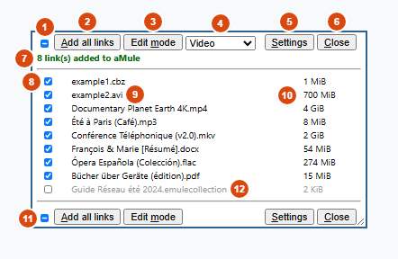

| # | Part | Rules |
|---|---|---|
| 1 | Box that checks or unchecks every link, mixed here | SF-5.1 |
| 2 | Counter: the links that Download sends, out of the links of the page | SF-2.10 |
| 3 | Server and category of the downloads (the server list when it offers two choices at least) | SF-6 |
| 4 | **Download**: sends the checked links | SF-5.3, SF-7 |
| 5 | **Settings** (⚙), then **Help** (?) | SF-8, SF-11 |
| 6 | **Minimize** (▲), **Maximize** (▼) once minimized; the other way round at the bottom of the window | SF-2.12, SF-10 |
| 7 | **Close** (✕) | SF-10 |
| 8 | Answer of aMule, for the `amuleapi` method | SF-7.10 |
| 9 | Box of a link, checked by default | SF-3.2, SF-5.2 |
| 10 | File name: a click sends this file only | SF-3.3 |
| 11 | Readable size | SF-3.4 |
| 12 | Bottom toolbar: its box and its counter as the top ones, **Edit mode** (Normal mode in edit mode), **Export**, the server, the category and Download | SF-2.7, SF-4, SF-5.4, SF-14 |
| 13 | A link left unchecked by the filter of the settings, in gray | SF-5.7 |

| Ref | Rule |
|---|---|
| SF-2.1 | The popup is injected **as the first child of `<body>`**, in a corner of the window chosen by the setting **Popup position** (`popupCorner`, since 0.14): top left (default, its only place up to 0.13), top right, bottom left or bottom right; an unknown value is read as top left. |
| SF-2.2 | The setting **Popup scrolling** (`popupScroll`, since 0.14, in place of Popup Position): **Stays in view** (`floating`, default, `position: fixed`), the popup stays in its corner when the page scrolls; **Scrolls with the page** (`static`, `position: absolute`), it stays at its place in the page, from its corner at the load of the page. At the bottom of the window, the popup always stays in view: scrolling with the page, it would be seen only at the load of the page; the choice is then grayed out in the dialog (SF-8.21). An unknown value is read as floating. |
| SF-2.3 | The maximum height is set in **lines of the list** (`popupRows`, 40 by default): the list shows that many lines, at every size (SF-2.5), and scrolls beyond; the maximum width in **characters of the list** (`popupCols`, 150 by default, at least 35, SF-2.13); `0` = unlimited (the window). Since 0.15, in place of pixels (`popupHeight`, `popupWidth`, 800 by default), the values stored in pixels being converted once: a line of 17 px, a character of 5.4 px, 68 px for the popup without its list (800 px: 43 lines, 148 characters). These limits apply **in normal mode only**; in edit mode the popup switches to `max-height/width: 100%`. The popup stays in the window, its padding and its frame included (it went 14 px out of a window narrower than it, before 0.15). |
| SF-2.4 | In normal mode, the popup can be **resized** by the user (`resize: both`); in edit mode, it cannot. Since 0.14, only at the top left of the window: the handle of the browsers is at its bottom right, and anchored elsewhere the popup would grow the other way than the mouse; it then keeps the size given by the maximum height and width of the settings. |
| SF-2.5 | Rendering, in the light theme (the colors of the other themes: SF-13): white background, 0.97 opacity, 2 px steel blue border (`#2b5c8a`, as the settings dialog), `z-index: 255`, 10 px font in the list. The toolbars (since 0.14) have a light blue background (`#e8f1fb`, as the top of the settings dialog), from one side of the frame to the other; their buttons and lists are 22 px high, with a 12 px font, their checkboxes 13 px, with 5 px above and below them, 6 px between them, and 9 px between the frame and the first and last of them. The rows of the list are 17 px high, their checkboxes 13 px. The buttons and the lists of the toolbars are white, with a gray border (`#8f8f9d`), light blue on hover, light gray when grayed out, whatever the page and the browser (since 0.14: a page that gives its own colors to the buttons, or the defaults of Firefox, made them gray), Download keeping its blue border. These sizes are those of 100 %, the default size: the setting **Size** (`textSize`, General section, after Theme, since 0.15), a slider from 80 % to 160 % by steps of 10 % (`SIZE_MIN`, `SIZE_MAX`, `SIZE_STEP` in the PARAM block), its value at its right ("100 % (default)", "120 %"), gives the factor (Size / 100) that multiplies every length of 3 px or more of the screens of the script, the text, the margins, the buttons, the icons, the radius and the sizes given by the themes, the borders of 1 and 2 px staying thin (`scaledCss()`, for a tablet or a high-resolution screen). The popup, its band, the help, the message of the closed popup and the settings dialog follow. The size applies once saved, the page being reloaded; a value out of the range or of its steps is read as 100 %, stored once (SF-8.7). The slider is the one of the browser, in the color of the theme (`accent-color`, SF-13.3). |
| SF-2.6 | CSS styles are **scoped to the popup** (selectors prefixed with `div#theDiv` / `div#divBody`) so as not to affect the host page (0.7 fix). The other way round, the styles of the page do not reach the popup: its text stays aligned to the left, without the letter spacing, capitals, indent or italics of the page, even on a page that centers its text, as some forums do; and the popup sets every size of its toolbars and of its rows itself (SF-2.5), so that a page whose buttons have a large padding or a minimum height, whose text has a small line height, or which has its own `toolbar` class, changes none of them (since 0.14: on a forum, the buttons of 0.13 were larger and its rows smaller). |
| SF-2.7 | A **toolbar is displayed at the top and at the bottom** of the popup. Since 0.14, the top one holds, from the left: the box that checks or unchecks every link (SF-5.1), the counter (SF-2.10), the server list (SF-6.11), the category list (SF-6), **Download** (SF-5.3), then at its right **Settings**, **Help** (SF-11), **Minimize** (or Maximize) and **Close**, shown as icons; the bottom one: the same box and counter, **Edit mode** (SF-4), **Export** (SF-14), then at its right the server list, the category list and Download. The tooltip of each control tells what it does and its keyboard shortcut (SF-9). The icons are drawn (SVG), in the set of the theme (solid or outline, SF-13.3), centered in their buttons whatever the fonts of the system: Settings in dark gray, Minimize in blue, Close in red. Download stands out: white, with a 2 px blue border (`#0075ff`), its text black and not bold. |
| SF-2.8 | There is **one popup at most**: opening a popup that is already open does nothing, and keeps its checkboxes and its edit box as they are. |
| SF-2.9 | In normal mode the popup is a column: top toolbar, list of links, bottom toolbar. When the links do not fit in the maximum height, **only the list scrolls**: both toolbars always stay visible. With few links nothing scrolls. Since 0.14, the list is framed by two gray lines, from one side of the frame to the other, which do not scroll with it (they used to be `<hr>` elements at both ends of the list, seen only at its top and its bottom); a light shadow on an edge of the list tells that links are hidden beyond it: at the bottom when the list is at its top, on both edges in the middle, at the top at its bottom. It is shown whatever the scrollbar (Firefox shows it only under the mouse), and follows the list when the popup is resized. In edit mode there is no line nor shadow: the frame of the edit box separates it from the toolbars. |
| SF-2.10 | The **counter** of each toolbar (since 0.14) tells the links that Download sends, out of the links of the page: `8/9`, the second number in gray. In edit mode, it counts the lines of the text that hold an ed2k link, as typed (`9/9`, `7/9` once two lines are removed). It is as wide as its widest value on the page (all the links checked), its digits all of a width: checking or unchecking links moves nothing in the toolbars; a text with more links in edit mode widens it. |
| SF-2.11 | **Alignments** (since 0.14): every checkbox of the popup, toolbars and list, in one column; the file names on the counters; the first list of the top toolbar (the server list, or else the category list) on Edit mode; Close, the Download of the bottom toolbar and the sizes, aligned to the right, on one right edge. |
| SF-2.12 | **Minimized view** (since 0.14): only the top toolbar is shown, at the width of the maximized popup, nothing moving in it; the list (or the edit box) and the bottom toolbar are only hidden, the checked links and the text of the edit box kept. The Minimize button (▲) minimizes the popup, Maximize (▼) shows it whole again, as Open Popup does; their arrow points to where the popup goes, so at the bottom of the window (SF-2.1), where it folds down to its toolbar, Minimize is ▼ and Maximize ▲. The popup keeps its corner, and cannot be resized while minimized. `Ctrl+Alt+W` (`Ctrl+Alt+X` up to 0.14) goes from the maximized view to the minimized one, then closes the popup, then opens it again (SF-9). |
| SF-2.13 | **Adaptive toolbars** (since 0.15): the controls of the toolbars keep their width; while a toolbar does not fit in the popup (a narrow window, a phone, a large size, long names), its controls go, one at a time, into a **menu button** (☰) at the right of the top toolbar: 1. first, the menu button takes the place of the buttons at the top right (settings, help, minimize, close), whichever toolbar does not fit (it is already there when the settings put a control, or these buttons, in the menu: SF-2.14); 2. then the controls of the toolbar that does not fit, one by one, **from left to right**: Edit mode, Export, the server list, the category list, as far as they are shown in it; 3. at last, the free space between Download and the menu button, kept until then (24 px at least, at 100 %) to move the popup (I-19). **Each toolbar folds on its own**: a control goes into the menu only when its own toolbar does not fit, so that the same control can be shown in one toolbar and folded in the other. The check box, the counter and Download never go into the menu; a control the settings do not show in a toolbar (Not shown, or In the menu) is skipped. When the popup widens, the controls come back in the reverse order, the buttons at the top right last, once no control is in the menu, neither folded nor put there by the settings. The width is measured, not set by thresholds: the toolbars adapt again when the window or the popup changes of width and when the server changes (`adaptToolbars()`); what is folded is told by the attribute `data-folded` of the popup (`menu`, then `top.<control>`, `bottom.<control>`). The menu opens under its button, and stays in the window: above its button when there is no room under it, moved up otherwise, its rows scrolling when the window is too low (since 0.15). It lists, once each, the controls in the menu, folded from either toolbar or put there by the settings, always in the order Server, Category, Edit mode, Export (a heading, then its commands, SF-14), Settings, Help, Minimize, Close, with their shortcuts; its lists act as those of the toolbars, its commands as their buttons; a choice, Escape or a click elsewhere closes it. It takes the theme (its radius, background, border and row under the mouse: SF-13.4) and the size (SF-2.5). The popup is never narrower than its toolbars folded at the last step, so that its menu, and the settings, stay reachable: the maximum width of the popup and the columns of the edit box are 35 at least (`POPUP_COLS_MIN`, `EDIT_COLS_MIN`; 31 and 27 are needed at most, measured on every theme, size and language), and the popup widens anyway to its toolbars folded. |
| SF-2.14 | **Where each control is shown** (since 0.15): the table **Toolbars**, in its own section of the settings (Toolbars, SF-8.1), in place of the checkboxes Show the category list and Show the server list of 0.14, has a row per control, from left to right as in the toolbars (the order is told above it), and a column per toolbar. At the top: **Shown**, **In the menu ☰** (the menu of the top toolbar, SF-2.13) or **Not shown** (absent from this toolbar); at the bottom: Shown or Not shown. The check box and the counter are always shown, Download always at the top. Defaults: Edit mode and Export not shown at the top, shown at the bottom; the server list, the category list and Download shown; the buttons at the top right (settings, help, minimize, close) shown, or in the menu, never not shown. As soon as a control of the top toolbar is in the menu, the buttons at the top right are too, the menu button taking their place: their list is then grayed out on In the menu, a note under it, and the choice of the user comes back, and is saved, without it. A list shown nowhere, nor in the menu, is not used: the links go to the server, or the category, of the settings (SF-6.10, SF-6.15). Edit mode and Export shown at the top come after the counter. The adaptive toolbars (SF-2.13) start from these choices: a control not shown stays so, a control shown in a toolbar only goes into the menu once folded. In a narrow dialog, the table is stacked: each control, then one line per toolbar. Fields: `tbEditTop`, `tbEditBottom`, `tbExportTop`, `tbExportBottom`, `tbServerTop`, `tbServerBottom`, `tbCategoryTop`, `tbCategoryBottom`, `tbDownloadBottom`, `tbButtonsTop`; the checkboxes of 0.14 unchecked become the lists not shown in either toolbar, stored once. |

The popup at 100, 120 and 140 % (SF-2.5):

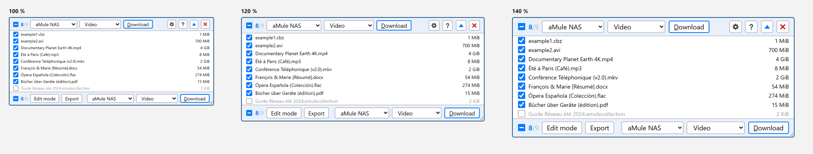

### SF-3 — Normal mode (list)

| Ref | Rule |
|---|---|
| SF-3.1 | A table is displayed, one row per link: `[checkbox] [clickable file name] [readable size]`. |
| SF-3.2 | All boxes are **checked by default**, except the links whose file name does not match the filter of the settings (SF-5.7). |
| SF-3.3 | The file name is an **individual link**: a click sends this file only to the ed2k client, with the configured method. With every method but `local`, whose sending a link cannot make (a POST, a request of the script), the link holds the ed2k link itself, and the click sends this file only, the same way as Download. With `local`, the link is the encoded ed2k link, handed to the application of the system (SF-7.7). |
| SF-3.4 | The size is converted into readable binary units (`B`, `KiB`, `MiB`, `GiB`…, base 1024, no decimal), and aligned to the right (since 0.14, SF-2.11). |
| SF-3.5 | The hovered row is highlighted (light blue background). |
| SF-3.6 | A tab order is assigned to the checkboxes, following the list: 1 for the first link, 2 for the second, and so on. |

### SF-4 — Edit mode

| Ref | Rule |
|---|---|
| SF-4.1 | The body of the popup is replaced by a **text area** containing every detected link, **one per line**. |
| SF-4.2 | The content is **selected automatically** when opened (for an immediate copy/paste). |
| SF-4.3 | The user can freely change, delete or add links; the content of the text area is what will be sent. |
| SF-4.4 | The number of columns and the number of rows can be set. |
| SF-4.5 | The edit box has **no maximum length**: the whole list is always displayed and can be edited, whatever its length, and the user can always type in it. Checked on Chrome with 2,000 links (about 216,000 characters); the automated tests check 1,000. |
| SF-4.6 | Switching between normal and edit mode applies to the **current page only** (since 0.14, SF-10.1): each page opens the popup in the default view of the settings. Up to 0.13, it was stored and persisted from one page to the next. |

The popup in edit mode, the links selected as it opens:

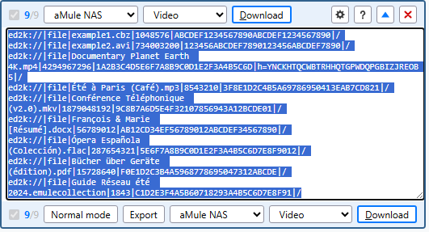

### SF-5 — Selection

| Ref | Rule |
|---|---|
| SF-5.1 | A "check all / uncheck all" box in the top toolbar, and the same one in the bottom toolbar (SF-5.4). It is checked when every link is checked, unchecked when none is, and **mixed** otherwise; a click checks or unchecks every link, a mixed box checking them all. Both boxes follow the boxes of the links, checked by hand or by the filter of the settings (SF-5.7). `Ctrl+Alt+A` and the menu entry "Check or uncheck all links" do what a click on the box does (since 0.14; nothing in edit mode or with the popup closed). |
| SF-5.2 | Individual selection, row by row. |
| SF-5.3 | Only checked links are sent by **Download** (in normal mode), named "Add all links" up to 0.13. |
| SF-5.4 | Since 0.13, the box of the bottom toolbar does what the top one does, both showing the same state (SF-5.1); until 0.12, it was disabled, for visual consistency only. Both are disabled **in edit mode**, where the list is a text area with no checkboxes. |
| SF-5.5 | **Popup not displayed** (closed): there is no selection to read, so **the links that the popup would check are sent**: every link of the page whose file name matches the filter of the settings (SF-5.7), every link when it is empty. This is what makes `Ctrl+Alt+D` and the "Download" menu entry usable without opening the popup. |
| SF-5.6 | If the selection is empty — no box checked, no file name matching the filter with the popup closed, or page without any ed2k link — sending is **abandoned without effect** (console trace, no window opened). Required because `@include *` makes the shortcut active on every page. |
| SF-5.7 | **Links checked by default** (since 0.13): a regular expression set in the settings (`checkFilter`, empty by default) chooses which links are checked when the popup is built. A link is checked when its file name matches it, and left unchecked otherwise, its name and its size in gray, the tooltip of its row telling why. The same field gives an allow list or a block list. **A**, every file but the eMule collections: `/^(?!.*\.emulecollection$)/i`. **B**, only the `.cbz`, `.cbr`, `.rar` and `.zip` files: `/\.(cbz\|cbr\|rar\|zip)$/i`. The expression is written alone (`\.cbz$`, case-sensitive), or between slashes followed by its flags, as in JavaScript (`/\.cbz$/i`, `i` ignoring the case); the flags `g` and `y` are refused, as they would make each test start where the previous one stopped. It is tested on the decoded file name (SF-1.8), without the suffix added by SF-1.9 (`eNames`), anywhere in the name unless anchored (`^`, `$`). The links left unchecked are still detected and listed (SF-1), and can be checked by hand or by the boxes of the toolbars (SF-5.1); the gray marks the links left unchecked by the filter, and stays when they are checked by hand. The edit box still lists every link (SF-4.1): the expression applies to the checkboxes only. Empty, every link is checked (SF-3.2). An expression that the browser cannot read is refused by Save (SF-8.10); one stored anyway is ignored, with a console trace, and every link is checked. |

### SF-6 — Server and categories

| Ref | Rule |
|---|---|
| SF-6.1 | A drop-down list lets the user choose the destination category in the ed2k client; there is one in each toolbar (since 0.14), both showing the category chosen in either. It is 22 characters wide at most (`categoryListMaxWidth`, in the PARAM block of the script; since 0.15 in characters, following the size of the text, SF-2.5, 140 px before): a longer name is cut in the list, the open list and the tooltip of the list (`Category: <name>`) showing it whole. It is 16 characters wide at least (`categoryListMinWidth`, since 0.14; 100 px before 0.15): the short categories of another server chosen in the popup (SF-6.11) move nothing in the toolbars. |
| SF-6.2 | Categories are entered in the settings as `*label1=value1;label2=value2;`. The `*` prefix marks the **default choice**. |
| SF-6.3 | Meaning of the value: **eMule** = tab index (numeric); **aMule 2.x** = category name (encoded in the request), `0` being turned into `all`; **aMule 3.1** (`amuleapi`) = category index (numeric, `0` = default category of aMule, a value that is not a number is sent as `0`). |
| SF-6.4 | The list is **disabled** (grayed out) for the `local` and `mldonkey` methods (not supported by these targets), and when the server has fewer than two categories (since 0.14): there is nothing to choose. |
| SF-6.5 | Each entry is checked: an entry without a name or a value is **skipped** (console trace) and the other categories are kept. Spaces around names and values are removed. The value is everything after the first `=` of the entry, so that it may hold an equals sign (`=`) (an aMule 2.x category named `A=B` is written `A B=A=B`); a `;` in a name or a value is written `\;`, as `;` separates the entries (a category named `test;23` is written `test 23=test\;23`). Only when **no valid category** remains is a message shown, in the band of the answers since 0.15 (an alert before, SF-8.7), and the setting reverts to `*default=0`. |
| SF-6.6 | The category used for sending is read **from memory** (`emuleCat` array), never from the popup DOM: sending remains possible with the popup closed. |
| SF-6.7 | **Exactly one default category**: the first one marked with `*`; any further `*` is ignored; without any `*`, the first category of the list. The drop-down list and the category actually sent (SF-6.6) therefore always agree. |
| SF-6.8 | Changing the category in the drop-down list **does not rebuild the popup**: the checkboxes, the text of the edit box, the size and the scroll of the popup are kept. Since 0.12, the file name links no longer carry the category (they hold the ed2k link, or with `mldonkey` a URL without category): the category is read when sending (SF-6.6). |
| SF-6.9 | The category chosen in the drop-down list is a **one-off choice, for the current page only** (product decision, consistent with a "one page = one batch of files of the same kind" usage). It is not stored: each new page starts again on the default category (`*`) of the settings, and a sending triggered with the popup closed (SF-5.5) uses that default. To change the category for good, change the default in the settings. |
| SF-6.10 | The category list is shown in each toolbar, in the menu, or not, as the table Toolbars of the settings asks (SF-2.14; since 0.14, the checkbox Show the category list). Shown nowhere, nor in the menu, the toolbars have no category list, Download following the server list, or else the counter, in the top one, and the links are sent to the default category of the server (SF-6.7). |
| SF-6.11 | A drop-down list of the **servers** (since 0.14), in each toolbar before the category list, lets the user send the links of the page to another server than the one checked in the settings, without opening them: **Local** (unless disabled, SF-8.20), then the servers of the settings, in their order (SF-8.9, SF-8.14). It is shown when it offers **two choices at least, Local included**: one server set in the settings is enough. Both lists show the server chosen in either; it is 22 characters wide at most (`serverListMaxWidth`, in the PARAM block; 140 px before 0.15), a longer name cut, and its tooltip tells the server chosen, whole, and its method (`Server: aMule NAS, aMule 3.x (amuleapi)`, `Server: Local (your system default)`). |
| SF-6.12 | The server chosen receives the links of the page, by Download, a click on a file name or `Ctrl+Alt+D`, with **its own method and settings** (Server URL, User, Password, Categories, as saved in the settings). The list of the servers is read only on a page with ed2k links; only the settings of the server checked in the settings are kept in memory, those of another server (its password included) being read when it is chosen, so that they leave the storage only on an action of the user. The category lists then offer **its categories**, from its default one, grayed out as in SF-6.4 (with Local for instance). Changing the server does not rebuild the popup: the checkboxes and the text of the edit box are kept (SF-6.8). |
| SF-6.13 | The server chosen is a **one-off choice, for the current page only**, as the category (SF-6.9): it is not stored, it stays chosen for the page, the popup closed and opened again included, and each new page starts again on the server checked in the settings. |
| SF-6.14 | The server lists are **grayed out while a sending waits for its answer** (SF-7.10), as Download: the answer shown is the one of the server that received the links. |
| SF-6.15 | The server list is shown in each toolbar, in the menu, or not, as the table Toolbars of the settings asks (SF-2.14; since 0.14, the checkbox Show the server list). Shown nowhere, nor in the menu, the toolbars have no server list, and the links are sent to the server checked in the settings. |

### SF-7 — Sending the links

Six download methods ("Ed2k Download Method"):

| Method | UI label | Transport | Behavior |
|---|---|---|---|
| `local` | Local (your system default) | `ed2k:` protocol | Each link is handed to the system handler through a **click on a synthetic anchor**, one link after the other. No URL, password or category used. **On Chrome, only one link is sent per user gesture** (see L-9). |
| `emule` | eMule (web) | HTTP **GET** made by the script (`GM_xmlhttpRequest`), no window | `URL?w=password&p=<pwd>&cat=<cat>&c=<links>`; the answer of eMule is shown (SF-7.12, § 3.9) |
| `amuleapi` | aMule 3.x (amuleapi) | HTTP **POST**, JSON, through `GM_xmlhttpRequest`, no window | Login on `URL/api/v1/auth/login`, then `URL/api/v1/downloads` with `{"links": [<links>], "category_index": <cat>}`, then logout (SF-7.9). aMule 3.1 or later (§ 3.8) |
| `amule` | aMule 2.x (amuleweb) | HTTP **GET** made by the script (`GM_xmlhttpRequest`), no window: the login, then the links, in the same session | `URL?pass=<pwd>`, then `URL/footer.php?selectcat=<cat>&Submit=Download+link&ed2klink=<links>`; the links looked for in its downloads, the answer shown (SF-7.13, § 3.10) |
| `mldonkey` | MLDonkey (web) | HTTP **GET** made by the script (`GM_xmlhttpRequest`), no window, with HTTP Basic | `URL/submit?jvcmd=multidllink&links=<links>`; the answer of MLDonkey is shown (SF-7.14, § 3.11) |
| `custom` | Custom (post to your own server) | HTTP **POST** (form), `emule` target | Fields `cat`, `ref` (URL of the source page), `ed2k` (links). The form is removed from the page once sent. A click on a single file name sends the same POST for that file (SF-3.3) |

Cross-cutting rules:

| Ref | Rule |
|---|---|
| SF-7.1 | Several links are joined with a **line feed** `\n` as separator (encoded as `%0A` for the GET methods — required for some links, 0.9 fix). |
| SF-7.2 | For the GET methods, the file name is normalized (`decodeURIComponent` then `encodeURIComponent`) **then the whole link is encoded again**: the name ends up deliberately encoded twice, which is what the eMule/aMule web interfaces expect. |
| SF-7.3 | For `custom` and `amuleapi`, no additional encoding is applied (the POST takes care of it). |
| SF-7.4 | `amule` mode: until 0.11, a first window logged in (`footer.php?pass=<pwd>`), then, after a **fixed wait of 1 second**, a second one sent the links. Since 0.12, the login is a request of the script, awaited, and the links are sent in the same session (SF-7.13). |
| SF-7.5 | Until 0.11, `blur()` was called on the windows opened by the sending, to try to give the focus back to the main page (no longer effective on recent browsers). Since 0.12, only `custom` still opens one: it posts its form in a tab named `emule` (I-12); the other methods send their requests themselves. |
| SF-7.6 | In normal mode, the source is the **selection of checked boxes**; in edit mode, it is the **raw content of the text area**, split by line. |
| SF-7.7 | `local` method: the link is **encoded by the script** (`encodeEd2kLink()`), both in the clickable links of the popup and when sending in batch. `ed2k` is not a *special scheme*: everything after `ed2k://` up to the final `/` is parsed as the host of the URL, where `\|`, space, `#`, `?`, `[`, `]`… are forbidden. Recent Chrome turns such a link into `about:blank` instead of encoding it, as older browsers used to do (0.2 in `CHANGELOG.md`). This whole part therefore goes through `encodeURIComponent`, after a prior decoding so that an already encoded link is not encoded twice; `ed2k://` and the final `/` stay in clear. ed2k handlers decode the link they receive. The other methods are not affected: their `http://` URL already encodes the whole link. |
| SF-7.8 | `local` method: the link is **never passed to `location.replace()`**, which rejects it (`SyntaxError`, the URL degenerating into `ed2k:///`) and would replace the document — only the last link of a batch would be sent. The script clicks one **synthetic anchor** per link. |
| SF-7.9 | `amuleapi` method: a **session per sending**. Login with the password in a JSON body, then **one request** with all the links and the category index, authorized by the token of the login, then logout, even when the sending fails. The password never appears in a URL, and the token is never stored (§ 3.8). |
| SF-7.10 | `amuleapi` method: as soon as the sending starts, a band under the top toolbar of the popup shows **"Please wait" followed by animated dots**, until **the answer of aMule** replaces it, the animation stopped. Meanwhile, the Download buttons are **disabled**, and no other sending starts (shortcut, click on a file name): the links are never sent twice. The answer shown is one of: number of links added, links refused (`207`, with the reason of the first one; in orange, a warning: aMule received the links, and only left some out, invalid or already in its list, the same reason for both), or the error: password refused (`401`), password without the right to add downloads (`403`), no API at this address (older aMule or another server), too many failed logins (`429`, with the delay), aMule disconnected from its core (`503`), aMule unreachable, or no answer within the time limit (§ 3.8): the message then says that the links may still be added, as aMule received them. **The band** (since 0.14, for every method sent by the script): from one side of the popup to the other, over the top of the list or of the edit box, so that the popup keeps its size (it hides the first links: its Close button, ✕, removes it); gray while waiting, green with a check mark for links added; with an exclamation mark, red for an error (the sending failed: password, rights, client unreachable or late, no client at the address), orange for a warning (links left out by the client, which received them, or an answer that is not understood). Minimized, it floats against the popup, glued to it, as with the popup closed (its own border and a light shadow): under it, above it at the bottom of the window, on its left edge (its right one in a corner at the right), as wide as its message, the popup keeping its size; maximized again, it is back in the popup; when the popup is closed, from any view, it stays, alone in the corner of the popup; switching to the edit mode or back keeps it. With the popup closed, it is shown alone, in the corner of the popup, with its own border and a light shadow (there is no popup, so no steel blue border), instead of the alert of the former versions: a success is no longer silent, and a failure never is. A success goes away after 8 s (`STATUS_DELAY`); an error or a warning stays until its Close button or the next sending; opening the popup takes the band of the closed popup in, over the list. |
| SF-7.11 | `amuleapi` method: the lines that are not ed2k links (empty lines or text in the edit box) are **left out** of the sending, as the API would refuse the whole request. |
| SF-7.12 | `emule` method (since 0.12): the links are sent by **a GET request of the script** (`GM_xmlhttpRequest`), the one that a window used to open: **no window**, nothing in the history of the browser, not subject to CORS nor to mixed content. The URL is the same (`URL?w=password&p=<pwd>&cat=<cat>&c=<links>`), the password now encoded in it (`&`, `#`, `+`, accents). At the first sending, Tampermonkey asks to allow the address of eMule (`@connect`). As for `amuleapi` (SF-7.10): "Please wait" with animated dots, the Download buttons disabled, no second sending meanwhile, the time limit of `sendingTimeout()`. eMule answers with a short XML status (§ 3.9), shown in the popup: `N link(s) added to eMule` (green); `eMule refused the password` (red); `eMule refused the links (<reason>)` (red); for an answer without this status (another server, another version of eMule), `Links sent, but the answer of eMule is not understood: check its transfer list` (orange: the links may still be added); eMule unreachable, or no answer within the time limit (red). With the popup closed, the answer is shown in a band, in the corner of the popup (SF-7.10). As eMule does not check what it receives, the lines that are not ed2k links (edit box) are left out, as for `amuleapi` (SF-7.11). |
| SF-7.13 | `amule` method (aMule 2.x, since 0.12): **requests of the script** (`GM_xmlhttpRequest`), **no window**. amuleweb needs a session, kept by its cookie (`amuleweb_session_id`), as by a browser: first the login, `URL?pass=<pwd>`, **awaited** (no fixed delay now); then the links, `URL/footer.php?selectcat=<cat>&Submit=Download+link&ed2klink=<links>`, without the password, the category (a name) and the links encoded. amuleweb 2.3.3 compares the category it receives with its names as if it had read it in Latin-1: a name with accents sent in UTF-8 matches no category, and the links are then dropped without any message. The category is therefore sent as amuleweb reads it, its UTF-8 bytes taken as characters, then encoded (`amuleWebCategory()`); a name without accents is unchanged. amuleweb answers the links with its form again, without any result: the script then looks for the links in its downloads (`amuleweb-main-dload.php`, a checkbox named after each hash), for 5 s at most (they show at once on aMule 2.3.3). As for `emule` (SF-7.12): "Please wait", the Download buttons disabled, the lines that are not ed2k links left out, the answer in the popup: `N link(s) added to aMule` (green), `M of N link(s) found in the transfer list of aMule: check it` (orange: a link may still be added), `Links sent, but the transfer list of aMule could not be read: check it` (orange too: the links are sent, only their check failed), `aMule refused the password`, `No aMule 2.x web interface at <address>`, aMule unreachable or late (red); with the popup closed, the answer is shown in a band, in the corner of the popup (SF-7.10). A link already in the downloads counts as found. |
| SF-7.14 | `mldonkey` method (since 0.12): **a GET request of the script** (`GM_xmlhttpRequest`), **no window**, `URL/submit?jvcmd=multidllink&links=<links>`, with the user and the password of the settings in an **HTTP Basic** authorization (MLDonkey asks for it on every page: without it, the browser asked for them in its own dialog). MLDonkey answers a line per link: `Added link …`, or `Unable to match URL …` with its reason (`already in download queue`, or an error for a malformed link). The answer shown in the popup: `N link(s) added to MLDonkey` (green, a link already there counted as added), `A link(s) added to MLDonkey, R refused` (orange: MLDonkey received the links, and only left some out), `MLDonkey refused the user or the password` (401), `No MLDonkey web interface at <address>`, an answer that tells nothing about the links (orange), MLDonkey unreachable or late (red). As for the other methods: "Please wait", the Download buttons disabled, the lines that are not ed2k links left out, the band of SF-7.10, in the corner of the popup when it is closed. |

### SF-8 — Configuration

The settings dialog as it opens the first time, General and Servers unfolded, the other sections folded (SF-8.22), with two servers: aMule NAS is checked (it receives the links) and displayed; the numbers refer to the table under it.

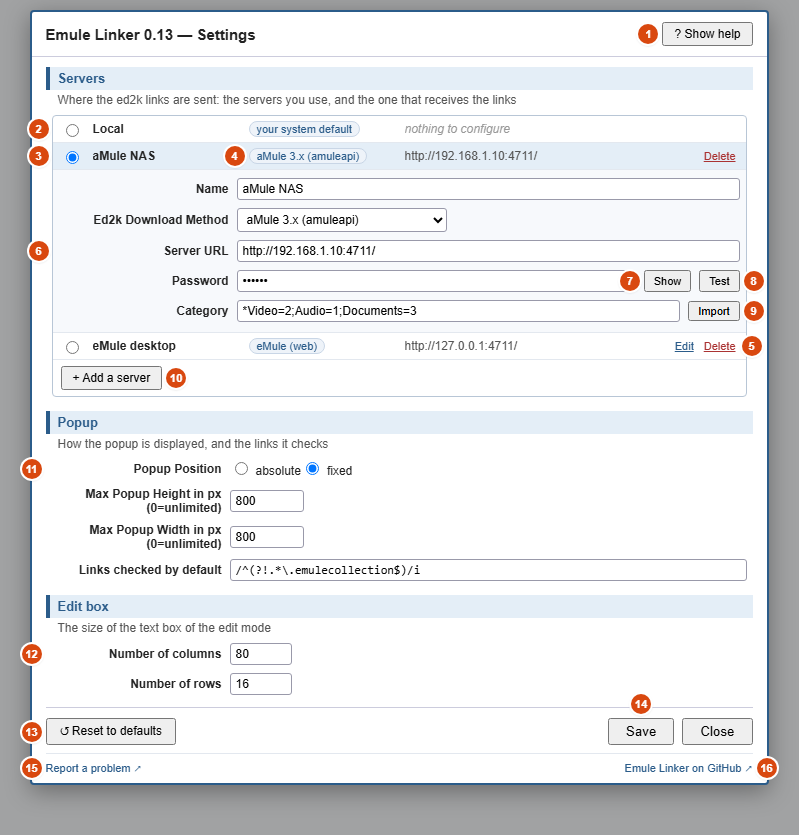

| # | Part | Rules |
|---|---|---|
| 1 | **Inline help** (?), pressed while the explanations are shown, then the **Close** icon (✕) | SF-8.3, SF-8.4 |
| 2 | **Local**: the application of the system, nothing to configure; its **Disable** link (Enable once disabled) | SF-8.9, SF-8.20 |
| 3 | A server: its radio button (checked: it receives the links), its name, its Server URL | SF-8.9 |
| 4 | Badge of its download method | SF-8.14 |
| 5 | **Edit** and **Delete** | SF-8.14 |
| 6 | Settings of the server displayed: only the fields of its method | SF-8.9 |
| 7 | **Show** (Hide once shown): the password | SF-8.8 |
| 8 | **Test**, for `emule`, `amuleapi`, `amule` and `mldonkey` | SF-8.16, SF-8.17 |
| 9 | **Import**, for `emule`, `amuleapi` and `amule` | SF-8.16, SF-8.18 |
| 10 | **+ Add a server** | SF-8.14 |
| 11 | Section Keyboard shortcuts, folded: a click on its title unfolds it | SF-9, SF-8.22 |
| 12 | Section Toolbars, folded | SF-2.14 |
| 13 | Section Popup, folded | SF-2.1 to SF-2.3, SF-5.7, SF-10.4 |
| 14 | Section Edit box, folded | SF-4.4 |
| 15 | **Reset to defaults** | SF-8.12 |
| 16 | **Save** and **Close** | SF-8.4, SF-8.5, SF-8.11 |
| 17 | **Report a problem** | SF-8.15 |
| 18 | **Emule Linker on GitHub** | SF-8.15 |

| Ref | Rule |
|---|---|
| SF-8.1 | A settings dialog is provided, titled with the version of the script ("Emule Linker 0.x — Settings", from the userscript manager), organized in sections: since 0.15, **General** (SF-8.19), **Servers**, **Keyboard shortcuts** (SF-9), **Toolbars** (SF-2.14), **Popup**, **Edit box**, each one folded or unfolded by its title (SF-8.22); up to 0.14, General, Servers, Popup and Edit box. It has the colors of the popup (white, light blue, steel blue `#2b5c8a` for its border and its section titles, not the blue of links; since 0.14, its title on the light blue of the toolbars of the popup, `#e8f1fb`), is half of the window wide, between 640 and 960 px (95 % of the window at most), fits its content in height, and its fields are aligned in a column: the long ones (Server URL, Password with its Show button, Category) take the whole width of the column, as their explanation; the others are sized to their content. Built inside the page by GM_config (§ 3.3), it does not take the text styles of the page: its text is aligned as designed (to the left, the labels to the right), with a normal line height and spacing, without capitals, indent or italics, even on a page that centers its text. |
| SF-8.2 | It opens **automatically on first run** (as long as the `emule_config` flag is 0). |
| SF-8.3 | Each field has an **explanation**, shown under it in a light blue box; the code it holds (an address, a value, a regular expression) is in a fixed-width font, as the field Links checked by default; in the tooltip, it is plain text. An explanation may hold a link, opened in a new tab: written `[text](#anchor)` in the table of texts, it leads to that section of the README of the repository (since 0.15: the help of Theme, to the section Usage, which shows every theme); the tooltip shows its text only. An **inline help** button, drawn as a question mark at the right of the title and pressed while they are shown, shows or hides the explanations of every field at once; they are not shown on mouse over, as the fields would then move under the mouse. While they are hidden, each one is also the tooltip of its row, shown by the browser after a short delay over it, for an occasional need; while they are shown, there is no tooltip repeating them. The choice is stored (`settings_help`): the dialog opens the next time as it was left. |
| SF-8.4 | **Save** and **Close** buttons, and a **Reset to defaults** button at the left (SF-8.12). Since 0.14, Save stands out as Download and OK in the popup (white, a 2 px blue border), and a **Close** icon (✕, in red), at the right of the title, closes the dialog as the Close button, without saving. |
| SF-8.5 | Saving **reloads the page** to apply the new settings. |
| SF-8.6 | Settings are persisted through the userscript manager storage (they survive a browser restart and are shared across all sites). |
| SF-8.7 | When an invalid setting is replaced by a usable value (URL without a final `/`, no valid category, popup too small; since 0.14, the Popup Position of 0.13, `popupPos`, becoming Popup scrolling: `absolute` is static, `fixed` is floating, the popup then at the top left), the corrected value is **stored**, so the message is shown once and not again on every page load: since 0.15, in the band of the answers (SF-7.10), in orange until closed, once the popup is shown, instead of an alert of the browser; a Size out of its range or of its steps (SF-2.5) is corrected silently. Only the corrected settings are stored: the other ones stay exactly as the user saved them. |
| SF-8.8 | The **password is masked**; a Show / Hide button next to it displays it. |
| SF-8.9 | The section **Servers** lists, after a fixed **Local** row (no settings), the servers of the user: for each one a radio button, which chooses the server that receives the links, its name, its download method, its Server URL, and its **Edit** and **Delete** buttons. Under the server being edited are shown its Name, its Ed2k Download Method (every method but `local`) and **only the fields that this method uses**: Server URL, User and Password for `mldonkey`, Server URL and Category for `custom`, Server URL, Password and Category for the others; changing its method changes the fields shown. |
| SF-8.10 | The values are **checked before saving**: a Server URL that does not start with `http://` or `https://` (every method, `custom` included: no other protocol is supported), a category list without any valid entry, a popup width between 1 and 34 characters, or an edit box of less than 35 columns (the menu of the popup, and the settings, would be hidden, SF-2.13), a number of lines that is not a whole number, a size that is not a whole number, an edit box of 0 column or row, a filter of the links checked by default that is not a valid regular expression, or that holds the flag `g` or `y` (SF-5.7), or a letter given to two keyboard shortcuts ("Already the shortcut of Download", under the second one, SF-9). Each wrong value is shown in red under its field, its section unfolded (SF-8.22), the focus goes to the first one, no alert is shown and nothing is saved until every value is right. SF-8.7 still covers the values stored by an older version. |
| SF-8.11 | The page is **dimmed behind the dialog**, and **Escape** closes it without saving. |
| SF-8.12 | **Reset to defaults** sets every setting back to its default value **in the dialog only**: Local is checked, **every server removed**, and the other fields set back to their default value. What it changed is highlighted, its section unfolded (SF-8.22), and a notice says how many settings changed and that nothing is saved yet; the letters of the keyboard shortcuts go back to those of the PARAM block. Its **Undo** button displays everything as before again. Save stores the defaults, Close or Escape forget them. |
| SF-8.13 | The dialog is **anchored at the top of the window** (10 px), centered in width (half of the window, between 640 and 960 px at 100 %, never wider than the window; narrow, on a phone or in a small window, each label above its field and the rows of the servers on three lines, since 0.15), and never higher than the window: when it does not fit, it **scrolls inside**, so that its bottom and its Save button are always reachable, even when the window is made lower once the dialog is open. |
| SF-8.14 | **Several servers**, each one with its own name, download method and settings (Server URL, Password, Category), **several of the same method** included (two aMule 3.x for instance). **+ Add a server** adds one with the default settings, displayed to name and configure it; **Edit** displays the settings of a server without checking it; **Delete** removes a server at once: a notice with an **Undo** button takes its place in the list, where the user clicked, so that it is always in view, and goes away at the next action in the list (its Undo would otherwise undo that action too); deleting the checked server checks Local, or the first server left when Local is disabled (SF-8.20). The **Undo** button of a notice (Delete, Reset) has the style of the Show button and is always on the right of the notice, whatever the length of its text: the colored frame of the notice tells what it undoes; in the list, it is on the right edge of the fields and of their buttons. A method name too long for its badge is cut by "…", the whole name in its tooltip. A server needs a **name, different from the others** (whatever the case), a Server URL starting with `http://` or `https://`, and a Category with at least one valid entry: until then, it stays displayed, the error under the field, and nothing is saved. **Save** stores every server (`servers`) and, in the settings read by the rest of the script, the method and settings of the checked server; Close and Escape forget every change. The single set of settings of the older versions becomes a server named after its method. |
| SF-8.15 | At the bottom of the dialog, two links open in a new tab: **Report a problem** (the issues of the GitHub repository) and **Emule Linker on GitHub** (the repository). Their address is `REPOSITORY`, set in the PARAM block at the top of the script, next to the default values. |
| SF-8.16 | **Test**, for the `emule`, `amule`, `amuleapi` and `mldonkey` methods, and **Import**, for `emule`, `amule` and `amuleapi` (MLDonkey has no categories): Test after Show, on the row of the Password, Import after the Category field, both with the style of Show and a tooltip ("Test the server URL and the password", "Fill the field with the categories of eMule or aMule"); for the other methods they are hidden, and the Category field keeps its whole width. They use the Server URL and the Password **typed in the dialog, saved or not**. An address that does not start with `http://` or `https://` is shown in red under its field, as by Save (SF-8.10), and nothing is sent; a final `/` is added when missing. With aMule 3.x, each click opens a session of the API and closes it (`auth/logout`), as a sending does (§ 3.8): the token is never stored, and the password travels in the login body only. With eMule, Test and Import open a session of its web interface and close it at once (§ 3.9); with aMule 2.x, they log in to amuleweb, which has no logout (§ 3.10). While the client answers, both buttons are disabled, the one clicked showing "Test…" or "Import…" (15 s at most). The result is shown under the field, framed in green, orange or red; the errors have the messages of SF-7.10 and SF-7.12 (wrong password, too many failed logins, no API or no eMule at this address, client unreachable or late, aMule not connected to its core). It goes away at the next action in the dialog, and when the Server URL or the Password changes (Test) or the Category field (Import). An answer that arrives once the dialog no longer shows what was sent (closed, another server, a field changed) is not shown. Nothing is saved until Save. |
| SF-8.17 | **Test** logs in, reads the version of aMule (`GET /api/v1/version`) and its state (`GET /api/v1/status`), then logs out. Connected, in green: `Connected to aMule 3.1.0 (ed2k: connected, Kad: connected).` In orange, connected, but the links would be refused: a password that is not the admin one (`role` of the login), or aMule not connected to its core (`ec_connected` false). With eMule, Test logs in to its web interface as its login page does (`?w=password&p=…`), then logs out (`?ses=…&w=logout`), nothing being sent: connected, in green, `Connected to eMule 0.70b x64.`, its version read in the title of its interface; its login page again: `eMule refused the password`; another answer: `No eMule web interface at <address>`. With aMule 2.x, Test logs in (`?pass=`) and reads the version of aMule in the first lines of its log (`log.php`): `Connected to aMule 2.3.3.` (`2.x` when the line is not there); its login page again: `aMule refused the password`; another answer: `No aMule 2.x web interface at <address>`. With MLDonkey, Test asks its version (`submit?q=version`) with the user and the password typed (HTTP Basic): `Connected to MLDonkey 3.2.1.`; `401`: `MLDonkey refused the user or the password`; another answer: `No MLDonkey web interface at <address>`. |
| SF-8.18 | **Import** reads the categories of the client: with aMule 3.x, it logs in, reads every page of `GET /api/v1/categories` (100 per page) and logs out; with eMule, it logs in to its web interface as Test does, reads the list of its form to add a link (`<select name="cat">`: index and name, without the display filters of its menu) and logs out (§ 3.9); with aMule 2.x, it logs in and reads the list of its form to add a link (`footer.php`, `<select name="selectcat">`), by name: each one is imported as `name=name`, its value being its name as aMule knows it, an equals sign (`=`) included (`A B=A=B` for a category named `A=B`), a `;` written `\;` (`test 23=test\;23` for `test;23`) (§ 3.10). It fills the Category field with them, **in the order of the client**, each one with its name and its index, the category 0 included under its own name (`Default` for aMule, `All` for eMule); `*Default=0` only when the client has none. The default one (`*`) stays on the category of the same name as before, whatever the case, or else goes to the first one. In the names, `;` and `=` become spaces and a leading `*` is removed; a category without a name is named `Category <index>`. The field is highlighted, and a notice framed in green tells how many categories were imported, which ones are new or removed, and which one is the default. Its **Undo** button, under Import, puts the field back. When the field already holds these categories, it is left as it is. |
| SF-8.19 | The section **General**, first in the dialog (since 0.14), holds the settings of the script as a whole. Its field **Default popup view** is a drop-down list: Maximized (default), Minimized, Closed, the view in which each page with ed2k links opens the popup (SF-10.2). Its explanation tells that, with Closed, the popup and this dialog open only from the menu of Tampermonkey or Violentmonkey, or by the keyboard shortcuts that exist (`Ctrl+Alt+O` or `Ctrl+Alt+W`, `Ctrl+Alt+S` by default, SF-9), named only when they exist. An unknown stored value is read as `maximized`. Its first field, **Language**, chooses the language of the script (SF-12); then **Theme**, its colors (SF-13), and **Size**, the size of its screens (SF-2.5), both since 0.15. The field **Show a message when the popup is closed** (`closeMessage`, checked by default; in General in 0.14, in Popup after Popup scrolling since 0.15) enables the message of SF-10.4; "Don't display again", in the message, unchecks it (SF-10.5). |
| SF-8.20 | **Disable Local** (since 0.14): once a server is set, the row of Local has a **Disable** link, at the place of the Delete links of the servers and in their color, for a system without an ed2k application. It is grayed out while Local is checked ("Check another server first"): the server that receives the links never changes without the user. Disabled, the row of Local and its radio button are grayed out, and its link becomes **Enable**, in the color of Edit; the server list of the popup neither offers nor counts Local (SF-6.11). Deleting the last server enables Local again, and checks it; Reset enables it too. Saved with the servers (`localDisabled` in `servers`), by Save only. |
| SF-8.21 | **Popup position** and **Popup scrolling** (since 0.14), in the section Popup, in place of Popup Position: two drop-down lists, first in the section (after the table Toolbars up to 0.14; SF-2.1, SF-2.2). With a corner at the bottom of the window, Popup scrolling is Stays in view, grayed out; at the top, it can be chosen again, and Reset and its Undo keep it so. |
| SF-8.22 | **Sections folded** (since 0.15): a click on the title of a section, or Enter or Space on it, folds the section to its title, or unfolds it; a chevron at the right of the title tells its state (▾ unfolded, ▸ folded). The first time, General and Servers only are unfolded (`settingsUnfolded`, in the PARAM block), the other sections folded; then each choice is stored at once, without Save (`settings_folded`), and the dialog opens again as the user left it, on every page. A section holding a value refused by Save (SF-8.10), or changed by Reset (SF-8.12), is unfolded. |

#### Screens of the settings dialog

The explanations shown under the fields by the **inline help** button (SF-8.3):

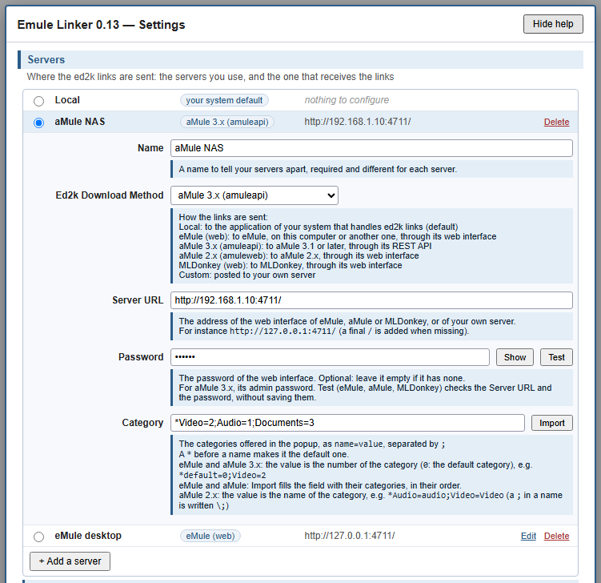

Values refused by **Save**, each one in red under its field (SF-8.10): a name already used by another server, a Category without any valid entry, a popup too narrow:

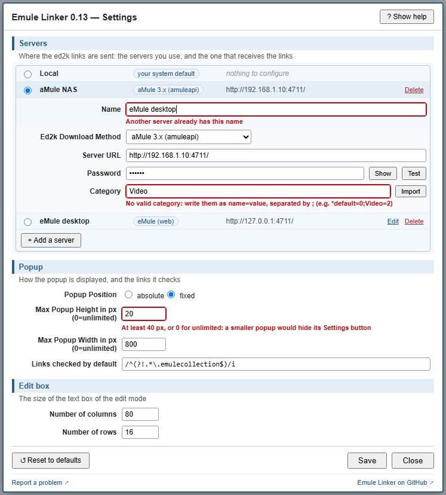

A server deleted: the notice takes its place in the list, with its **Undo** button on the right (SF-8.14):

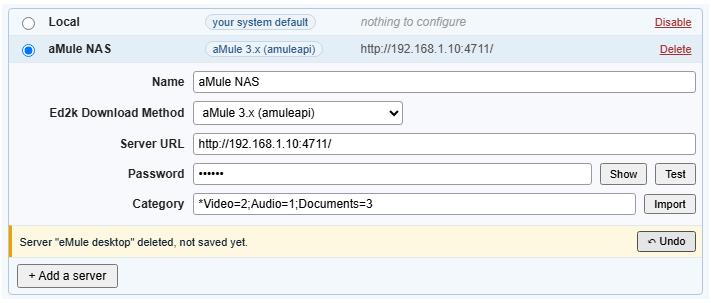

**Reset to defaults**: every server is removed, the popup height and the filter of the links checked by default are set back; the three are highlighted, their sections unfolded, and the notice has its **Undo** button (SF-8.12):

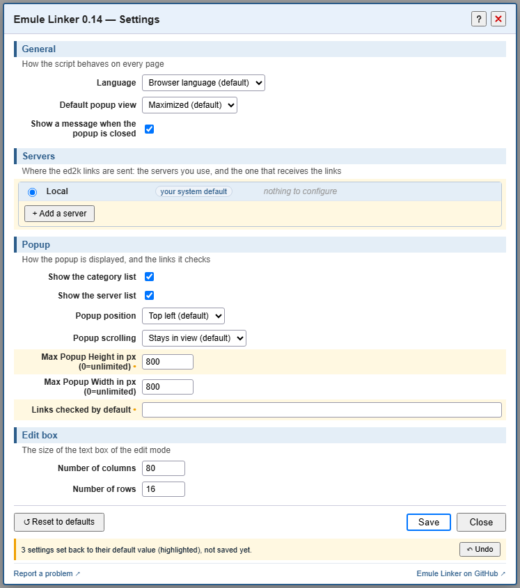

**Test** and **Import** (SF-8.16 to SF-8.18): connected to aMule, and its categories imported in its order, the field highlighted, the **Undo** button under Import:

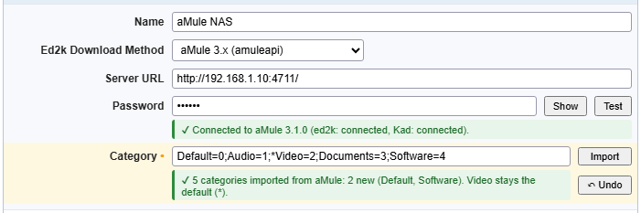

**Test**, connected, but the links would be refused (orange), and an error (red):

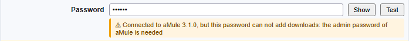

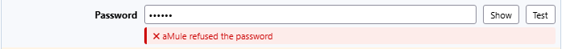

#### Fields and validation rules

| Field | Type | Default | Validation |
|---|---|---|---|
| `language` (Language) | list | `browser` | `browser` \| `en` \| `fr`; another value read as `browser` (SF-12.2) |
| `theme` (Theme) | list | `auto` | `auto`, or a theme of `THEMES`: `light` \| `macos` \| `firefox` \| `mono` \| `glass` \| `legacy` \| `win11` \| `chrome` \| `steel` \| `oled`; another value read as `auto` (SF-13.1) |
| `textSize` (Size) | slider | `100` | `80` to `160` by `10` (`SIZE_MIN`, `SIZE_MAX`, `SIZE_STEP`); another value read as `100`, stored once (SF-2.5) |
| `popupView` (Default popup view) | list | `maximized` | `maximized` \| `minimized` \| `closed`; another value read as `maximized` (SF-8.19) |
| `ed2kDlMethod` | list | `local` | — |
| `emuleUrl` (Server URL) | text | `http://127.0.0.1:4711/` | Starts with `http://` or `https://` (SF-8.10); final `/` added automatically, **except** in `custom` mode |
| `emuleUser` (User) | text | `admin` | MLDonkey only: its user (SF-7.14); a server stored before 0.12 takes the default |
| `emulePwd` (Password) | password | empty | **Optional**: eMule accepts a web interface without a password; empty, it is sent as `p=`. MLDonkey too (its user with an empty password, checked on MLDonkey 3.2.1). Needed for aMule 2.x: its web interface could not be set without one in our tests |
| `emuleCat` | text | `*default=0;` | Format `[*]name=value;…` (the value is everything after the first `=`, a `;` in a name or a value is written `\;`); invalid entries skipped, exactly one default (SF-6.5, SF-6.7); no valid category → message in the band + revert to `*default=0` (SF-8.7) |
| `keyCheckAll`, `keyDownload`, `keyCopy`, `keyExport`, `keyEditMode`, `keySettings`, `keyHelp`, `keyView`, `keyClose`, `keyOpen`, `keyDebug` (Keyboard shortcuts) | list | `A`, `D`, `C`, none, none, `S`, `H`, `W`, none, `O`, none (`shortcuts`) | Empty (None) or a letter `A` to `Z`, used by one shortcut only (SF-8.10); shown as a table; a stored value that is not a letter, or a letter taken by an action before it, gives no shortcut (SF-9) |
| `tbEditTop`, `tbExportTop`, `tbServerTop`, `tbCategoryTop` (Toolbars, top) | list | `none`, `none`, `shown`, `shown` | `shown` \| `menu` \| `none`; another value read as the default (SF-2.14); the section Toolbars, shown as a table |
| `tbEditBottom`, `tbExportBottom`, `tbServerBottom`, `tbCategoryBottom`, `tbDownloadBottom` (Toolbars, bottom) | list | `shown` | `shown` \| `none` (SF-2.14) |
| `tbButtonsTop` (Toolbars, buttons at the top right) | list | `shown` | `shown` \| `menu`; in the menu anyway as soon as a control of the top toolbar is (SF-2.14) |
| `popupCorner` (Popup position) | list | `top-left` | `top-left` \| `top-right` \| `bottom-left` \| `bottom-right`; another value read as `top-left` (SF-2.1) |
| `popupScroll` (Popup scrolling) | list | `floating` | `floating` \| `static`; another value read as `floating`, and `floating` at the bottom of the window (SF-2.2); taken from `popupPos` of 0.13 (SF-8.7) |
| `closeMessage` (Show a message when the popup is closed) | checkbox | checked | — (SF-10.4, SF-10.5) |
| `popupRows` (Max lines of the list) | integer | `40` | A whole number, `0` = unlimited; converted once from `popupHeight`, in pixels before 0.15 (SF-2.3) |
| `popupCols` (Max Popup Width in characters) | integer | `150` | At least `35` (`POPUP_COLS_MIN`), or `0` = unlimited (otherwise the menu of the popup, and the settings, would be hidden, SF-2.13): refused by Save, a stored value below forced to `0`; converted once from `popupWidth` (SF-2.3) |
| `checkFilter` (Links checked by default) | text | empty | A JavaScript regular expression, alone or as `/expression/flags`; must be valid, without the flags `g` and `y` (SF-8.10); empty: every link checked (SF-5.7). Not a setting of a server: the same for all of them |
| `editCol` (Number of columns) | integer | `80` | At least `35` (`EDIT_COLS_MIN`, the same limit as the popup, SF-2.13): refused by Save, a stored value below raised to it |
| `editRow` | integer | `16` | — |

### SF-9 — Commands and keyboard shortcuts

Global keyboard shortcuts, `Ctrl+Alt` and a letter, without `Shift` or `Meta`. The letter of each command is chosen in the section **Keyboard shortcuts** of the settings (since 0.15): a table, a row per command, `Ctrl+Alt+` and a list, **None** then `A` to `Z`. The letters by default are in the PARAM block (`shortcuts`), with the commands that have none by default:

| Command | By default | Action |
|---|---|---|
| Check or uncheck all links | `Ctrl+Alt+A` | Check or uncheck every link, as the box of the toolbars (SF-5.1); since 0.14 |
| Download | `Ctrl+Alt+D` | Send the selected links (`Ctrl+Alt+A` up to 0.13) |
| Copy the links | `Ctrl+Alt+C` | Copy the links that Download would send, the popup closed too (SF-5.5, SF-14); nothing on a page without ed2k links. Since 0.15 (up to 0.14, `Ctrl+Alt+C` closed the popup) |
| Export (its menu) | None | Open or close the menu of Export, its first command focused (SF-14) |
| Edit mode / Normal mode | None | Switch between normal and edit mode (opens the popup in normal mode when it is closed); `Ctrl+Alt+M` up to 0.14 |
| Settings | `Ctrl+Alt+S` | Open the settings dialog |
| Help | `Ctrl+Alt+H` | Show or hide the help of the popup (SF-11); since 0.14 |
| Switch view (maximized, minimized, closed) | `Ctrl+Alt+W` | Maximized → minimized → closed → maximized, never duplicating the popup (SF-2.12); `Ctrl+Alt+X` up to 0.14, now taken by Firefox (its AI panel) |
| Close the popup | None | Close the popup, on this page only (SF-10.1), with a message telling how to open it again (SF-10.4); `Ctrl+Alt+C` up to 0.14 |
| Open the popup | `Ctrl+Alt+O` | Open the popup, in normal mode, or maximize it when it is minimized; nothing if it is already open (SF-2.8) |
| Debug traces (on / off) | None | Switch the debug traces in the browser console on or off |

| Ref | Rule |
|---|---|
| SF-9.1 | A letter is used by **one command only**: Save refuses a letter given to a second command, under its list (SF-8.10). **None** turns a shortcut off. The letters are read from the stored settings when the page loads, before the menu of the userscript manager and the dialog are set up; a stored value that is not a letter, or a letter already taken by a command before it in the table, gives no shortcut. |
| SF-9.2 | The **tooltips** of the buttons tell their shortcut, when they have one ("Download the checked links (Ctrl+Alt+D)"; Export: "Ctrl+Alt+C copies the links"); the letter of a shortcut is **underlined** in the label of its button when the label holds it (SF-12.3); the menu ☰ (SF-2.13), the menu of Export and the help (SF-11) show them; a command without a shortcut shows none. A text that names a shortcut, the message of the closed popup (SF-10.4), the help of Close and the explanation of Default popup view (SF-8.19), names only those that exist, and stays right without them. |
| SF-9.3 | A letter that types a character with `AltGr` on the keyboard does not work in **Firefox**: Windows treats `Ctrl+Alt` as `AltGr`, and Firefox then reports neither `Ctrl` nor `Alt` but `AltGraph` (checked on Windows with a French keyboard: `Ctrl+Alt+E` types `€`). Chrome reports `Ctrl` and `Alt`, and the shortcut works. The key `AltGr` itself never triggers a shortcut, in either browser. Hence, no `E` by default; the explanation of the table tells it, with `Ctrl+Alt+X`, taken by Firefox. |
| SF-9.4 | The **menu of the userscript manager**, under Emule Linker (since 0.15): **Settings**, **Help**, **Open Popup**, their access keys being the letters of their shortcuts (`s`, `h`, `o` by default), and **Toggle debug traces** (access key: the letter of its shortcut, or `t` when no other entry takes it; `d` up to 0.13). Download, Check or uncheck all links, Change mode, Switch view and Close Popup, in it up to 0.14, are left to the popup, its menu ☰ and the shortcuts. |
| SF-9.5 | **Toggle debug traces** switches the debug traces in the browser console on or off; the choice is stored (`debug_mode`), off by default. It is told in the band of the answers, in green ("Emule Linker: debug traces on (see the browser console)"), instead of an alert up to 0.14. |

### SF-10 — Display state of the popup

| Ref | Rule |
|---|---|
| SF-10.1 | The state of the popup applies to the **current page only** (since 0.14), in variables of the script: `popupMode`, `0` = closed, `1` = normal mode, `2` = edit mode, and `popupMinimized`, the minimized view (SF-2.12). It is not stored: closing the popup, or switching it to edit mode, has no effect on the next pages. The `popup_mode` value stored up to 0.13 is ignored, without migration: a popup closed in 0.13 opens again in the default view. |
| SF-10.2 | Each page with ed2k links opens the popup in the **Default popup view** of the settings (`popupView`, section General, SF-8.19): `maximized` (default), the popup in normal mode; `minimized`, only its top toolbar (SF-2.12); `closed`, nothing is displayed, not even the toolbars, until the popup is opened on this page (by its shortcuts, `Ctrl+Alt+O` or `Ctrl+Alt+W` by default, or the menu Open Popup). A user who wants the popup closed on every page chooses it there. |
| SF-10.3 | An unexpected value, which the script never sets, is traced and told in the band of the answers, in red until closed: `Internal error of Emule Linker (popupMode=…): please report the problem`, in the language of the script (an alert in English up to 0.14). |
| SF-10.4 | When the user **closes the popup** (its Close button or the menu ☰, since 0.14; its shortcut when it has one), a **message** tells how to open it again: a box inside the page, not an alert, centered in the window on a backdrop, as the settings dialog, so that it cannot be missed (the page cannot be clicked behind it, and a click on the backdrop does not close it), opaque, titled "Emule Linker — Popup closed", as the settings dialog. It lists the ways to open the popup again: its shortcuts, when they exist (`Ctrl+Alt+O` and `Ctrl+Alt+W` by default, SF-9.2), then Open Popup in the menu of the userscript manager, named after `GM_info.scriptHandler` (Tampermonkey, Violentmonkey); then how to keep it closed on every page: Closed as the Default popup view, or the script restricted to some sites, a link opening the installation guide of the README in a new tab (`REPOSITORY#how-to-install`, its step about the user includes). There is no message when Switch view (`Ctrl+Alt+W`) closes the popup (it goes through the views, the user knows how to open it again), at the load of a page whose default view is Closed, or when no popup was open. |
| SF-10.5 | **OK**, the Close button of the message (✕) or **Escape** close it, and so does the popup opened again. With its box **Don't display again** checked, closing it unchecks the setting Show a message when the popup is closed (SF-8.19), stored at once, the other settings left as they were: no more messages, on this page and the next ones, until the setting is checked again. |

### SF-11 — Help

| Ref | Rule |
|---|---|
| SF-11.1 | A **help** built into the script (since 0.14, I-5) is shown by the **Help** button (?) of the top toolbar, between Settings and Minimize, by its shortcut (`Ctrl+Alt+H` by default) or by the menu entry Help; the same commands close it. Nothing is shown on a page without ed2k links. |
| SF-11.2 | It is a box inside the page, titled "Emule Linker 0.x — Help" as the settings dialog, opaque, **without backdrop**: the popup it explains stays in view and usable. It draws each control of the toolbars (the box, the counter, the server and category lists with generic names, Download, Edit mode, the icons, the arrows as at the place of the popup), with what it does and its shortcut, when it has one; then the list of the links, the next pages and the menu of the userscript manager (named after `GM_info.scriptHandler`); at its bottom, links to the documentation and to the issues on GitHub, in a new tab, and OK. |
| SF-11.3 | It is **centered in the free space beside the popup**, at its right, or at its left when the popup is at the right of the window, so that both can be read at once; centered in the window when it does not fit there, or without popup; always within the window, its content scrolling inside when it is too high. It follows the window resized. |
| SF-11.4 | It is **moved by dragging its title bar** ("move" cursor), not from its Close button, without selecting text, within the window. Its place is kept for the page: closed and opened again, it comes back there, and a smaller window only brings it back into it. Not stored: each page places it automatically again. |
| SF-11.5 | **OK**, its Close button (✕), **Escape**, the Help button or its shortcut close it. |

### SF-12 — Languages

| Ref | Rule |
|---|---|
| SF-12.1 | The script is in **English or in French** (since 0.14): every text that the user sees, the popup, its tooltips, the answers of the clients, the message of the closed popup, the help, the settings dialog (the buttons of GM_config included), the band of the answers (the internal errors included, SF-10.3) and the menu of the userscript manager. The traces of the console stay in English; so do the names of the clients and of the download methods (eMule (web), aMule 3.x (amuleapi)...). |
| SF-12.2 | The setting **Language** (`language`, first field of the General section): **Browser language** (default), English or Français, each language named in its own language. Browser language gives French for a browser in French (`fr`, `fr-FR`, `fr-CA`...), English for any other. The language is read when the page loads, from the storage of GM_config, before the dialog is set up, as its fields need the texts: Save reloads the page in the language chosen. |
| SF-12.3 | The texts are gathered in the PARAM block, one table per language (`TEXTS.en`, `TEXTS.fr`), English being the reference: a text missing in another language is taken from it. A text may hold values (`{count}`, `{client}`). The letter of the keyboard shortcut of a button is underlined in its label when the label of the language holds it (`Download`), not otherwise (`Télécharger`), the first one starting a word (`keyLabel()`, since 0.15; marked by `&` in the texts up to 0.14): the shortcuts are the same in every language, and the tooltips always tell them. A text that names a shortcut is built by the code from pieces of sentences, one per shortcut that exists (`closedKey`, `helpCloseKey`, `popupViewKeys`…), so that a translation holds no condition (SF-9.2). |
| SF-12.4 | The tests run in English whatever the language of the system: the test tools give the script the language that a test asks for (`en-US` by default). A test checks that both tables have the same texts, with the same values, except the names of the themes, whose French version is optional (SF-13.5). |

### SF-13 — Themes

| Ref | Rule |
|---|---|
| SF-13.1 | The setting **Theme** (`theme`, in the General section after Language, since 0.15) chooses the colors of every screen of the script: **Automatic** (`auto`, default), then the light themes **Default light** (`light`), **macOS** (`macos`), **Firefox light** (`firefox`), **Monochrome light** (`mono`), **Transparent glass** (`glass`), **Legacy** (`legacy`, the look of the versions up to 0.13), and the dark ones: **Windows 11 dark** (`win11`), **Chrome dark** (`chrome`), **Steel blue night** (`steel`) or **OLED black** (`oled`); in French: Automatique, Clair par défaut, macOS, Firefox clair, Monochrome clair, Verre transparent, Ancien style, Windows 11 sombre, Chrome sombre, Bleu acier de nuit, Noir OLED. The setting lists them in the order of the table `THEMES`; its help links to the section Usage of the README, which shows every theme (SF-8.3). An unknown stored value is read as `auto`. |
| SF-13.2 | **Automatic** is not a theme of its own: it takes Default light (`THEME_AUTO_LIGHT`), or Windows 11 dark (`THEME_AUTO_DARK`) when Windows or the browser is in dark mode (`prefers-color-scheme`), at the load of the page, and at once when the mode changes, the page open. The other themes stay whatever the mode. |
| SF-13.3 | A theme colors the popup, its band of the answers, the message of the closed popup, the help and the settings dialog, and never the page. The native controls of these screens (drop-down lists, edit box, scroll bars) follow its light or dark kind (`color-scheme`), and the checked boxes its color (`accent-color`, the one of the browser in Light). A theme also sets the **font** of these screens (`THEME_FONTS`: Segoe UI for Default light, Monochrome light, Transparent glass, Steel blue night and OLED black, Segoe UI Variable for Windows 11 dark, the font of the system for Firefox light and Chrome dark, the one of macOS for macOS, Arial for Legacy, each one followed by fallbacks down to `sans-serif`), imposed on every element and never taken from the page; the edit box and the filter of the links checked by default keep a monospace font (Consolas). Before 0.15, the popup, its band, its help and its message took the font of the page visited, and the settings dialog was in Arial. It sets the **radius** of the buttons and lists of the toolbars and of the settings dialog, of Download, OK and Save, and of the controls drawn in the help: 2 px (Monochrome light, Legacy), 3 px (Default light, Steel blue night), 4 px (Windows 11 dark, as its controls), 6 px (Transparent glass), a pill (macOS, Firefox light, Chrome dark, 11 px), square (OLED black); the fields of the settings dialog keep theirs. It sets the **set of icons** (`ICONS`): solid (Default light, Legacy, Steel blue night, OLED black), outline, thinner and open (Windows 11 dark, Chrome dark), or a set of its own: the traffic lights of macOS, the window controls of Windows (Firefox light), sliders and chevrons (Transparent glass), a question mark without its circle (Monochrome light). Such a set lists only the icons it changes, the others being those of outline. When Automatic changes theme, the icons already shown are drawn again in the set of the new one. A theme changes the look only: the order of the controls stays, and their sizes follow the setting Size, for every theme (SF-2.5). |
| SF-13.4 | The CSS of the PARAM block (§ 3.1) writes every color as a variable, `var(--eml-<name>)`; the table `THEMES`, in the PARAM block before the CSS, gives for each theme the value of every variable, 47 colors, its font (named in `THEME_FONTS`) and its radius, and its set of icons (`ICONS`, given by `icon()`), grouped by use and explained in its comment: there is no inheritance between themes, so that a color is found and changed in one place. `applyTheme()` writes the variables of the theme chosen in one style element of the page, on the boxes of the script only (`div#theDiv`, `div#emlMsg`, `div#emlHelp`, `div#emlStatus`, `#GM_config` and their backdrops), before one of them is shown. Since 0.15, the code sets no color inline: the popup, the band of the answers and the backdrop of the settings dialog take theirs from the CSS. A theme may also give **optional values**, listed in the comment of `THEMES` and in [THEMES.md](THEMES.md); without them, a screen keeps the look given by the other values: the radius of the frames of the boxes (square; 4 px for the settings dialog), and of the band of an answer floating against the popup, minimized or closed; the opacity of the popup (97 %); the blur of the page seen through the boxes; the colors of the edit box and of the fields of the settings dialog (those of the browser); the buttons at the top right and the close buttons of the dialogs (background, border, radius, size, under the mouse, pressed, size of their icons, colors of Minimize, Maximize and Close, Close under the mouse and pressed, the symbols drawn on the colored dots of macOS); the frame of Download, OK and Save (color, width), their text under the mouse, their background and ring pressed; the other buttons pressed, and their border under the mouse and pressed. Every button of the screens, those of the settings dialog included (Show, Test, Import, Reset, Close, the buttons of its title), takes the colors and the radius of the theme; its state under the mouse and pressed stays visible. The rules shared by every box (the blur, the symbols of the dots) are in `THEME_CSS`, written by `applyTheme()`. |
| SF-13.5 | **Adding a theme** (explained for contributors, with the meaning of each value, in [THEMES.md](THEMES.md)): an entry in `THEMES` listing every color, its font, its radius and its set of icons, its name in the English table of texts (`theme.<name>`), its French name being optional (the English one by default, SF-12.3); the field `theme` offers it with nothing else to change, its options being made from `THEMES` (`themeOptions()`: Automatic, then every theme, in the order of the table); `tests/take_screenshots.py` then makes its picture, `screenshots/theme/<name>.png`, and adds it to the overview (`0_overview.png`, first in the folder). `test_screenshots` checks that each theme of the script has its picture. |
| SF-13.6 | The tests run in light mode whatever the mode of the system: the test tools give the script the mode that a test asks for, at the load of the page or the page open (`T.load(dark=…)`, `T.set_dark()`), as they give it its language (SF-12.4). |

The themes, their popup side by side:

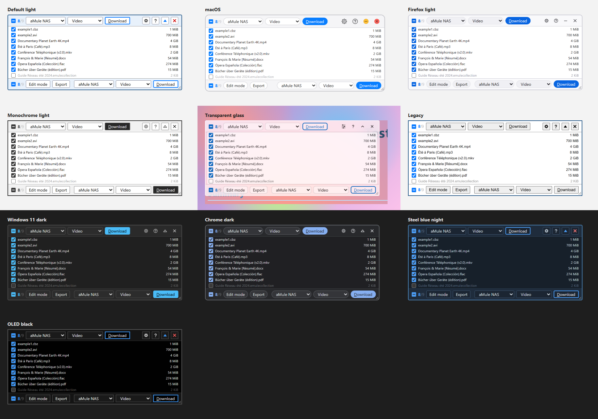

Each theme on every screen (popup, minimized view, answers, edit mode, help, message of the closed popup, settings dialog, the band of an answer the popup closed), with its main colors, its fonts, and the buttons of the popup shown, under the mouse and pressed:

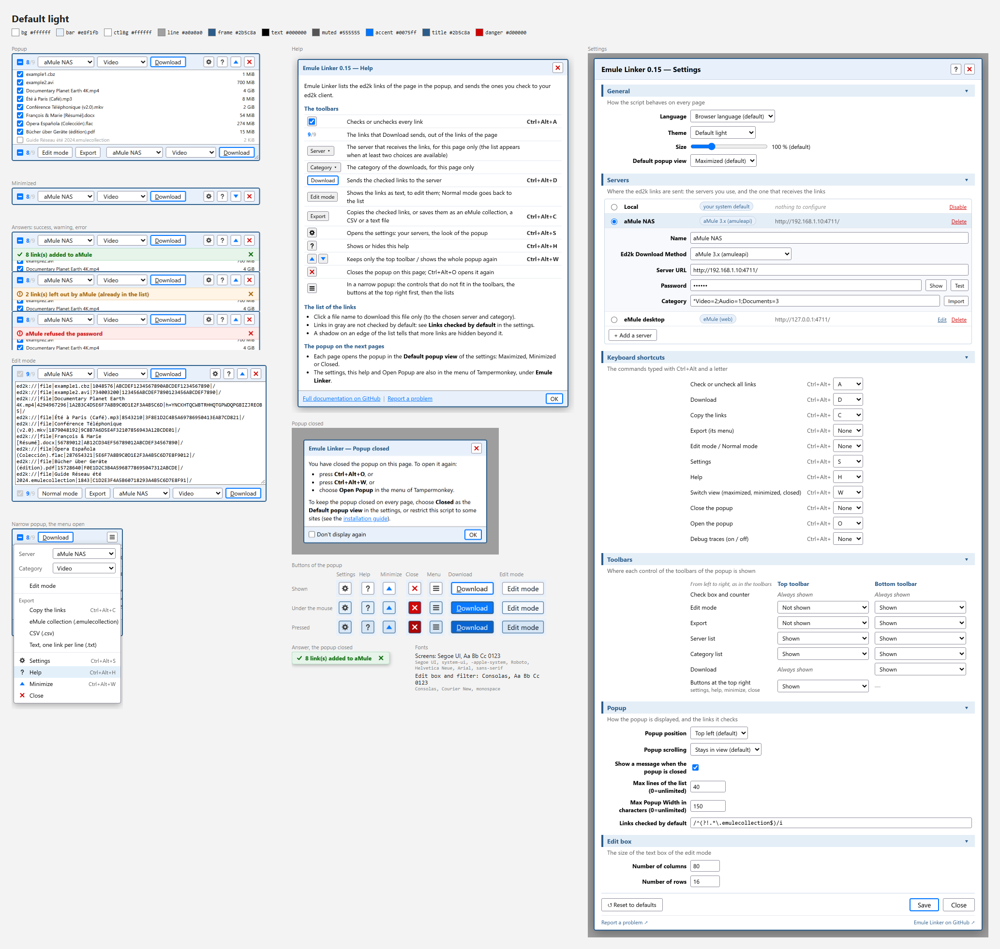

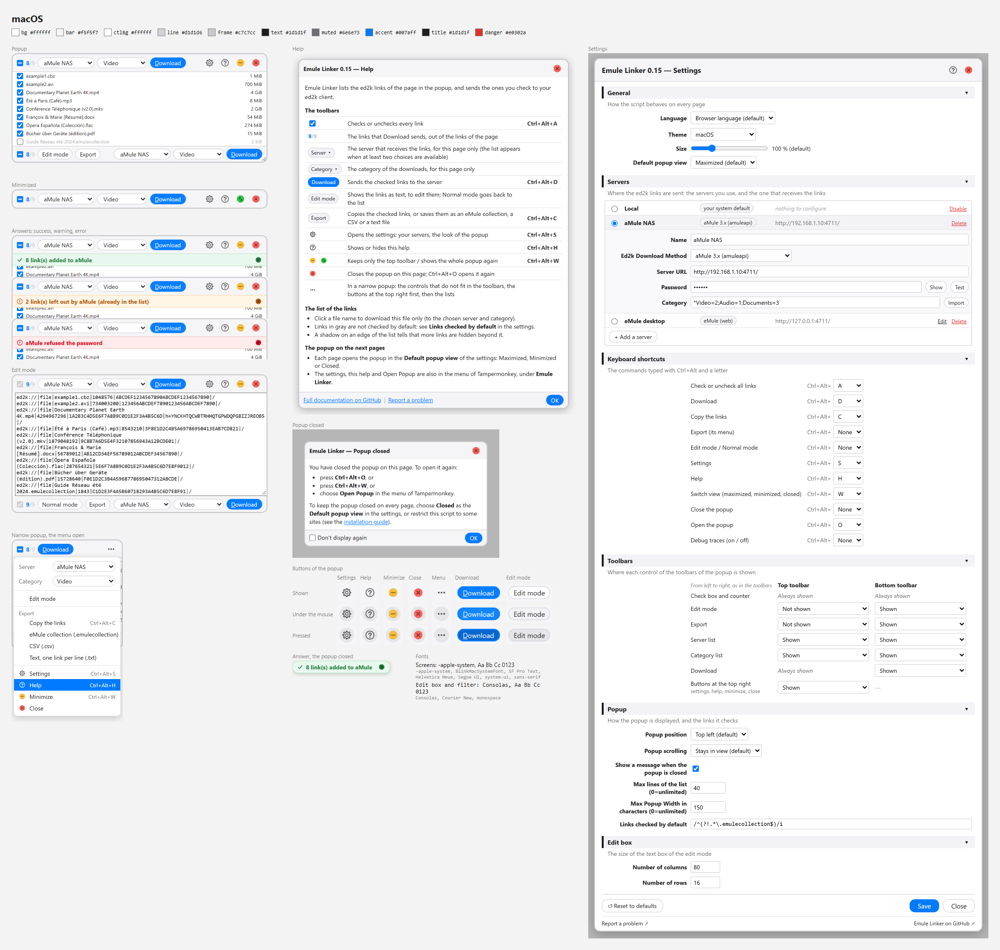

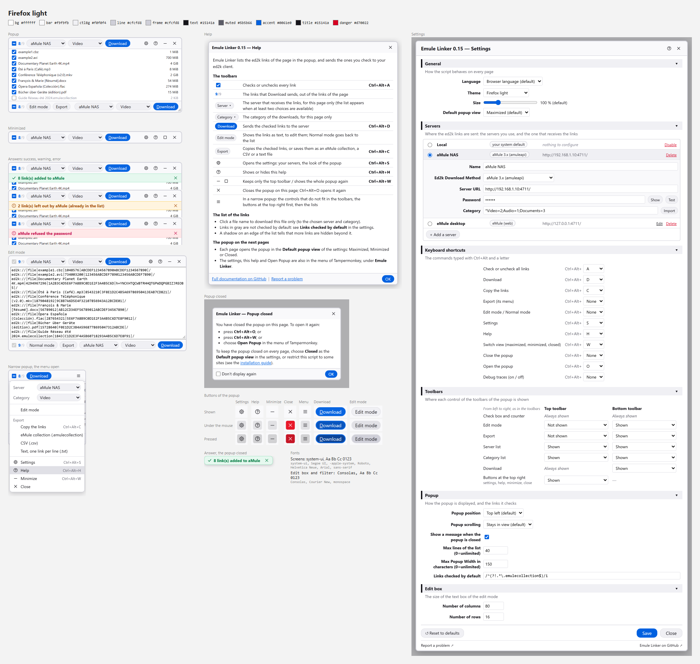

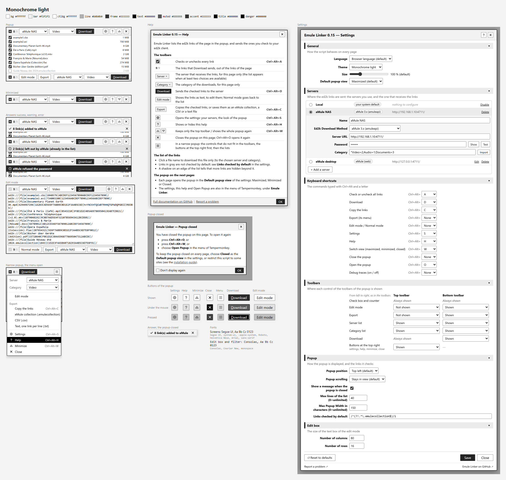

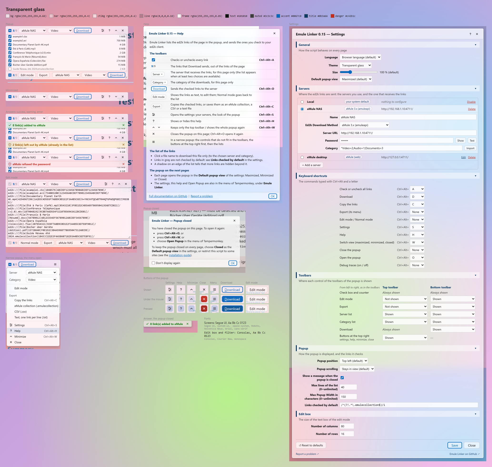

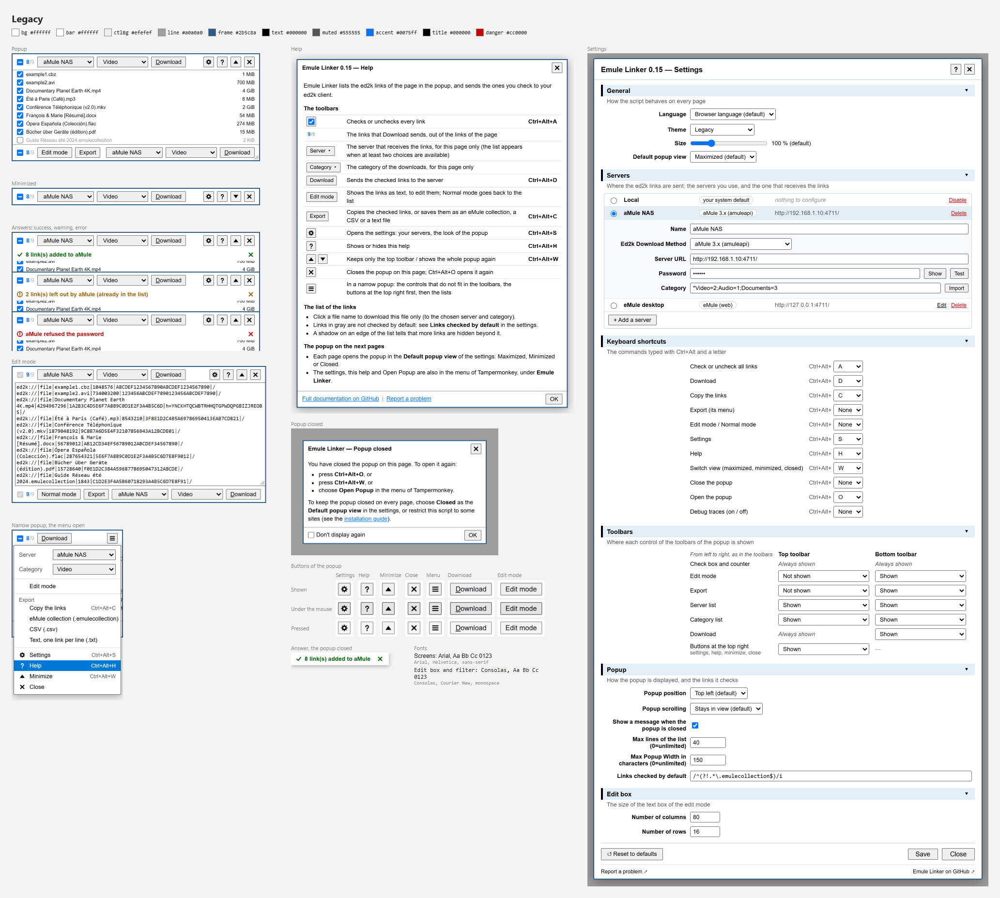

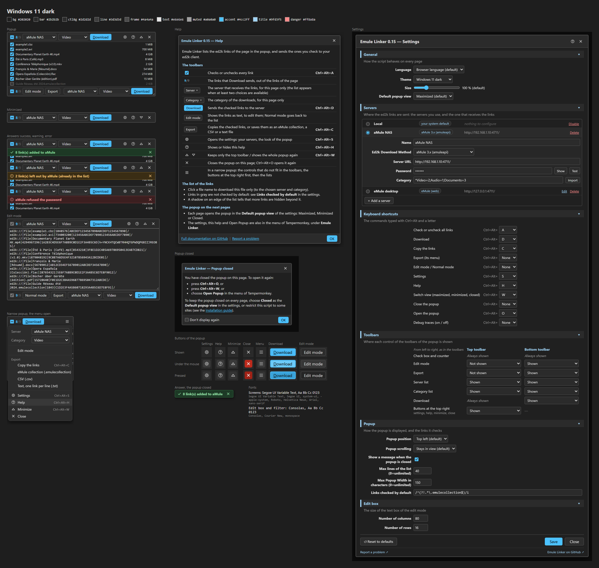

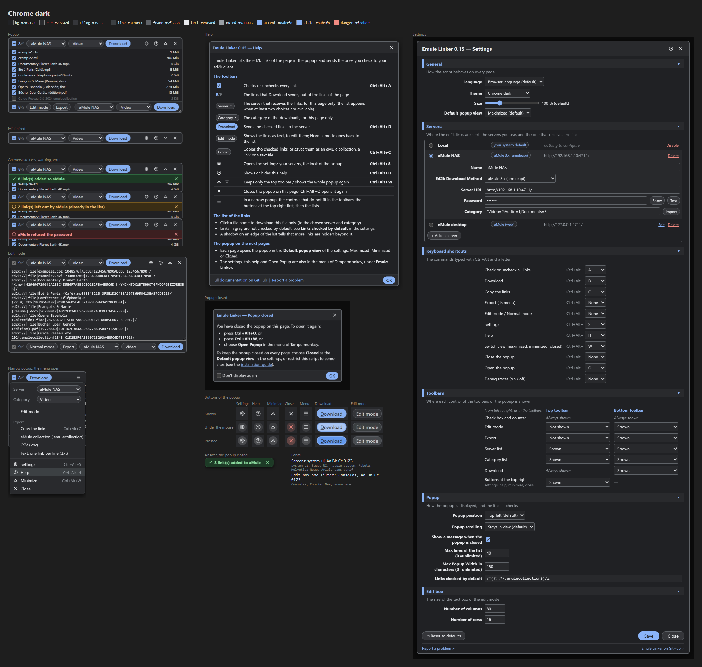

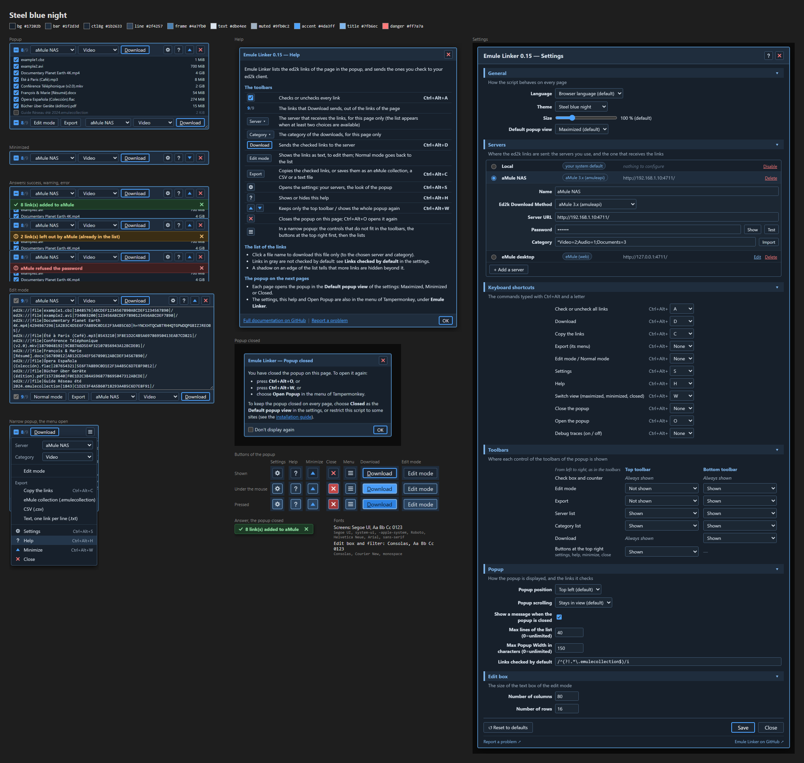

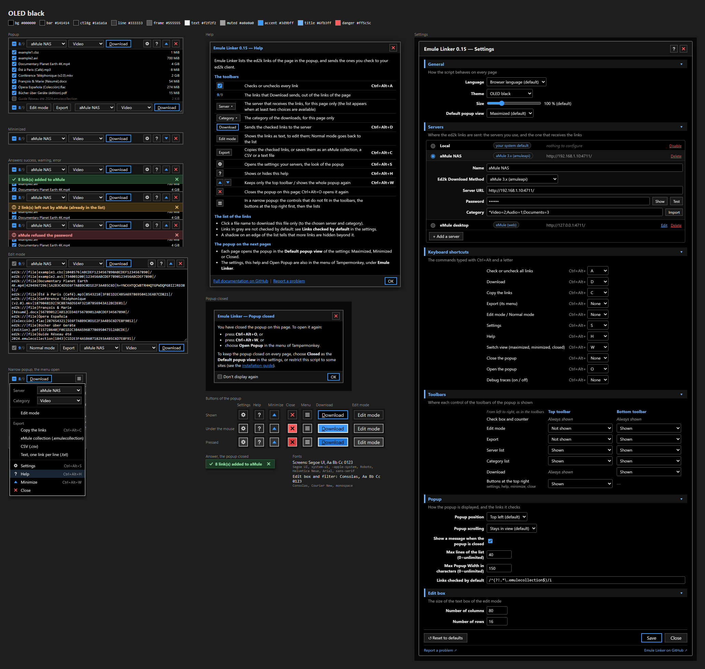

### SF-14 — Export

| Ref | Rule |
|---|---|
| SF-14.1 | **Export** (since 0.15, I-11), after Edit mode in the bottom toolbar (not shown at the top by default, SF-2.14), opens its **menu** under it: **Copy the links**, **eMule collection** (`.emulecollection`), **CSV (.csv)**, **Text, one link per line (.txt)**, in this order; the button stays pressed while it is open; a choice, a click on the button again, Escape or a click elsewhere closes it. Folded or put in the menu ☰ by the settings, its commands are in that menu, under a heading Export (SF-2.13). Its shortcut (none by default, SF-9) opens the menu, its first command focused; without Export shown, at the right of the top toolbar. |
| SF-14.2 | The links exported are those that **Download would send**: the checked ones, or in edit mode the lines of the text that hold an ed2k link; with none, the band tells "No link to export: check some links first", in orange, and nothing is exported. `Ctrl+Alt+C` (SF-9) copies them, the popup closed too: the links that the popup would check (SF-5.5). |
| SF-14.3 | **Copy**: the links, one per line, to the clipboard (`navigator.clipboard`; in a page in `http`, a hidden text area and `execCommand('copy')`); the band tells "9 link(s) copied", or that the browser refused it. |
| SF-14.4 | **eMule collection**: the binary format that eMule reads (its source, `CCollection`), not signed: a version (1, or 2 when a file exceeds 4,290,048,000 bytes), the name of the collection (the title of the page; no author), then each file with its hash, its size, its name (UTF-8) and its AICH hash when the link has one; the links that are not files (a server) are left out. eMule opens it (checked by hand with eMule 0.70b). |
| SF-14.5 | **CSV**: the columns `Link`, `Name`, `Size` (readable, SF-3.4) and `Referer` (the page), headers in English whatever the language, a comma between the values, UTF-8 with a byte order mark (BOM), lines ended by CRLF (RFC 4180); a name holding a comma or a quote is quoted, and one starting with `=`, `+`, `-` or `@` gets a leading `'`, so that a spreadsheet does not run it as a formula. **Text**: the links, one per line. |
| SF-14.6 | The files are named after the page, `<title of the page> <YYYY-MM-DD>.<extension>` (the characters forbidden in a file name removed, 100 characters at most), and **saved in the download folder** at once, by a link of the page (`download`), without a new `@grant`; the band tells "9 link(s) exported (CSV)". In a page in `http`, Chrome may refuse to save the collection, telling why; Firefox saves it. |

---

## 3. Technical specifications

### 3.1 File layout

| File | Role |
|---|---|
| `GM_EmuleLinker.user.js` | **The deliverable**: single-file userscript, with no external dependency. The `.user.js` extension lets Tampermonkey offer the installation when its address is opened |
| `GM_EmuleLinker.js` | **Former address** of the script, up to 0.9: a copy frozen at 0.10, kept so that the older installations find the new address (§ 3.2). Never to be modified nor deleted |
| `CHANGELOG.md` | The changes of every version, in the [Keep a Changelog](https://keepachangelog.com/en/1.1.0/) format: the only list of changes (§ 3.2) |
| `README.md` | User documentation (installation, configuration, limitations) |
| `THEMES.md` | Guide for contributors: how the themes work, the meaning of each of their values, how to modify a theme or create one, and how to check it (SF-13) |
| `SPECIFICATIONS.md` | This document |
| `test_sample.html` | Test page covering 11 cases: 9 valid links, numbered 1 to 9 (accents, single/double encoding, AICH hash, encoded scheme), and 2 invalid ones, unnumbered (malformed link, placed first, and server link), an Expected column telling which are sent and which are ignored |
| `test_many_links.html` | Test page generating 500 valid ed2k links (`?n=` to change the number), to check by hand that the popup displays them all; the automated tests check 1,000 links, in Chrome and in Firefox (§ 7.2) |
| `tests/` | Automated test suite, run in headless Chrome or Firefox (§ 7.2), the publication check `check_publication.py` (§ 7.4), the server of the manual migration check `migration_check.py` (§ 7.3), and `take_screenshots.py`, which takes the screenshots of the README and of this document in headless Chrome, with fictitious settings |
| `mockups/` | Tools of the mockups of the screens, made before an implementation (since 0.15): `drawio_export.py` makes an editable draw.io mockup from the real screens of the script (popup, edit mode, minimized view, answer of the client, message of the closed popup, help, settings dialog), with layers of vertical and horizontal alignment guides and a hidden screenshot of each screen; `drawio_render.py` draws its pages with draw.io itself (the copy embedded in its VS Code extension), over the screenshots, to check that both agree; `drawio_diff.py` lists what an edited mockup changed. The mockups, their variants and the work files are in `mockups/wip/`, ignored by Git |
| `screenshots/` | Screenshots of the README, in `screenshots/spec/` the pictures of this document, its popup and its settings dialog (SF-2, SF-4, SF-8), and in `screenshots/theme/` the picture of each theme and their overview (SF-13). All of them are taken by `tests/take_screenshots.py` |
| `LICENSE` | GPL v3 |
| `.editorconfig` | Editor settings of the repository: tabs in the JavaScript, spaces in the Python, Markdown (2 under a bullet, 3 under a numbered item, as CommonMark requires; fenced code blocks only), HTML and JSON files, UTF-8, a final newline, no blank at the end of a line; applied by VS Code with the EditorConfig extension. The line endings are left to Git (LF in the repository) |
| `GM_EmuleLinker.code-workspace` | VS Code workspace (parent folder, outside the Git repository): Markdown and test settings, a task opening the test page in Chrome with Tampermonkey, and three launch configurations (Chrome with Tampermonkey under the debugger, Chrome with Violentmonkey, Firefox with the user's profile). Under the VS Code debugger, Tampermonkey does not read its storage: its dashboard and its permission requests stay blank. The manual checks with Tampermonkey are therefore made in a Chrome launched by the task, without the debugger |

The source file is organized in three commented blocks, listed by an index at the end of the comments of its header (since 0.14):

- **PARAM**: the default values of the settings, then the look: the CSS of the popup (`POPUP_CSS`), of the message shown when it is closed (`MESSAGE_CSS`), of the help (`HELP_CSS`), of the band of the answers (`STATUS_CSS`) and of the settings dialog (`SETTINGS_CSS`), and the icons of the screens (`ICONS`, two sets: solid and outline), their colors, their font, the radius of their buttons and their set of icons given by the themes (`THEMES` and `THEME_FONTS`, before them, SF-13). Then come the texts, one table per language (`TEXTS`, SF-12.3).
- **LIB**: the embedded GM_config (§ 3.3).
- **CODE**, in parts, each with a title: **State** (the links of the page, the state of the popup, of the sending and of the settings dialog), **Startup** (the menus, the settings read, the links found, the popup shown, the keyboard shortcuts), **Detection** (SF-1), **Popup** (SF-2 to SF-5, SF-9, SF-10), **Selection** (SF-5, SF-6), **Sending** (SF-7), **Settings** (SF-8), then the generic **Utilities** (traces, requests of the script, categories as text, sizes).

PARAM and CODE are indented with tabs; LIB keeps the 2 spaces of GM_config (`.editorconfig`).

### 3.2 Userscript metadata

```text
@include     *              → active on every page
@grant       GM_getValue, GM_setValue, GM_registerMenuCommand, GM_log, GM_xmlhttpRequest
@connect     *              → GM_xmlhttpRequest may reach any address (the aMule of the user, § 3.8)
@version     <version>      → written here and in CHANGELOG.md only
@updateURL / @downloadURL   → raw.githubusercontent.com/alo0/GM_EmuleLinker/master/GM_EmuleLinker.user.js
```

No `@require`, no `@resource`, no network resource loaded: the script is self-contained. `GM_xmlhttpRequest` is used by the `amuleapi`, `emule`, `amule` and `mldonkey` methods (§ 3.8 to § 3.11), towards the address set by the user: Tampermonkey asks the user to allow this address the first time. Users are invited to restrict where it runs with the **User includes** or **User excludes** of its Tampermonkey settings: unlike a change of `@include`, they survive the updates.

**Change of address (0.10).** Up to 0.9, the script was `GM_EmuleLinker.js`, and its update URLs pointed to this file. Tampermonkey checks the `@updateURL` of the *installed* script, downloads the new version from its `@downloadURL`, then follows the URLs written in the new version. This gives the migration, without any action of the users:

1. `GM_EmuleLinker.js` stays at its address, frozen at 0.10, with update URLs pointing to `GM_EmuleLinker.user.js`.
2. An installation in 0.9 or before finds the 0.10 at the former address and installs it: from then on, it checks the new address, and gets the next versions from there.
3. `@name` and `@namespace` never change: Tampermonkey identifies the script by them, so it updates the installed script instead of adding a second one, and the stored settings are kept.

The frozen copy never needs to be updated: whatever the version installed, it leads to the new address. Until 0.10 is published, it is kept identical to `GM_EmuleLinker.user.js` (checked by `test_repository.py`). The migration itself is checked by hand, in a real Tampermonkey (§ 7.3).

### 3.3 Embedded library: GM_config

The **GM_config** library (Mike Medley et al., LGPL, 2009-2010 version) is **inlined** in the file instead of being loaded through `@require`, so that local fixes can be applied to it. It provides: dynamic form building, typed fields (`text`, `int`, `radio`, `select`, `checkbox`, `textarea`, `hidden`, `button`), numeric validation, JSON serialization, `onInit/onOpen/onSave/onClose/onReset` callbacks.

**Local fixes applied**:

| Location | Fix |
|---|---|
| `toNode()`, `select` case | `selected: i == value` instead of `options[i] == value` — the default value of a drop-down list was ignored (GM_config issue #30) |
| `open()`, iframe loading | `frame.contentDocument \|\| frame.contentWindow.document` — `contentDocument` can be `null` on Chrome/Tampermonkey |
| `open()`, resize listener | `function () { if (config.isOpen) config.center(); }` instead of `config.center` passed alone, which lost its `this`: every resize of the window raised a `TypeError` and the dialog was not moved. Its position is now set by the CSS of the script anyway (SF-8.13) |
| `scriptConfig()` | A **`<div>` is passed as container** instead of letting the library create an iframe, which avoids cross-origin restrictions on Chrome/Tampermonkey |

Storage automatically falls back to `localStorage` when the `GM_getValue` API is missing.

### 3.4 Data model

**Global state in memory** — four parallel arrays with consistent indexes:

```js
eLinks[i]  // full ed2k link, decoded       "ed2k://|file|name.mp3|1048576|HASH|/"
eFiles[i]  // displayed file name           "name.mp3"  (suffixed " (i)" if duplicate)
eSizes[i]  // size in bytes, raw            "1048576"
eNames[i]  // file name, without the suffix "name.mp3"  (tested by the filter, SF-5.7)
```

The filter of the links checked by default is read once, by `saveConfig()`, into `checkRegExp` (`null`: every link checked).

**Structure of an ED2K link** after `split('|')`:

| Index | Content | Example |
|---|---|---|
| 0 | scheme | `ed2k://` |
| 1 | type | `file` |
| 2 | **file name** | `example1.cbz` |
| 3 | **size (bytes)** | `1048576` |
| 4 | MD4 hash (32 hexadecimal characters) | `ABCDEF1234567890ABCDEF1234567890` |
| 5+ | optional: AICH hash `h=…`, sources, then `/` | `h=YNCK…` |

**Categories** — array of `{name, value, select}` objects, serialized to a string with `catToStr()` / deserialized with `strToCat()`.

#### Persistent storage keys

| Key | Scope | Values |
|---|---|---|
| `GM_config` | User settings (JSON of all fields) | serialized object |
| `popup_mode` | Popup display state, up to 0.13: ignored since 0.14, the state applying to the page only (SF-10.1) | `0` closed, `1` normal, `2` edit |
| `emule_config` | "Configuration already done" flag | `0` / `1` |
| `debug_mode` | Debug traces in the browser console (menu "Toggle debug traces") | `0` (default) / `1` |
| `settings_help` | Explanations of the fields shown in the settings dialog (the inline help button of the dialog) | `0` (default) / `1` |
| `settings_folded` | The sections of the settings dialog folded by the user (SF-8.22), since 0.15; none stored: all but those of `settingsUnfolded` | JSON: `["shortcuts", "toolbars", "popup", "editbox"]` |
| `servers` | The servers of the user (SF-8.14); the method and settings of the checked one are also in `GM_config` | JSON: `{"active": id or null for Local, "list": [{"id", "name", "method", "emuleUrl", "emulePwd", "emuleCat"}, …]}` |

### 3.5 Execution sequence

```text
Page load
  │
  ├─ readShortcuts(storedSettings())          (the letters of the shortcuts, before the menu and the dialog, SF-9.1)
  ├─ GM_registerMenuCommand × 4                  (Settings, Help, Open Popup, Toggle debug traces, SF-9.4)
  │
  ├─ scriptConfig()
  │    ├─ creates the container <div>, appended to body
  │    ├─ GM_config.init(div, title, fields, {save: () => location.reload()})
  │    │     └─ reads the storage, creates the GM_configField objects
  │    ├─ if emule_config < 1 → GM_config.open()   (first run)
  │    └─ saveConfig()                              (config → global variables + validation)
  │
  ├─ try { getEd2kLinks(eLinks, eFiles, eSizes, eNames) } → n   (failure contained, n = 0)
  │    └─ per link: isEd2kLink → decodeEd2kLink → deduplication
  │                → split('|') → isValidEd2kFile → storage
  │
  ├─ popupMode ← popupView of the settings     (closed → 0, otherwise 1; SF-10.2)
  │
  ├─ if n > 0 and popupMode != 0 → createPopup()
  │    ├─ builds <div id="theDiv"> + scoped <style>
  │    ├─ addToolbar(container, 0)                (top: checkall, counter, Category, Download, Settings, Minimize, Close)
  │    ├─ depending on popupMode:
  │    │     1 → htmlLinkList()  → <div id="divBody"> with the table, addScrollShadows()
  │    │     2 → addEditBox()    → <textarea id="editbox">
  │    ├─ addToolbar(container, 1)                (bottom: checkall, counter, Edit mode, Export, Server, Category, Download)
  │    └─ fitCounters(), syncCheckAll()
  │
  ├─ if popupView is minimized → setMinimized(true)
  ├─ if settings were corrected while read → showStatus(…, 'doubt')   (SF-8.7)
  │
  └─ installs the global keydown listener          (the letters of shortcuts, SHORTCUT_ACTIONS)
```

**Sending sequence** (`addButton`, asynchronous):

```text
addButton()
  ├─ normal mode → getSelectLink(eLinks)          (checked boxes)
  │  edit mode   → textarea.value.split('\n')
  ├─ getAddLink(links) → href                     (encoding + URL depending on the method)
  └─ dispatch:
       local     → loop openLocalLink(link)       (click on a synthetic anchor)
       custom    → post(emuleUrl, href)           (POST form, target "emule")
       amuleapi  → sendToAmuleApi(href)           (login, POST of the links, logout; answer shown)
       emule     → sendToEmule(href)              (GET of the links, no window; answer shown)
       amule     → sendToAmuleWeb(href)           (login, GET of the links, check of the downloads; answer shown)
       mldonkey  → sendToMldonkey(href)             (GET of the links with HTTP Basic, no window; answer shown)
```

### 3.6 Function inventory

| Function | Responsibility |
|---|---|
| `getEd2kLinks(links, files, sizes, names)` | XPath scan, decoding, deduplication, validation, name/size extraction, suffixing |
| `isEd2kLink(href)` | Recognizes the `ed2k` scheme, literal or encoded at any depth |
| `decodeEd2kLink(href)` | Decodes in successive passes until the scheme is readable (max 4) |
| `isValidEd2kFile(tlnk)` | Structural validation of the split link (5 fields, `file` type, name, numeric size) |
| `createPopup(links, files, sizes)` | Builds and injects the popup depending on `popupMode` |
| `delPopup()` / `updatePopup()` | Removes / rebuilds the popup |
| `htmlLinkList(links, files, sizes)` | Generates the HTML table (normal mode) |
| `addToolbar(container, pos)` | Top (`pos=0`) or bottom (`pos=1`) toolbar (SF-2.7) |
| `toolbarButton(html, title, action, classes)` / `iconButton(icon, title, action, classes)` | A button of a toolbar, with a label or an icon of `ICONS` (SF-2.7) |
| `categoryList(pos)` / `categoryTitle(selection)` | The category list of a toolbar, grayed out when there is nothing to choose, and its tooltip (SF-6.1, SF-6.4) |
| `serverList(pos)` / `serverTitle(selection)` / `changeServer(list)` | The server list of a toolbar, its tooltip, and the server chosen: both lists show it, the category lists are rebuilt with its categories (SF-6.11, SF-6.12) |
| `readServers()` / `useServer(server)` | The servers offered by the popup, Local first, the one checked in the settings taking its settings from GM_config; the method and the settings of the server chosen, in memory only (SF-6.11 to SF-6.13) |
| `fitCounters()` | The counters as wide as their widest value on the page (SF-2.10) |
| `addScrollShadows(container, list)` / `placeScrollShadows(container, list, shadows)` | The shadows on the edges of the list where links are hidden (SF-2.9) |
| `minimizeButton()` / `setMinimized(on)` / `cycleView()` | The minimized view, and the views in turn with `Ctrl+Alt+W` (SF-2.12) |
| `checkAllButton()` | `Ctrl+Alt+A`: checks or unchecks every link, as the box of the toolbars (SF-5.1) |
| `addEditBox(container, txt)` / `delEditBox()` | Text area (edit mode) |
| `concatLinks(links)` | Joins the links, separated by `\n` |
| `getSelectLink(links)` | Extracts the links whose box is checked; when the boxes do not exist, the links checked by default (SF-5.5) |
| `parseCheckFilter(str)` | Reads the filter of the links checked by default: the regular expression, or why it is refused (SF-5.7, SF-8.10) |
| `checkedByDefault(name)` | Tells whether a file name matches the filter, always when it is empty (SF-5.7) |
| `checkButton(checkbox)` / `syncCheckAll()` | The "check all" boxes of both toolbars: every link takes the state of the box clicked; both boxes show the state of the links (SF-5.1) |
| `setHelpText(help, text)` | Writes the help of a field, its code (between grave accents in the text) in a fixed-width font (SF-8.3) |
| `getSelectedCat()` | Reads the selected category from `emuleCat` (independent of the DOM) |
| `getAddLink(links)` | **Core of the adaptation**: encoding and building of the URL/payload per method |
| `addButton()` | Triggers the sending (asynchronous) |
| `openButton()` | Opens the popup, unless it is already open or the page has no ed2k link |
| `debugButton()` | Switches the debug traces on or off, stores the choice, and tells it in the band (SF-9.5) |
| `internalError(what)` | An error that should never happen: traced, and told in the band, in red (SF-10.3) |
| `editButton()` / `setButton()` / `changeCat()` | UI action handlers |
| `closeButton()` / `closePopup()` | Closes the popup: with the message of SF-10.4 (Close button, menu ☰, its shortcut), or without it (Switch view, `Ctrl+Alt+W`) |
| `closedKeys()` / `popupViewHelp()` | The ways to open the popup by the keyboard in the message of the closed popup, and the explanation of Default popup view, naming the shortcuts that exist only (SF-9.2) |
| `showCloseMessage()` / `dismissCloseMessage()` / `delCloseMessage()` | The message shown when the popup is closed, closed by OK, its Close button or Escape, "Don't display again" stored (SF-10.4, SF-10.5) |
| `storeSetting(id, value)` | Stores one setting at once, outside the settings dialog, on top of the stored ones (SF-10.5) |
| `helpButton()` / `showHelp()` / `delHelp()` | The help of the popup, shown or closed (SF-11) |
| `placeHelp()` / `dragHelp(e)` | The place of the help, beside the popup or where the user moved it, within the window (SF-11.3, SF-11.4) |
| `popupPlace()` / `popupResize()` / `viewIcon(minimized)` | The corner and the scrolling of the popup, the resizing at the top left only, the arrow of Minimize and Maximize (SF-2.1, SF-2.2, SF-2.4, SF-2.12) |
| `toggleLocal()` / `syncPopupScroll()` | In the settings dialog: Local disabled or enabled (SF-8.20); Popup scrolling following Popup position (SF-8.21) |
| `sizeFactor()` / `scaledCss(css)` | The factor of the size chosen; a style sheet, a style or a value at that size (every length of 3 px or more multiplied) (SF-2.5) |
| `setupSizeSlider()` / `syncSizeValue()` | Size as a slider in the settings, its value at its right (SF-2.5) |
| `setupSections()` / `foldedSections()` / `foldSection(holder, fold, store)` / `unfoldSectionOf(node)` | The sections of the settings folded or unfolded by their title, as the user left them, a section unfolded for a wrong or reset value (SF-8.22) |
| `readShortcuts(stored)` / `storedSettings()` / `shortcutField(action)` / `shortcutId(action)` / `setupShortcutsTable()` | The letters of the keyboard shortcuts, read from the stored settings before GM_config is set up; their fields (`keyCheckAll`…) and their table in the settings (SF-9) |
| `shortcutText(action)` / `keyTitle(key, action)` / `keyLabel(key, action)` / `copyShortcut()` | A shortcut as shown (Ctrl+Alt+D, or nothing); a tooltip with it; a label with its letter underlined; `Ctrl+Alt+C` (SF-9.2, SF-14.2) |
| `setupToolbarsTable()` / `syncToolbarButtons()` | The choices of the toolbars as a table in the settings; the buttons at the top right following the menu (SF-2.14) |
| `adaptToolbars()` / `setToolbarsMenu(div, on)` | The toolbars adapted to the width of the popup: the menu button first, then each toolbar on its own, its controls one by one from left to right (class `emlFolded`); the menu button in place of the buttons at the top right (class `emlMenuOn`) (SF-2.13) |
| `openToolbarMenu()` / `closeToolbarMenu()` / `toggleToolbarMenu()` | The menu of the folded controls, under its button; closed (SF-2.13) |
| `newMenu(kind)` / `showMenu(menu, button, left)` / `placeToolbarMenu(menu, button, left)` / `menuCommand(…)` / `menuList(…)` / `menuSeparator(menu)` | A menu of the popup (the menu ☰, the one of Export), kept in the window; its commands, lists and separators (SF-2.13, SF-14.1) |
| `toggleExportMenu(button)` / `exportCommands(menu)` / `exportLinks(format)` / `exportedLinks()` | The menu of Export and its commands; a format exported, the links of Download (SF-14) |
| `linkInfo(link)` / `exportCsv(links)` / `emuleCollection(name, files)` | What a link of a file tells (name, size, hashes); the CSV; the binary eMule collection (SF-14.4, SF-14.5) |
| `pageTitle()` / `exportFileName()` / `saveFile(name, type, data)` / `copyText(text, done)` / `copyBySelection(text)` | The name of the file, from the page and the date; the file saved in the download folder; the links copied (SF-14.3, SF-14.6) |
| `limitListRows(list)` | The list of the popup no higher than `popupRows` lines, the height of its lines measured (SF-2.3) |
| `applyTheme()` | The colors, the font and the radius of the theme chosen, at the size chosen, as variables on the boxes of the script; Automatic following the mode of the system, the icons shown drawn again in its set (SF-13) |
| `icon(name)` / `themeIcons()` | An icon in the set of the theme (or in outline, when the set does not change it), marked with its name (`data-eml-icon`); that set (SF-13.3) |
| `themeOptions()` | The options of the setting Theme: Automatic, then every theme of `THEMES`, named by its text (SF-13.5) |
| `boxTitle(name)` | The title of a box of the script, with its version: "Emule Linker 0.x — Settings", "— Help" |
| `scriptLanguage()` / `tr(key, values)` | The language of the script; a text in that language, its values replaced (SF-12) |
| `scriptConfig()` / `saveConfig()` / `resetConfig()` | Configuration lifecycle |
| `catToStr(cat)` / `strToCat(str)` | Category serialization |
| `post(path, params, method)` | Sends through an HTML form (`custom` method), removed from the page once submitted |
| `linkHref(link)` | The href of a file name link of the popup: the ed2k link itself with `custom`, `amuleapi`, `emule` and `amule` (`sentByScript()`), the URL of the method otherwise |
| `clickOneLink(e)` | With `custom` and `amuleapi`, turns a click on a file name into the sending of that file |
| `sendToAmuleApi(body)` | `amuleapi` method: login, sending of the links, logout (SF-7.9) |
| `sendToEmule(req)` | `emule` method: the GET of the links through `GM_xmlhttpRequest`, no window (SF-7.12) |
| `emuleResult(count, r)` | The message for the answer of eMule, with the kind of answer: added, refused, not understood (SF-7.12) |
| `gmRequest(method, url, body, token)` | A request through `GM_xmlhttpRequest`, as a promise: the status of the answer, the answer read as JSON, and as text |
| `amuleApiResult(links, r)` / `amuleApiError(r)` | The message for an answer of the aMule API (SF-7.10) |
| `showStatus(msg, ok)` / `placeStatus()` / `delStatus()` | The band of the answer of a client: under the top toolbar, over the list, or in the corner of the closed popup; removed by its Close button, or after `STATUS_DELAY` for a success (SF-7.10) |
| `humanFileSize(bytes, si, dp)` | Readable size formatting |
| `encodeEd2kLink(lnk)` | Encodes the part between `ed2k://` and the final `/` (`local` method, popup and batch sending) |
| `openLocalLink(lnk)` | Hands a link to the system `ed2k:` handler through a synthetic anchor |
| `sendToAmuleWeb(req)` / `amuleWebLogin(r)` / `amuleWebFound(url, hashes)` | `amule` method: login, links, check of the downloads (SF-7.13) |
| `sendToMldonkey(req)` / `mldonkeyResult(count, r, url)` / `basicAuth(user, password)` | `mldonkey` method: the GET of the links with HTTP Basic, and its answer (SF-7.14) |
| `serverSetting(server, id)` | A setting of a server, or its default value when an older version stored none (User) |
| `trace(txt)` | Logging in the browser console, when the debug traces are on (`debug_mode` setting) |

**Dead code removed in 0.11**: `silentPost()` and `silentGet()` (blocked by CORS and mixed content, L-3), `loadChildWindow()` and `waitReady()` (marked "Not working"), and the commented-out code that used them (the `amule` POST branch, the calls of `loadChildWindow()`). Removed in 0.12: `sleep()` (the fixed delay of the `amule` login, now awaited) and `refreshLinkUrls()` (the update of the links of the popup after a category change, none of them carrying the category any longer).

### 3.7 Key technical choices

| Choice | Rationale | Consequence |
|---|---|---|
| Single-file userscript, no build | Installation by copy/paste, maximum portability | Third-party library duplicated in the source; the tests inject the file unchanged into the pages (§ 7.2) |
| Mostly ES5 JavaScript (`var`, `new Array()`) | Legacy from 2012-2013 | A few modern elements here and there: `async/await`, arrow functions, default parameters, `**` |
| DOM handled by hand (no framework) | No dependency | HTML built by string concatenation for the popup and the table |
| Opening a window (`window.open`) rather than `XMLHttpRequest` | Silent cross-origin calls are blocked by modern browsers (CORS, mixed content) | A visible window at each sending, `blur()` ineffective — see § 5. Except `amuleapi`, whose JSON API leaves no choice: `GM_xmlhttpRequest`, which is not subject to CORS (§ 3.8) |
| **GET** transport for eMule/aMule/MLDonkey | The only method requiring neither server configuration nor complex interaction | Password in clear in the URL and the history; limited URL length |
| File name deliberately encoded twice | Expected by the eMule/aMule web interfaces | Delicate encoding logic, the source of most historical fixes |
| XPath rather than `querySelectorAll` | Legacy | Functionally equivalent here |

### 3.8 The `amuleapi` method (aMule 3.1 and later)

**Why a new method.** aMule 3.1.0 (September 2026) replaces its web interface `amuleweb`, used by the `amule` method, with `amuleapi`: a REST daemon serving `/api/v1/*` and a new Web UI, on the same port 4711. The `footer.php` page called by the `amule` method no longer exists there. The `amule` method stays for aMule 2.x; `amuleapi` is added beside it, shown as **aMule 3.x (amuleapi)** in the settings dialog. The aMule 3.0.x versions are supported by neither method: `amule` no longer works with them (L-10), and they have no `amuleapi`.

**What the API expects** (from `docs/api/REFERENCE.md` of the aMule repository, confirmed against a real aMule 3.1.0):

| Step | Request | Answer |
|---|---|---|
| Login | `POST /api/v1/auth/login`, JSON body `{"password": "…"}`, with `Accept: application/jwt` (or `?include_token=true`) to get the token in the body | `200` with `token`, `expires_at` and `role` (`admin` to add downloads), and a cookie `amuleapi_token` (HttpOnly, `SameSite=Strict`, `Path=/api/v1`). Failed logins are rate-limited per IP (`429` with `Retry-After`) |
| Sending | `POST /api/v1/downloads`, header `Authorization: Bearer <token>`, JSON body `{"links": ["ed2k://…", …], "category_index": <n>}`: several links per request, category optional (0 by default), admin role only | `202` all accepted (the add is asynchronous), `207` partial success (`results[].ok` per link), `400` malformed body or link, `401` session refused, `503` daemon disconnected |
| Categories | `GET /api/v1/categories?limit=100&offset=<n>`, header `Authorization: Bearer <token>` (`401` without it) | `{"categories": [{"index": 0, "name": "Default", "save_path": …, "comment": …, "color": …, "priority": …}, …], "total": …, "offset": …, "limit": …}`: categories identified by an integer `index` (0 to 255), in the order of their index, the default one being `0`, named "Default" by aMule; page by page, 100 by default. Read by Import (SF-8.18) |
| Version | `GET /api/v1/version`, no session needed | `{"service": "amuleapi", "api_version": "v1", "amuleapi_version": "3.1.0", "daemon_version": "3.1.0", …}`. Read by Test (SF-8.17) |
| State | `GET /api/v1/status`, header `Authorization: Bearer <token>` | `ec_connected` (the API is connected to the core of aMule), `ed2k.state` and `kad.state` (`connected`…), and statistics. Read by Test (SF-8.17) |
| Cancel | `DELETE /api/v1/downloads/{hash}` (MD4 hash, 32 hexadecimal characters) | `204`: the download is cancelled and its files deleted. Used by the live test to remove its test files |
| Logout | `POST /api/v1/auth/logout` | `204`: the token is revoked |

**Design**:

- **Transport**: the API needs a JSON `POST` and an authorization header. A `window.open()` or a form cannot send them, and a `fetch()` from the page is blocked by the browser: the API answers other origins only when `AllowCORS=1` is set on the server, and its cookie is `SameSite=Strict`. The method therefore uses **`GM_xmlhttpRequest`**, which is not subject to CORS. This needs `@grant GM_xmlhttpRequest` and `@connect *`, as the address of aMule is chosen by the user: Tampermonkey asks the user to allow it the first time.
- **Gains** for this method: the password no longer appears in a URL nor in the history (L-1), no URL length limit (L-2), no window opened (L-4, L-5), no fixed delay (L-6), and the answer of aMule is shown to the user (L-8, SF-7.10).
- **Time limit**: aMule answers the sending only once every link is added, and this time grows faster than the number of links: 8 s for 500 links, 77 s for 2,000 links, measured on aMule 3.1.0. The sending therefore waits 60 s plus 100 ms per link (`sendingTimeout()`), the login and the logout 15 s. A late answer is not reported as an unreachable aMule (SF-7.10).
- **Pages**: `GET /api/v1/downloads` answers page by page (`limit`, `offset`, `total`; 100 downloads by default). The live test reads every page.
- **Session**: a session is opened for each sending and closed after it (`auth/logout`), even when the sending fails: the token is never stored. The password travels in the body of the login request only.
- **Category**: a numeric index, written in the Category setting as for eMule (`*default=0;Video=2`).
- **Encoding of the links**: the links travel in JSON, not in a URL, so they are not encoded a second time (SF-7.2). Checked on aMule 3.1.0: a file name sent raw and the same name encoded once both give the exact name in the transfer list (accents, spaces, `&`, brackets, parentheses). The links are therefore sent as normalized by SF-7.2, name encoded once, as for the other clients.
- **Tests**: a fake `amuleapi` in the test server (login, sending, error answers), `GM_xmlhttpRequest` in `tests/gm_shim.js`, relayed by the test server as Tampermonkey does, and a live test against a real aMule 3.1 (§ 7.2).

### 3.9 The `emule` method without a window

**Why.** Until 0.11, the `emule` method opened a window on the URL of the sending: a visible window at each sending, sometimes blocked (L-4), the URL with the password kept in the history of the browser (L-1), and no answer for the user (L-8). Since 0.12, the same GET request is made by the script, through **`GM_xmlhttpRequest`**, as for `amuleapi` (§ 3.8): no window, and the answer of eMule is read. The `amule` and `mldonkey` methods followed, in 0.12 too (§ 3.10, § 3.11); `custom` is still to do (I-12).

**What eMule answers** (eMule 0.70b, checked against the real eMule of the live test; other versions may answer otherwise):

| Request | Answer |
|---|---|
| Sending: `URL?w=password&p=<pwd>&cat=<cat>&c=<links>` (one link per line, the whole list encoded) | `200`, a short XML status: `<status result="OK"><description>Link added: </description><filename>…the links…</filename></status>`. eMule does not check the links: a malformed link, or a link already in the list, also gives `OK` |
| Same, wrong or missing password | `<status result="FAILED" reason="WRONG_PASSWORD"><description>Link not added. Wrong password.</description></status>` |
| Login alone (Test): `URL?w=password&p=<pwd>` | Its web interface, which holds a session (`ses=<n>`) and its version in its title (`eMule 0.70b x64 - Web Interface`); or its login page again (a password field) when the password is wrong |
| Categories (Import) | The same answer to the login holds them, in the list of its form to add a link: `<select name="cat"><option value="0">All</option><option value="1">…</option>…</select>`, in its order, UTF-8 (accents sent as they are), without the display filters (negative values) of the menu of its Transfer page |
| Logout: `URL?ses=<n>&w=logout` | Closes the session opened by Test or Import |

**Design**:

- **No session for a sending**: one request adds the links and answers, without a cookie. Test and Import open a session (to check the password, to read the categories), and close it at once. eMule names its category 0 `All`: Import keeps this name (`All=0`, SF-8.18).
- **Time limit**: 500 links in one request (a URL of 72,548 characters, accepted) were answered in 7 s by eMule 0.70b, and listed in its transfers 3 s later. The sending waits 60 s plus 100 ms per link (`sendingTimeout()`, shared with `amuleapi`), Test 15 s.
- **Password**: still in the URL, which is what the web interface of eMule expects (L-1), but no longer in the history, and now encoded.
- **Encoding of the links**: unchanged (SF-7.2): the name encoded once in the link, then the whole list encoded in the URL. Checked: accents, spaces, `&`, brackets and parentheses arrive intact.
- **Tests**: the fake eMule of the test server (`/__emule/`) answers as eMule 0.70b does; the live test checks the answer shown and that no window opened, and Test with the right and a wrong password (§ 7.2).

### 3.10 The `amule` method without a window (aMule 2.x)

**Why.** Until 0.11, the `amule` method opened two windows: one to log in (`footer.php?pass=…`), then, after a fixed wait of 1 s, one with the links. Since 0.12, as for `emule` (§ 3.9), the requests are made by the script, through `GM_xmlhttpRequest`: no window, the login awaited instead of a delay (L-6), and the result checked.

**What amuleweb answers** (aMule 2.3.3, checked against a real one in a Docker container; its answers are compressed (`gzip`), which the browser handles):

| Request | Answer |
|---|---|
| Any page, no session | Its login page (`<form name="login">`), and a cookie `amuleweb_session_id` |
| Login: `URL?pass=<pwd>` | Right password: a short page that goes on to `amuleweb-main-dload.php`, the session of the cookie logged in. Wrong one: the login page again |
| The password and the links in **one** request, no session | The login is done, **the links are ignored**: two requests are needed, the session kept by the cookie |
| Links: `URL/footer.php?selectcat=<cat>&Submit=Download+link&ed2klink=<links>`, session open | The links are added (several at once, one per line, accents intact), and its form is answered again, **without any result** |
| Downloads: `URL/amuleweb-main-dload.php` | One row per download, with a checkbox named after its hash (in capitals): the links sent are looked for there. Shown 0.03 s after the request of the links |
| Sending to a category whose name has accents | Sent in UTF-8 (as by its own form): **no category is recognized, and the links are dropped** without any message (an unknown name, or no `selectcat`, too). Sent as amuleweb reads it, its UTF-8 bytes taken as Latin-1 characters, then encoded (`2%C3%83%C2%A8me` for `2ème`): the links land in that category. |
| Categories (Import): `URL/footer.php` | The list of its form: `<select name="selectcat"><option>all</option><option>…</option></select>`, by name, UTF-8 |
| Version (Test): `URL/log.php` (the log, framed by `amuleweb-main-log.php`) | Its first lines: `Initialising aMuleD 2.3.3 compiled with …` (never `log.php?rstlog=1`, which resets the log) |
| Cancel (live test): `POST URL/amuleweb-main-dload.php`, `command=cancel&<hash>=on` | The download is cancelled |

**Design**:

- **Cookie**: the session needs the cookie of the login to be sent with the links, as a browser does; `GM_xmlhttpRequest` keeps the cookies by default (checked through the test server, which relays the requests with a cookie jar, and in the live test; to be checked in each userscript manager, § 7.3). Without it, the check of the downloads would show it at once (`0 of N link(s) found`).
- **No logout**: amuleweb has none; its session ends by itself.
- **Category**: aMule 2.x knows its categories by their name (SF-6.3): Import gives `name=name`, `all=all` for its first one. A name may hold an equals sign (`=`) (`A=B`, accepted by aMule 2.3.3, checked): sent as `A B`, the links are dropped; the value keeps it (`A B=A=B`), and the links land in the category (checked, live test). A `;` too (`test;23`, accepted by aMule 2.3.3, checked): written `\;` in the value (`test 23=test\;23`), the links land in it (checked, live test).
- **Tests**: a fake amuleweb in the test server (`/__amuleweb/`: the session, the login, the links, the downloads, the categories, the log), and a live test against a real aMule 2.x (`--live-amuleweb`, § 7.2).

### 3.11 The `mldonkey` method without a window

**Why.** Until 0.11, the `mldonkey` method opened a window on the URL of the sending; MLDonkey answering it with a request for an HTTP authentication, the browser asked the user for its user and its password, at each new session. Since 0.12, the request is made by the script, with this authorization: no window, nothing to type, and its answer read.

**What MLDonkey answers** (MLDonkey 3.2.1, checked against a real one in a Docker container):

| Request | Answer |
|---|---|
| Any page, without the authorization or with a wrong one | `401`, `WWW-Authenticate: Basic realm="MLdonkey"` |
| `URL/submit?jvcmd=multidllink&links=<links>` (one link per line, the whole list encoded), `Authorization: Basic …` | `200`, a page with a line per link: `Added link ed2k://…`; `Unable to match URL ed2k://… Donkey: File is already in download queue of admin` for a link already there; `Unable to match URL … Donkey: Exception Failure(…)` for a malformed link. Answered in 0.06 s for 2 links, accents intact |
| Version (Test): `URL/submit?q=version` | `MLNet 3.2.1.git: Multi-Network p2p client …` (and `Server: MLdonkey/3.2.1.git`) |
| Downloads (live test): `URL/submit?q=vd` | Its list, the name and the number of each download (`File#: 10`); the names are escaped twice there (`A&amp;amp;B`) |
| Cancel (live test): `URL/submit?q=cancel <n>`, then `confirm yes` | The downloads cancelled |

**Design**:

- **User**: MLDonkey knows several users; its default one is `admin`. A **User** field is shown for MLDonkey only (`admin` by default, `emuleUser`), with the Password. A server stored by an older version has no user: the default one is used.
- **Authorization**: `Authorization: Basic <base 64 of user:password, in UTF-8>` on each request; no session, no cookie.
- **No categories**: MLDonkey has none here (SF-6.4): Test, no Import.
- **Tests**: a fake MLDonkey in the test server (`/__mldonkey/`: HTTP Basic, a line per link, its version), and a live test against a real MLDonkey (`--live-mldonkey`, § 7.2).

---

## 4. Compatibility

Support of each download method, with Tampermonkey, on the latest stable version of the browsers:

<!-- LTeX: enabled=false -->
| Method / Browser | Local (your system default) | eMule (web) | aMule 3.x (amuleapi) | aMule 2.x (amuleweb) | MLDonkey (web) | Custom (post to your own server) |
|---|---|---|---|---|---|---|
| Chrome | Partial ¹ | Full | Full ² | Full ² | Full | Full |
| **Firefox** (recommended) | Full | Full | Full ² | Full ² | Full | Full |
<!-- LTeX: enabled=true -->

The columns are the labels of the settings dialog; the methods are, in the same order, `local`, `emule`, `amuleapi`, `amule`, `mldonkey` and `custom` (SF-7).

¹ One link per user gesture (L-9). Workaround: the `emule` method with `http://127.0.0.1:4711/`, which sends all the links at once.

² For aMule 3.1 or later, the `amuleapi` method (§ 3.8); `amule` is for aMule 2.x. aMule 3.0.x is not supported (L-10).

| Item | Support |
|---|---|
| Managers | **Tampermonkey** (recommended and tested); **Violentmonkey** (tested on Chrome: the script works fully, it provides the `GM_` functions used, `GM_xmlhttpRequest` included, and keeps its storage under the VS Code debugger); Greasemonkey 4: **not supported**, as its API replaced the `GM_` functions with asynchronous `GM.` ones and has no `GM_registerMenuCommand` (the script was written for Greasemonkey 3, before 2017) |
| ed2k clients tested | eMule 0.70b (local and remote), aMule 3.1.0 (`amuleapi`, remote), aMule 2.3.3 (`amule`) and MLDonkey 3.2.1 (`mldonkey`), both local in Docker containers; each of them by a live test (§ 7.2) and by hand in Tampermonkey, on Chrome and on Firefox (§ 7.3) |

---

## 5. Constraints, limitations and security

| Ref | Item |
|---|---|
| L-1 | **Password in clear**: in the URL with `emule` and `amule` (`p=`, `pass=`), in the HTTP Basic authorization with `mldonkey` (base 64, not encrypted): readable in the web server logs, and on the network when using HTTP. Since 0.12, no method opens a window: the URLs are no longer in the browser history. → The README explicitly recommends HTTPS to access the remote client. The `amuleapi` method is not concerned (§ 3.8). |
| L-2 | **Limited URL length** with GET (browser, proxies, eMule/aMule web server). Beyond it, the sending fails. With `emule`, `amule` and `mldonkey`, the answer of the client is shown since 0.12, so that it is no longer silent; what each client answers beyond its limit has not been checked. → Workaround: send the links in batches. |
| L-3 | **Mixed content / CORS**: a silent XHR sending from an HTTPS page to an eMule served over HTTP is blocked. This is why `silentPost()` was abandoned (removed in 0.11). The `amuleapi`, `emule`, `amule` and `mldonkey` methods are not concerned: `GM_xmlhttpRequest` is made by the userscript manager, outside the page. |
| L-4 | **Popup blockers**: opening a window can be blocked when it is not seen as triggered by a user gesture — especially the second aMule window after `await sleep(1000)`. → **Solved in 0.12** for every method but `custom`, which still posts its form in a tab named `emule` (I-12). |
| L-5 | **Deprecated `blur()`**: giving the focus back to the main page no longer works on recent browsers. → No longer used since 0.12: no window is opened. |
| L-6 | **aMule login workaround based on a fixed delay** (1 s): fragile with a slow server or network latency. → **Solved in 0.12**: the login is awaited (SF-7.13). |
| L-7 | **`@include *`**: the script runs on every visited page, including sensitive HTTPS pages. The popup only appears when ed2k links are detected, but the DOM scan and the injection of the settings `<div>` always take place. |
| L-8 | No feedback from the ed2k client is used by the `custom` method: the script does not know whether the links were added. The `amuleapi`, `emule`, `amule` and `mldonkey` methods show the answer of the client (SF-7.10, SF-7.12 to SF-7.14). |
| L-9 | **Chrome: one link per user gesture with the `local` method.** Chrome requires a real user gesture to launch an external application and **consumes it** at the first launch: the following links of a batch are refused (`Not allowed to launch '…' because a user gesture is required`). Firefox is not affected. A gesture cannot be simulated: an event produced by a script (`click()`, `dispatchEvent()`) is flagged `isTrusted === false` and grants no activation. **Validated workaround**: enable the eMule web server, even locally, and choose the `emule` method with `http://127.0.0.1:4711/` — all links are sent in a single request, hence with a single gesture. |
| L-10 | **aMule 3.0.x is not supported.** Choose a more recent version, with the aMule 3.x (amuleapi) method. |

The `amuleapi` method is free of L-1, L-2, L-4, L-5, L-6 and L-8 (§ 3.8).

---

## 6. Identified improvements

By decreasing value:

| Ref | Improvement | Target version |
|---|---|---|
| I-10 | **Automatic batch sending** when the URL exceeds a length threshold (L-2), for the methods sending a GET (`emule`, `amule`, `mldonkey`). Still to be decided: a fixed threshold, below the limits measured on the clients, rather than a setting that the user could hardly choose. | |
| I-12 | **Silent sending for the `custom` method**, as the other methods since 0.12: its POST made by `GM_xmlhttpRequest` instead of a form posted in a tab named `emule` (SF-7.5), so that no tab is opened, and the answer of the server shown in the popup (L-8). What a custom server is expected to answer is still to be defined (an HTTP status, for instance). To be checked against a real server. | |
| I-13 | **Technical work**: separate the GM_config library from the business script (through `@require` on a frozen copy) and modernize the syntax. The automated test suite (§ 7.2) makes such changes safer. | |
| I-15 | **eMule collection for the `local` method on Chrome** (L-9): when several links are sent with `local` on Chrome, offer to download them as a single eMule collection (`.emulecollection`) in text format, one link per line (`#` starts a comment line), generated in the page, instead of one link per user gesture. Tested by hand with eMule 0.70b and Chrome: the file is downloaded without warning; eMule, associated with the extension, opens its View Collection window listing the links, accents intact, and adds them with its Download button. Chrome opens the file on a click in its download list, or by itself once "Always open files of this type" is checked in the menu of the file in that list: 2 clicks for N links instead of N. Each sending leaves a file in the download folder, renamed `(1)`, `(2)`… when the name is taken. Still to be checked: the other clients (aMule), and the option "Add new downloads into the collection category" of eMule, which might give the `local` method a category. The export (SF-14) already saves a binary collection (`emuleCollection()`); this one would be in text format. | |
| I-16 | **Long file names shortened in the middle**: when a file name is too long for the popup, its middle characters are replaced by `...`, so that the name and the size of the file fit in the box (SF-3.1), the start of the name and its end, extension included, staying visible: `Filename very loooooooooooooooooooooooooooooooooong.zip` becomes `Filename very loooooooo...oooooong.zip`. Still to be decided: the full name shown on hover (`title`), and the width taken into account (maximum width of the settings, SF-2.3, or the popup resized by the user, SF-2.4); CSS (`text-overflow: ellipsis`) only cuts the end of a text, so the cut is made by the script. | |
| I-17 | **Right-to-left languages**: the popup laid out from right to left when the language is written that way (Arabic, Hebrew…), most of its controls mirrored: the toolbars, the column of the checkboxes and the column of the sizes, and the alignments of SF-2.11. Requires the language support (SF-12), and the CSS of the popup organized so that it can change with the language, as it changes with the theme (SF-13). Still to be decided: what keeps its direction, such as the file names, the sizes and the ed2k links of the edit mode. | |
| I-19 | **Move every window, the main popup included**, by dragging it, as the help (SF-11.4): the popup, the settings dialog and the message of the closed popup. The place applies to the current page only, as the help: on a refresh or on the next page, each window is back at its default place. The popup, which has no title bar, is grabbed by a space large enough between Download and Settings in its top toolbar (SF-2.7), also shown when it is minimized. With the setting Scrolls with the page (SF-2.2), the popup cannot be moved, the other windows can. Minimized, the band of an answer (SF-7.10) stays under the popup, wherever it was moved, except at the bottom of the window, where it goes above it, as today. A window left out of the visible part of the browser (the browser window made smaller, for instance) is brought back into it. | |
| I-20 | **Popup placed where it was moved**, in a second step after I-19: the place of the moved popup stored, so that it comes back there on a refresh and on the next pages. A larger change of the placement of the popup (SF-2.1, SF-2.2), which needs more thought. | |
| I-22 | **Automatic text size on phones**: on a site made for computers (no viewport tag), a phone lays the page out about 980 px wide and shrinks it to its screen (about ×0.4), the popup with it, too small to be read even at 160 % (SF-2.5). An automatic choice for the setting Size (a box next to its slider) would compensate this shrinking, measured on the page. Likewise, on a page wider than the screen of the phone, the settings dialog is centered on the page and not on the screen, and goes out of it on the right. To be checked on a real phone (Firefox for Android with Tampermonkey, for instance). | |
| I-25 | **A preview of the General settings in the settings dialog**: a box showing a small popup as the four settings of the section General would draw it (Language, Theme, Size, Default popup view), drawn again at each change, before Save. A preview of Size alone (a sample button and text at the right of its slider) was put aside for this one. | |

---

## 7. Tests

### 7.1 Test page

`test_sample.html` covers the following cases, to be run again after any change to the detection/encoding chain. Only the valid links are numbered, as they are the only ones displayed and sent; the invalid ones are shown on a red background, and the Expected column of the page tells, for each link, whether it must be sent or ignored. The page starts with an invalid link, so that the detection is checked to go on after an error.

| # | Case | Expected |
|---|---|---|
| — | **Malformed** link `ed2k://xxxxxxxx`, first link of the page | Ignored, **and the 9 valid links that follow are still displayed** (non-regression of the 0.10 fix) |
| 1-2 | Simple links (archive, video); 1 is the only one checked by the example B of SF-5.7 | Detected, exact name and size |
| 3 | Additional **AICH** hash (`h=…`) | Detected and displayed normally |
| 4 | **Raw** special characters (accents, spaces, parentheses) | Name displayed as is |
| 5 | Name **encoded once** (UTF-8) | Decoded once |
| 6 | Name **encoded twice** (`%25`) | Decoded twice |
| 7 | `ed2k://` kept, **rest encoded** (`%7C`, `%2F`) | Detected, name correctly decoded |
| 8 | A **fully encoded** link (`ed2k%3A%2F%2F`) | Detected after 1 pass, name correctly decoded |
| 9 | Scheme **encoded twice** (`ed2k%253A%252F%252F`); an eMule collection (`.emulecollection`, as eMule names them), the only link left unchecked by the example A of SF-5.7, once decoded | Detected after 2 passes, name correctly decoded |
| — | **Server** link, last link of the page | Ignored |

All valid links follow the ed2k format: MD4 hash of 32 hexadecimal characters, numeric size. eMule and aMule reject a hash of any other length.

### 7.2 Automated test suite

The `tests/` folder holds a suite run in a real headless browser, Chrome or Firefox, with the Python standard library only:

```text
python tests/run_tests.py                run every test
python tests/run_tests.py category       run the tests whose name contains "category"
python tests/run_tests.py --firefox      run them in Firefox instead of Chrome
python tests/run_tests.py --chrome --firefox    in Chrome, then in Firefox
python tests/run_tests.py --live-emule   run the live test against the real eMule (see below)
python tests/run_tests.py --live-amule   run the live test against a real aMule 3.1 (see below)
python tests/run_tests.py --live-amuleweb   run the live test against a real aMule 2.x (see below)
python tests/run_tests.py --live-mldonkey   run the live test against a real MLDonkey (see below)
```

The exit code is 1 when a test fails. The options combine: `--live-amule --firefox` runs the live test in Firefox. Chrome and Firefox are found automatically, or through the `CHROME_PATH` and `FIREFOX_PATH` environment variables. In VS Code, the same tests appear in the Testing panel, one class per level, through the unittest adapter `tests/vscode_tests.py`: in Chrome, or in Firefox when the `TEST_BROWSER` environment variable is `firefox` (the live tests are left out of it).

`GM_EmuleLinker.user.js` is injected **unchanged** into the pages served by a local web server, after a small stand-in for the `GM_*` API (`tests/gm_shim.js`, values kept in `localStorage`): Tampermonkey is not needed. Chrome is driven through the DevTools protocol (`tests/cdp.py`), Firefox through **WebDriver BiDi**, the standard protocol that replaces it there (`tests/bidi.py`); both clients offer the same operations, so that every test runs unchanged in both browsers. The keyboard shortcuts and the mouse clicks are real (trusted) events, and the alerts are caught. Each browser runs with a temporary profile, deleted at the end (an error is reported if it cannot be). Testing in a real browser matters for this script: most of its defects came from browser behavior (URL parsing of `ed2k:` links, user gestures), which a simulated DOM does not reproduce.

**Fake ed2k clients.** The test web server also answers under `/__emule`, standing for the web interface of eMule, aMule, MLDonkey or a custom server. The script really sends its requests there, through the browser, and each test checks what an ed2k client would read in them (password, category, name, size and hash of every link). Nothing reaches a real ed2k client. Only the `local` method cannot be served this way (`ed2k:` links): its anchor clicks are caught and recorded. Under `/__amuleapi`, a fake aMule 3.1 REST API answers the `amuleapi` method (login, sending, logout), and each test sets how it behaves: password refused, links refused, aMule disconnected... The `GM_xmlhttpRequest` of the stand-in is relayed by the test server (`/__gmxhr`), as Tampermonkey makes the request outside the page: it is not subject to CORS either, and reaches the real aMule in the live test.

| Level | File | Content |
|---|---|---|
| 0 — Repository | `tests/test_repository.py` | Without the browser: `@version` and `CHANGELOG.md` agree, `CHANGELOG.md` is in order, the header of the script holds no list of changes, no other file writes a version (§ 3.2); the update URLs, and the former address `GM_EmuleLinker.js` leading to the new one (§ 3.2); the address of the repository set in the PARAM block, the one of `@updateURL` (SF-8.15); the layout of the script: the CSS and the icons in the PARAM block, the parts of the CODE block in the order of the index of the header, the utilities last (§ 3.1); no dead code left in the script (§ 3.6); no field of the settings dialog declaring a key twice (§ 3.3); every picture shown by the documents exists, is taken by `take_screenshots.py`, and every picture of `screenshots/` is shown (§ 3.1); the indentation set by `.editorconfig`, no blank at the end of a line, a final newline (§ 3.1); a time limit on every HTTP request of the test tools, so that a browser or a client that no longer answers stops the run with an error (§ 7.2) |
| 1 — Functions | `tests/test_units.py` | Tables of cases for `isEd2kLink`, `decodeEd2kLink`, `isValidEd2kFile`, `encodeEd2kLink`, `strToCat`, `catToStr`, `mergeCategories`, `amuleWebCategory`, `humanFileSize`, `parseCheckFilter`, `checkedByDefault` |
| 2 — Scenarios | `tests/test_scenarios.py` | Detection on `test_sample.html`, page without ed2k links, first run, shortcuts, opening and closing the popup, menu entries, a huge number of links, toolbars staying visible, categories, settings dialog (look, help, masked password, Escape, width and borders, links to the repository, low window, list of the servers, two servers of the same method, fields shown per method, names required and different, Delete and Undo, style and place of Undo, Reset and Undo, values checked before saving, the Server URL in `http://` or `https://` for every method, settings saved, the field Links checked by default, the code of the helps, the default view, Show the category list, the message shown when the popup is closed: the ways of closing it, centered on a backdrop, OK, its Close button, Escape, Don't display again and its setting; the help: its button, its content, its place beside the popup, moved by its title bar; the header of the settings dialog and Save; Local disabled; the corner and the scrolling of the popup, their migration from `popupPos`, the arrows at the bottom; the colors of the controls whatever the page; the languages: the setting, the French texts, the language chosen, the tables complete), download methods in the settings, edit mode, `local` method, corrected settings stored, optional eMule password, links checked by default (the examples of the help, the case, names of the same file, a stored filter that cannot be read), the "check all" boxes of both toolbars and `Ctrl+Alt+A`, the keyboard shortcuts (their letters in PARAM and in the settings, a letter used twice, None, the texts that name them, the commands removed), the export (its button and menu, each format read back, the collection as eMule reads it, the copy, edit mode, `Ctrl+Alt+C`), the sections of the settings folded, the slider of Size, the fields of the server aligned, the band in place of the alerts, the toolbars (their controls in order, their sizes on a page with the styles of a forum, their alignments, their icons, their counter, the views and `Ctrl+Alt+W`, the lines and the shadows of the list, the category lists: grayed out, width, tooltip; the server lists: shown, order, place, width, tooltip, the server chosen and its categories, nothing stored, Show the server list) |
| 2 — Sending | `tests/test_sending.py` | Against the fake clients: `emule` (without a window: the answers of eMule shown, popup closed, waiting and no second sending, lines of the edit box left out, password encoded; all links, popup closed, partial selection, category change keeping the popup and the edit box text, edit box text, single link click), `amule` (without a window: login then links in the same session, check of the downloads, answers, an accented category encoded as aMule 2.3.3 reads it, edit box, popup closed; Test and Import), `amuleapi` (login, JSON sending and logout, category, single link click, edit mode, answers of aMule shown, popup closed; in the settings dialog, Test and Import: buttons shown per method, the address and the password typed, every answer of aMule, waiting, every page of the categories, Undo, nothing saved), `mldonkey`, `custom` (POST form), Test and Import with eMule, nothing sent when there is nothing to send, the links checked by default sent (popup open or closed, edit mode), the server chosen in the popup (its address, password and category, by Download and by a file name; the server lists grayed out while waiting) |
| 3 — Live | `tests/test_live_emule.py`, `tests/test_live_amule.py`, `tests/test_live_amuleweb.py`, `tests/test_live_mldonkey.py` | Optional, against the running eMule, a running aMule 3.1, a running aMule 2.x and a running MLDonkey (below) |

Each test names the rule (SF-x) or section (§) it checks. Many checks read the debug traces: the tests switch them on through the `debug_mode` setting, whatever the default of the script.

**Live test against the real eMule** (`--live-emule`), to run before a release, with eMule running and its web server enabled. The web password is read from the `EMULE_PASSWORD` environment variable, the address from `EMULE_URL` (default `http://127.0.0.1:4711/`). The script adds three test files to eMule; the test finds them in the eMule transfer list, with their names intact (spaces, accents, parentheses, `&`, brackets) and their hashes, then **cancels them**, even when the test fails, and checks that they are gone. The test files carry a random marker in their name and random hashes: nothing else in eMule is ever touched. The password never reaches the disk durably: the test sends it to eMule in POST bodies only; the script under test puts it in its GET URL, but inside the temporary Chrome profile, which the runner deletes at the end — the run fails if it cannot; and every message printed is masked. What eMule itself writes in its own log is outside the reach of the tests. The test also checks that the popup shows the answer of eMule and that no window opened, and a second test clicks Test with the right password, then a wrong one, and a third one clicks Import and compares the field with the categories of eMule, accents included.

**Live test against a real aMule 3.1** (`--live-amule`), to run before a release, with aMule 3.1 or later running with its REST API. Its address is read from the `AMULE_URL` environment variable, its admin password from `AMULE_PASSWORD`, or `EMULE_PASSWORD` when not set. The script adds three test files with the `amuleapi` method; the test finds them in the aMule transfer list through the API, with their names intact, their size and their category, checks the answer shown in the popup, then **cancels them** (`DELETE /api/v1/downloads/{hash}`), even when the test fails, and checks that they are gone. A second test clicks Test and Import in the settings dialog: connected to aMule 3.x, every category of aMule imported in its order, nothing saved, nothing changed in aMule. Same precautions as for eMule: random marker and hashes, nothing else touched, and the password only in JSON request bodies.

**Live test against a real aMule 2.x** (`--live-amuleweb`), with aMule 2.x running with its web server (amuleweb), for instance in a Docker container. Its address is read from the `AMULEWEB_URL` environment variable, its password from `AMULE_PASSWORD`, or `EMULE_PASSWORD` when not set. The script adds three test files with the `amule` method, without a window; the test finds them in the downloads of amuleweb, with their names intact, checks the answer shown in the popup, then **cancels them**, even when the test fails. A second test sends a link to a category whose name has accents (to create in aMule), and checks that it lands there. A third one clicks Test (right and wrong password) and Import, the field compared with the categories of aMule. Same precautions as for eMule.

**Live test against a real MLDonkey** (`--live-mldonkey`), with MLDonkey running with its web interface, for instance in a Docker container. Its address is read from the `MLDONKEY_URL` environment variable, its user from `MLDONKEY_USER` (`admin` when not set), its password from `MLDONKEY_PASSWORD`, even empty for an MLDonkey without a password, or else from `AMULE_PASSWORD` or `EMULE_PASSWORD`. Without a password, MLDonkey 3.2.1 accepts its user with an empty password, which the script sends (checked in 0.12, both ways). The script adds three test files with the `mldonkey` method, without a window; the test finds them in the list of MLDonkey (`vd`), with their names intact, checks the answer shown in the popup, then **cancels them** by their number (`cancel`, then `confirm yes`), finding them by the random marker of their name, even when the test fails. A second test clicks Test (right and wrong password).

Non-regression case still to add: two different links with the same file name (SF-1.9).

### 7.3 Manual checks before a release

What depends on elements outside the reach of the suite — the extension (Tampermonkey, Violentmonkey), the Windows protocol handler — is checked by hand, with the user's own browser profiles:

1. Run `python tests/run_tests.py --live-emule` and `python tests/run_tests.py --live-amule` (§ 7.2): they cover the `emule` and `amuleapi` methods end to end, the ed2k clients included.
2. Install the script in Tampermonkey, on Chrome and on Firefox, and open `test_sample.html`: the popup lists the 9 valid links.
3. `local` method: on Chrome, clicking a file name in the popup adds it to eMule (one link per user gesture, L-9); on Firefox, Download adds the 9 links.
4. `emule` method, on Chrome and on Firefox: at the first sending, Tampermonkey asks to allow the address of eMule; once allowed, Download adds the 9 links to eMule, in the selected category, without opening a window, and the popup shows "9 link(s) added to eMule". In the settings dialog, Test shows "Connected to eMule…", and Import fills the Category field with the categories of eMule, an accented name intact (the live test checks it through the test server, not through Tampermonkey).
5. `amule` method, when an aMule 2.x is available: Download adds the 9 links, in the selected category, without opening a window, and the popup shows "9 link(s) added to aMule": the session cookie is kept by the userscript manager between the login and the links (to check in Tampermonkey and in Violentmonkey). Test shows "Connected to aMule 2.…", Import fills the Category field (name=name), an accented name intact. `mldonkey` method: the same, "9 link(s) added to MLDonkey", without the browser asking for the user and the password; with a wrong password, the popup shows the error, and the browser must not show its own login dialog (checked in 0.12, Tampermonkey on Chrome and on Firefox). Test shows "Connected to MLDonkey 3.…".
6. `amuleapi` method, in Tampermonkey on Chrome and on Firefox: at the first sending, Tampermonkey asks to allow the address of aMule (`@connect`); once allowed, Download adds the 9 links to aMule 3.1, in the selected category, and the popup shows "9 link(s) added to aMule". With a wrong password, the popup shows the error. In the settings dialog, before any sending to this address, **Test** triggers the same permission request of Tampermonkey, then shows "Connected to aMule…"; **Import** fills the Category field with the categories of aMule. When Tampermonkey loads the script through a loader script (`@require`), only the header of the loader counts: it must carry the `@grant` and `@connect` lines of the script, otherwise `GM_xmlhttpRequest` is not defined.
7. The settings survive a browser restart. The settings dialog, in Tampermonkey on Chrome and on Firefox, shows the help of a field under it, lists the servers, keeps two servers of the same method apart, shows under a server only the fields of its method, and refuses a wrong value in red under its field. **Links checked by default** (SF-5.7), on `test_sample.html`: with the first example of its help, only the eMule collection (link 9) is unchecked, in gray; with the second one, only `example1.cbz` stays checked; the boxes of both toolbars are mixed, and a click on one of them checks every link (checked in 0.13, Tampermonkey on Chrome and on Firefox).
8. **Change of address** (§ 3.2), for the 0.10 only: run `python tests/migration_check.py` and follow the steps it prints, in a browser profile with Tampermonkey but without the real Emule Linker. A local server stands for GitHub: Tampermonkey installs the 0.9, updates to 0.10 from the former address, then to a simulated next version from the new one, and the settings are kept.

The test files added by hand to eMule and aMule in checks 3 to 6 must then be cancelled by hand.

### 7.4 Publishing a version

The users get a new version through `@updateURL`, which points to the `master` branch on GitHub. To publish one:

1. **Review the code with the maintainer**, before anything else: go through the diff of the version (`git diff master..<branch>`) in several steps, in an order that a human can follow (the new features, then the user interface, then the tests, then the documentation), each step explained in more detail than in the commit message. The questions it raises are settled before going on.
2. **Check that nothing personal will be published**: `python tests/check_publication.py`, with `EMULE_PASSWORD` set. It looks at every commit not yet on GitHub (`origin/master..HEAD`): its author and committer e-mail addresses (only no-reply addresses may be published), its message, and every text file it holds. It reports any e-mail address other than the public ones, any local path revealing a user folder, the real eMule password, and the terms listed in `tests/private_terms.txt` — a local file ignored by git, for what cannot be written in the published script itself (names of private machines, of sites...). Findings never show a private value. There must be no finding.
3. Check the `@version` of `GM_EmuleLinker.user.js` and, in `CHANGELOG.md`, set the date of the first entry to the publication day; check that this entry lists every change of the version, and that its comparison link at the bottom of the file points to the new tag. For the 0.10 only, copy it then to `GM_EmuleLinker.js` (§ 3.2); from the 0.11 on, this frozen copy is no longer touched.
4. Retake the screenshots from this version: `python tests/take_screenshots.py <folder>` writes them under a folder of your choice, to compare them with the current ones, and without a folder replaces them in `screenshots/`: the README ones (`screenshot_main.png`, the popup, and `screenshot_settings.png`, the settings dialog) and the ones of this document (`screenshots/spec/`). Look at each of them: the numbered markers must still point at their part (their legends are in SF-2 and SF-8), and nothing personal may appear. The settings are fictitious, and the test page is served locally, without any other tab, bookmark or account.
5. Run `python tests/run_tests.py --chrome --firefox`, then the same with `--live-emule`, `--live-amule`, `--live-amuleweb` and `--live-mldonkey`, and the manual checks of § 7.3.
6. **Reorder the entry of the version in `CHANGELOG.md`**, its changes having been added as they came: in each section (Added, Changed, Removed, Fixed), what the user sees first, by decreasing importance and in the order of the download methods (Local, eMule, aMule 3.x, aMule 2.x, MLDonkey, Custom), then the documentation, the code, the tests and the tools. The text of the changes is left as it is; the commit is amended.
7. Run `python tests/check_publication.py` again: steps 3, 4 and 6 changed the version.
8. Merge the version branch into `master`.
9. Tag the merge: `git tag vX.Y`.
10. Push `master` and the tag: `git push origin refs/heads/master refs/tags/vX.Y` (full names: a branch or a tag of the same name would make `vX.Y` ambiguous).
11. **Propose a summary of the release**, to announce it (release notes on GitHub, forums): its title `vX.Y (YYYY-MM-DD)`, a few bullets on its main changes, in the words of a user rather than of the code, and the link to the full changes, `Full Changelog: vX.W...vX.Y`. For instance, for 0.11: "New download method aMule 3.x (amuleapi), for aMule 3.1 and later, through its REST API", "Complete revamp of the settings dialog to choose one or multiple download methods", "Old code cleaning", "Doc and automated test update".
