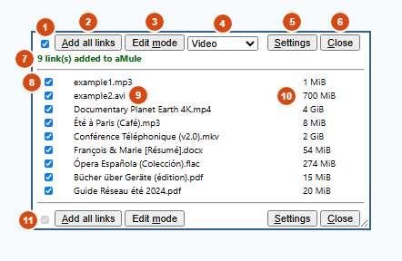
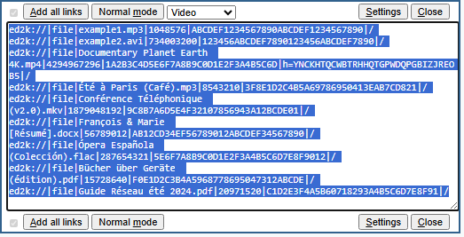
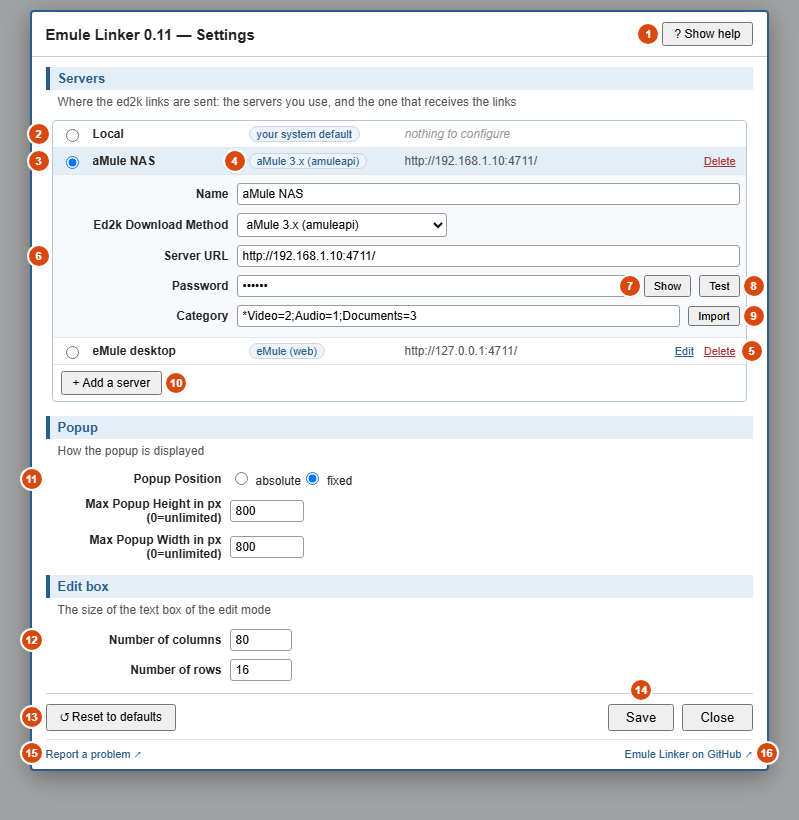
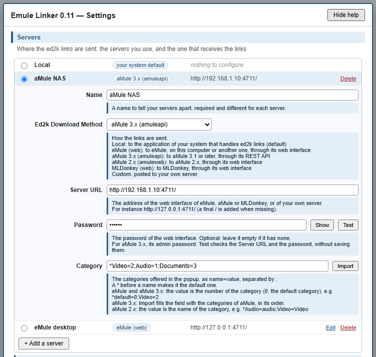
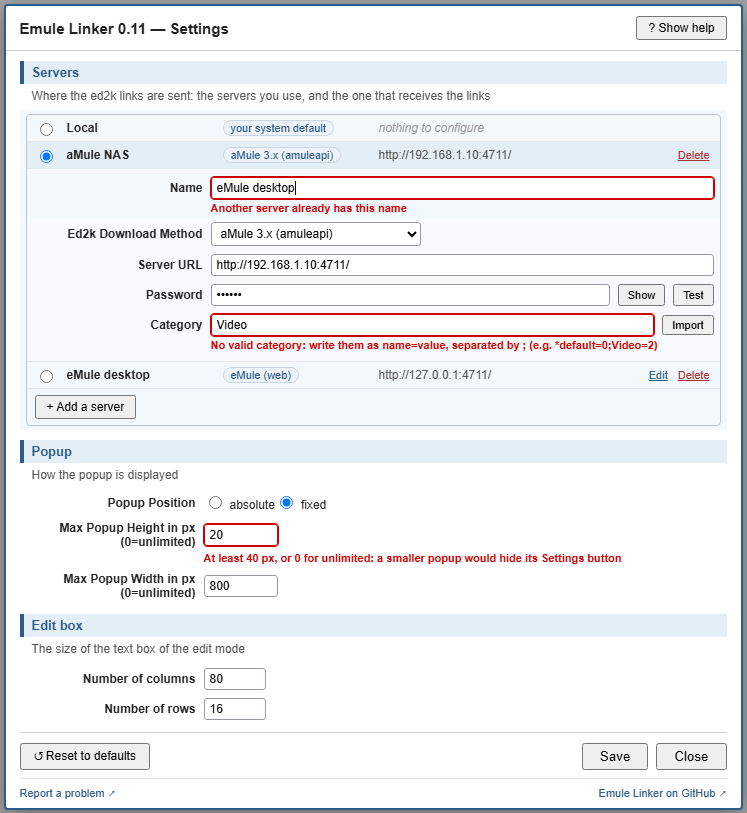
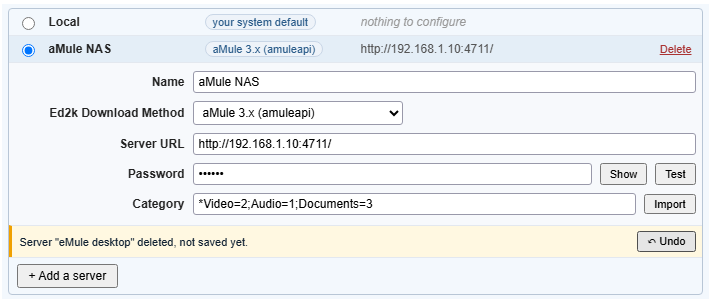
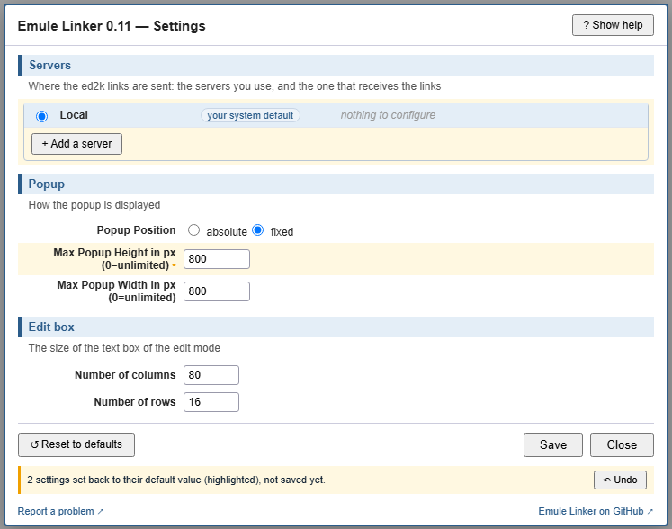
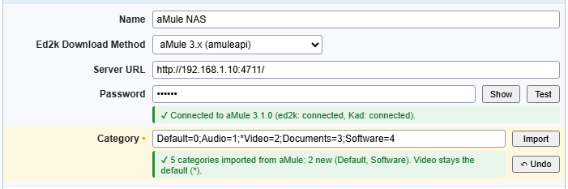
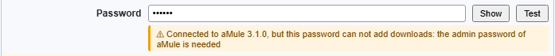
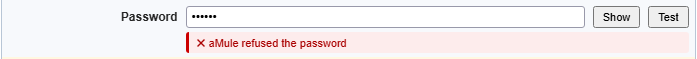

# GM_EmuleLinker — Functional and Technical Specifications

| | |
|---|---|
| **Product** | Emule Linker (Tampermonkey userscript, originally written for Greasemonkey 3) |
| **Documented version** | The one written in the `@version` of `GM_EmuleLinker.user.js` and in the first entry of `CHANGELOG.md`, the only places where the version is written (§ 3.2) |
| **Source file** | `GM_EmuleLinker.user.js` (single file, ~2150 lines) |
| **License** | GNU GPL v3 (`LICENSE`) — the embedded GM_config library remains under LGPL |
| **Repository** | <https://github.com/alo0/GM_EmuleLinker> |
| **Document** | Reverse specification, written by analyzing the code and the workspace files |

## Table of contents <!-- omit from toc -->

- [1. Overview](#1-overview)
  - [1.1 Purpose](#11-purpose)
  - [1.2 How it works](#12-how-it-works)
  - [1.3 Actors and environment](#13-actors-and-environment)
  - [1.4 Scope](#14-scope)
- [2. Functional specifications](#2-functional-specifications)
  - [SF-1 — ED2K link detection](#sf-1--ed2k-link-detection)
  - [SF-2 — Display popup](#sf-2--display-popup)
  - [SF-3 — Normal mode (list)](#sf-3--normal-mode-list)
  - [SF-4 — Edit mode](#sf-4--edit-mode)
  - [SF-5 — Selection](#sf-5--selection)
  - [SF-6 — Categories](#sf-6--categories)
  - [SF-7 — Sending the links](#sf-7--sending-the-links)
  - [SF-8 — Configuration](#sf-8--configuration)
  - [SF-9 — Commands and keyboard shortcuts](#sf-9--commands-and-keyboard-shortcuts)
  - [SF-10 — Persistence of the display state](#sf-10--persistence-of-the-display-state)
- [3. Technical specifications](#3-technical-specifications)
  - [3.1 File layout](#31-file-layout)
  - [3.2 Userscript metadata](#32-userscript-metadata)
  - [3.3 Embedded library: GM\_config](#33-embedded-library-gm_config)
  - [3.4 Data model](#34-data-model)
  - [3.5 Execution sequence](#35-execution-sequence)
  - [3.6 Function inventory](#36-function-inventory)
  - [3.7 Key technical choices](#37-key-technical-choices)
  - [3.8 The `amuleapi` method (aMule 3.1 and later)](#38-the-amuleapi-method-amule-31-and-later)
- [4. Compatibility](#4-compatibility)
- [5. Constraints, limitations and security](#5-constraints-limitations-and-security)
- [6. Identified improvements](#6-identified-improvements)
- [7. Tests](#7-tests)
  - [7.1 Test page](#71-test-page)
  - [7.2 Automated test suite](#72-automated-test-suite)
  - [7.3 Manual checks before a release](#73-manual-checks-before-a-release)
  - [7.4 Publishing a version](#74-publishing-a-version)

---

## 1. Overview

### 1.1 Purpose

Emule Linker is a userscript that **detects every ED2K link in a web page** and lets the user **send them in one click** to a file-sharing client: eMule, aMule, MLDonkey (through their web interface, local or remote), the system's default application, or a custom web server.

Without this script, the user has to click each ED2K link one by one — which quickly becomes tedious on forum pages holding dozens of links (historical use case: comic book sharing forums).

### 1.2 How it works

```text
Web page                 Userscript                        ed2k client
┌──────────┐            ┌────────────────────┐            ┌─────────────┐
│ <a href= │  DOM scan  │ 1. getEd2kLinks()  │            │ eMule       │
│  ed2k:// │ ─────────► │ 2. createPopup()   │            │ aMule       │
│  ...     │  (XPath)   │ 3. user selection  │ ─────────► │ MLDonkey    │
│ <a href= │            │ 4. getAddLink()    │  GET/POST  │ local app   │
│  ed2k:// │            │ 5. addButton()     │  / ed2k:   │ custom srv  │
└──────────┘            └────────────────────┘            └─────────────┘
```

### 1.3 Actors and environment

| Actor / component | Role |
|---|---|
| **User** | Browses, selects the links, triggers the sending, configures the script |
| **Browser + userscript manager** | Firefox or Chrome + **Tampermonkey** (recommended) or **Violentmonkey**; Greasemonkey 4 not supported (§ 4) |
| **Host page** | Any page (`@include *`) containing `<a href="ed2k://...">` links |
| **ed2k client** | eMule / aMule / MLDonkey with the web interface enabled, or a local `ed2k:` protocol handler, or a custom HTTP endpoint |

### 1.4 Scope

**Included**: detection, deduplication, display, selection, manual editing, categorization, sending, persistent configuration, keyboard shortcuts.

**Excluded**: automatic update from the UI, multiple languages, extension filtering, status feedback from the ed2k client (no acknowledgment is read), queue management.

---

## 2. Functional specifications

### SF-1 — ED2K link detection

| Ref | Rule |
|---|---|
| SF-1.1 | When each page loads, the script goes through **every `<a>` element with a `href` attribute**, using the XPath query `//a[@href]`. |
| SF-1.2 | The test is made on the **raw `href` attribute** (`getAttribute`), trimmed of surrounding spaces, and not on the resolved `href` property: when the scheme itself is encoded, the browser recognizes no scheme, resolves the attribute as a relative URL, and the `ed2k` prefix disappears. |
| SF-1.3 | A link is kept when its `href` starts with `ed2k` followed by the scheme separator, **literal or encoded at any depth**: `ed2k:`, `ed2k%3A`, `ed2k%253A`… The comparison is case-insensitive. |
| SF-1.4 | The `href` is **decoded** in successive passes: `decodeURIComponent()` first, falling back to `unescape()` when an exception is raised (invalid UTF-8 sequences, legacy ISO-Latin encoding). A first pass is always made; further passes are made as long as the scheme is not readable and decoding still changes something, up to 4 passes. |
| SF-1.5 | **Links identical after decoding** are ignored: only one copy is kept. Two links written with different encodings but pointing to the same file are therefore correctly deduplicated. |
| SF-1.6 | The link is split on the `\|` separator to extract the **file name** (field 3) and the **size in bytes** (field 4). |
| SF-1.7 | The link is **structurally validated** before use: at least 5 fields, type `file`, non-empty name, purely numeric size. Any non-compliant link — malformed (`ed2k://xxxx`) or of another type (`\|server\|`, `\|serverlist\|`) — is **silently ignored**, with a console trace. A bad link therefore cannot interrupt the scan of the page. |
| SF-1.8 | If the file name still contains a `%XX` pattern, it is **decoded a second time** (names encoded twice by the source site) and the link is rebuilt. |
| SF-1.9 | If an identical file name has already been met (but with a different link), a **` (n)` suffix** is added, `n` being the index of the link. <!-- markdownlint-disable-line MD038 --> |
| SF-1.10 | The three arrays are filled only **after** validation and fixes, `eLinks` last: its length is authoritative, and no partial entry can be used. |
| SF-1.11 | An unexpected failure of the scan is **contained**: the keyboard shortcuts and the settings dialog keep working, only the popup is not displayed. |
| SF-1.12 | The popup is displayed **only if at least one link** has been found. On a page without ed2k links, no shortcut and no menu entry opens it, and none of them raises an error. |

**Note**: detection requires the scheme separator after `ed2k`. A relative link such as `ed2k-guide.html`, common on forums about the subject, is therefore discarded and cannot produce a ghost entry.

### SF-2 — Display popup

The popup in normal mode, after a sending to aMule 3.x; the numbers refer to the table under it:



| # | Part | Rules |
|---|---|---|
| 1 | Box that checks or unchecks every link | SF-5.1 |
| 2 | **Add all links**: sends the checked links | SF-5.3, SF-7 |
| 3 | **Edit mode** (Normal mode in edit mode) | SF-4 |
| 4 | Category of the downloads | SF-6 |
| 5 | **Settings** | SF-8 |
| 6 | **Close** | SF-10 |
| 7 | Answer of aMule, for the `amuleapi` method | SF-7.10 |
| 8 | Box of a link, checked by default | SF-3.2, SF-5.2 |
| 9 | File name: a click sends this file only | SF-3.3 |
| 10 | Readable size | SF-3.4 |
| 11 | Bottom toolbar, its box disabled | SF-2.7, SF-5.4 |

| Ref | Rule |
|---|---|
| SF-2.1 | The popup is injected **as the first child of `<body>`**, at the top left of the page. |
| SF-2.2 | `fixed` positioning (follows scrolling) or `absolute` (stays at the top of the page), chosen in the settings. |
| SF-2.3 | Maximum height and width can be set in pixels; `0` = unlimited. These limits apply **in normal mode only**; in edit mode the popup switches to `max-height/width: 100%`. |
| SF-2.4 | In normal mode, the popup can be **resized** by the user (`resize: both`); in edit mode, it cannot. |
| SF-2.5 | Rendering: white background, 0.97 opacity, 2 px steel blue border (`#2b5c8a`, as the settings dialog), `z-index: 255`, 10 px font. |
| SF-2.6 | CSS styles are **scoped to the popup** (selectors prefixed with `div#theDiv` / `div#divBody`) so as not to affect the host page (0.7 fix). |
| SF-2.7 | A **toolbar is displayed at the top and at the bottom** of the popup. |
| SF-2.8 | There is **one popup at most**: opening a popup that is already open does nothing, and keeps its checkboxes and its edit box as they are. |
| SF-2.9 | In normal mode the popup is a column: top toolbar, list of links, bottom toolbar. When the links do not fit in the maximum height, **only the list scrolls**: both toolbars always stay visible. With few links nothing scrolls. |

### SF-3 — Normal mode (list)

| Ref | Rule |
|---|---|
| SF-3.1 | A table is displayed, one row per link: `[checkbox] [clickable file name] [readable size]`. |
| SF-3.2 | All boxes are **checked by default**. |
| SF-3.3 | The file name is an **individual link**: a click sends this file only to the ed2k client, with the configured method, in a tab named `emule`. With the `custom` and `amuleapi` methods, whose sending is a POST that a link cannot make, the link holds the ed2k link itself, and the click sends the POST for this file only. |
| SF-3.4 | The size is converted into readable binary units (`B`, `KiB`, `MiB`, `GiB`…, base 1024, no decimal). |
| SF-3.5 | The hovered row is highlighted (light blue background). |
| SF-3.6 | A tab order is assigned to the checkboxes. |

### SF-4 — Edit mode

| Ref | Rule |
|---|---|
| SF-4.1 | The body of the popup is replaced by a **text area** containing every detected link, **one per line**. |
| SF-4.2 | The content is **selected automatically** when opened (for an immediate copy/paste). |
| SF-4.3 | The user can freely change, delete or add links; the content of the text area is what will be sent. |
| SF-4.4 | The number of columns and the number of rows can be set. |
| SF-4.5 | The edit box has **no maximum length**: the whole list is always displayed and can be edited, whatever its length, and the user can always type in it. Checked on Chrome with 2,000 links (about 216,000 characters); the automated tests check 1,000. |
| SF-4.6 | Switching between normal and edit mode is stored and **persists from one page to the next**. |

The popup in edit mode, the links selected as it opens:



### SF-5 — Selection

| Ref | Rule |
|---|---|
| SF-5.1 | A "check all / uncheck all" box in the top toolbar. |
| SF-5.2 | Individual selection, row by row. |
| SF-5.3 | Only checked links are sent by "Add all links" (in normal mode). |
| SF-5.4 | The box of the bottom toolbar is present but **disabled** (visual consistency only). The box of the top toolbar is disabled **in edit mode**, where the list is a text area with no checkboxes. |
| SF-5.5 | **Popup not displayed** (closed, or page without links while edit mode is stored): there is no selection to read, so **every link of the page is sent**. This is what makes `Ctrl+Alt+A` and the "Add links" menu entry usable without opening the popup. |
| SF-5.6 | If the selection is empty — no box checked, or page without any ed2k link — sending is **abandoned without effect** (console trace, no window opened). Required because `@include *` makes the shortcut active on every page. |

### SF-6 — Categories

| Ref | Rule |
|---|---|
| SF-6.1 | A drop-down list lets the user choose the destination category in the ed2k client. |
| SF-6.2 | Categories are entered in the settings as `*label1=value1;label2=value2;`. The `*` prefix marks the **default choice**. |
| SF-6.3 | Meaning of the value: **eMule** = tab index (numeric); **aMule 2.x** = category name, `0` being turned into `all`; **aMule 3.1** (`amuleapi`) = category index (numeric, `0` = default category of aMule, a value that is not a number is sent as `0`). |
| SF-6.4 | The list is **disabled** for the `local` and `mldonkey` methods (not supported by these targets). |
| SF-6.5 | Each entry is checked: an entry without a name or a value is **skipped** (console trace) and the other categories are kept. Spaces around names and values are removed. Only when **no valid category** remains does an alert appear, and the setting reverts to `*default=0`. |
| SF-6.6 | The category used for sending is read **from memory** (`emuleCat` array), never from the popup DOM: sending remains possible with the popup closed. |
| SF-6.7 | **Exactly one default category**: the first one marked with `*`; any further `*` is ignored; without any `*`, the first category of the list. The drop-down list and the category actually sent (SF-6.6) therefore always agree. |
| SF-6.8 | Changing the category in the drop-down list **does not rebuild the popup**: only the URL of the file name links is updated, as they carry the category. The checkboxes, the text of the edit box, the size and the scroll of the popup are kept. |
| SF-6.9 | The category chosen in the drop-down list is a **one-off choice, for the current page only** (product decision, consistent with a "one page = one batch of files of the same kind" usage). It is not stored: each new page starts again on the default category (`*`) of the settings, and a sending triggered with the popup closed (SF-5.5) uses that default. To change the category for good, change the default in the settings. |

### SF-7 — Sending the links

Six download methods ("Ed2k Download Method"):

| Method | UI label | Transport | Behavior |
|---|---|---|---|
| `local` | Local (your system default) | `ed2k:` protocol | Each link is handed to the system handler through a **click on a synthetic anchor**, one link after the other. No URL, password or category used. **On Chrome, only one link is sent per user gesture** (see L-9). |
| `emule` | eMule (web) | HTTP **GET**, new `emule` window | `URL?w=password&p=<pwd>&cat=<cat>&c=<links>` |
| `amuleapi` | aMule 3.x (amuleapi) | HTTP **POST**, JSON, through `GM_xmlhttpRequest`, no window | Login on `URL/api/v1/auth/login`, then `URL/api/v1/downloads` with `{"links": [<links>], "category_index": <cat>}`, then logout (SF-7.9). aMule 3.1 or later (§ 3.8) |
| `amule` | aMule 2.x (amuleweb) | HTTP **GET**, new `amule` window | `URL/footer.php?pass=<pwd>&selectcat=<cat>&Submit=Download+link&ed2klink=<links>` |
| `mldonkey` | MLDonkey (web) | HTTP **GET**, new `emule` window | `URL/submit?jvcmd=multidllink&links=<links>` |
| `custom` | Custom (post to your own server) | HTTP **POST** (form), `emule` target | Fields `cat`, `ref` (URL of the source page), `ed2k` (links). The form is removed from the page once sent. A click on a single file name sends the same POST for that file (SF-3.3) |

Cross-cutting rules:

| Ref | Rule |
|---|---|
| SF-7.1 | Several links are joined with a **line feed** `\n` as separator (encoded as `%0A` for the GET methods — required for some links, 0.9 fix). |
| SF-7.2 | For the GET methods, the file name is normalized (`decodeURIComponent` then `encodeURIComponent`) **then the whole link is encoded again**: the name ends up deliberately encoded twice, which is what the eMule/aMule web interfaces expect. |
| SF-7.3 | For `custom` and `amuleapi`, no additional encoding is applied (the POST takes care of it). |
| SF-7.4 | `amule` mode **with a password**: a first window is opened on `footer.php?pass=<pwd>` to establish the session, followed by a **1-second wait**, before the links are actually sent. This is a workaround for the aMule login page. |
| SF-7.5 | After opening, `blur()` is called on the child window to try to give the focus back to the main page (no longer effective on recent browsers). |
| SF-7.6 | In normal mode, the source is the **selection of checked boxes**; in edit mode, it is the **raw content of the text area**, split by line. |
| SF-7.7 | `local` method: the link is **encoded by the script** (`encodeEd2kLink()`), both in the clickable links of the popup and when sending in batch. `ed2k` is not a *special scheme*: everything after `ed2k://` up to the final `/` is parsed as the host of the URL, where `\|`, space, `#`, `?`, `[`, `]`… are forbidden. Recent Chrome turns such a link into `about:blank` instead of encoding it, as older browsers used to do (0.2 in `CHANGELOG.md`). This whole part therefore goes through `encodeURIComponent`, after a prior decoding so that an already encoded link is not encoded twice; `ed2k://` and the final `/` stay in clear. ed2k handlers decode the link they receive. The other methods are not affected: their `http://` URL already encodes the whole link. |
| SF-7.8 | `local` method: the link is **never passed to `location.replace()`**, which rejects it (`SyntaxError`, the URL degenerating into `ed2k:///`) and would replace the document — only the last link of a batch would be sent. The script clicks one **synthetic anchor** per link. |
| SF-7.9 | `amuleapi` method: a **session per sending**. Login with the password in a JSON body, then **one request** with all the links and the category index, authorized by the token of the login, then logout, even when the sending fails. The password never appears in a URL, and the token is never stored (§ 3.8). |
| SF-7.10 | `amuleapi` method: as soon as the sending starts, a line under the top toolbar of the popup shows **"Please wait" followed by animated dots**, until **the answer of aMule** replaces it, the animation stopped. Meanwhile, the "Add all links" buttons are **disabled**, and no other sending starts (shortcut, click on a file name): the links are never sent twice. The answer shown is one of: number of links added, links refused (`207`, with the reason of the first one), or the error: password refused (`401`), password without the right to add downloads (`403`), no API at this address (older aMule or another server), too many failed logins (`429`, with the delay), aMule disconnected from its core (`503`), aMule unreachable, or no answer within the time limit (§ 3.8): the message then says that the links may still be added, as aMule received them. With the popup closed, a success is silent, and an error is shown in an alert, so that a failure is never silent. |
| SF-7.11 | `amuleapi` method: the lines that are not ed2k links (empty lines or text in the edit box) are **left out** of the sending, as the API would refuse the whole request. |

### SF-8 — Configuration

The settings dialog, with a server of each kind: aMule NAS is checked (it receives the links) and displayed; the numbers refer to the table under it.



| # | Part | Rules |
|---|---|---|
| 1 | **Show help** (Hide help once shown) | SF-8.3 |
| 2 | **Local**: the application of the system, nothing to configure | SF-8.9 |
| 3 | A server: its radio button (checked: it receives the links), its name, its Server URL | SF-8.9 |
| 4 | Badge of its download method | SF-8.14 |
| 5 | **Edit** and **Delete** | SF-8.14 |
| 6 | Settings of the server displayed: only the fields of its method | SF-8.9 |
| 7 | **Show** (Hide once shown): the password | SF-8.8 |
| 8 | **Test**, for aMule 3.x | SF-8.16, SF-8.17 |
| 9 | **Import**, for aMule 3.x | SF-8.16, SF-8.18 |
| 10 | **+ Add a server** | SF-8.14 |
| 11 | Section Popup | SF-2.2, SF-2.3 |
| 12 | Section Edit box | SF-4.4 |
| 13 | **Reset to defaults** | SF-8.12 |
| 14 | **Save** and **Close** | SF-8.4, SF-8.5, SF-8.11 |
| 15 | **Report a problem** | SF-8.15 |
| 16 | **Emule Linker on GitHub** | SF-8.15 |

| Ref | Rule |
|---|---|
| SF-8.1 | A settings dialog is provided, titled with the version of the script ("Emule Linker 0.x — Settings", from the userscript manager), organized in 3 sections: download method, popup, edit box. It has the colors of the popup (white, light blue, steel blue `#2b5c8a` for its border and its section titles, not the blue of links), is half of the window wide, between 640 and 960 px (95 % of the window at most), fits its content in height, and its fields are aligned in a column: the long ones (Server URL, Password with its Show button, Category) take the whole width of the column, as their explanation; the others are sized to their content. |
| SF-8.2 | It opens **automatically on first run** (as long as the `emule_config` flag is 0). |
| SF-8.3 | Each field has an **explanation**, shown under it in a light blue box. A **Show help / Hide help** button at the right of the title shows or hides the explanations of every field at once; they are not shown on mouse over, as the fields would then move under the mouse. While they are hidden, each one is also the tooltip of its row, shown by the browser after a short delay over it, for an occasional need; while they are shown, there is no tooltip repeating them. The choice is stored (`settings_help`): the dialog opens the next time as it was left. |
| SF-8.4 | **Save** and **Close** buttons, and a **Reset to defaults** button at the left (SF-8.12). |
| SF-8.5 | Saving **reloads the page** to apply the new settings. |
| SF-8.6 | Settings are persisted through the userscript manager storage (they survive a browser restart and are shared across all sites). |
| SF-8.7 | When an invalid setting is replaced by a usable value (URL without a final `/`, no valid category, popup too small), the corrected value is **stored**, so the alert is shown once and not again on every page load. Only the corrected settings are stored: the other ones stay exactly as the user saved them. |
| SF-8.8 | The **password is masked**; a Show / Hide button next to it displays it. |
| SF-8.9 | The section **Servers** lists, after a fixed **Local** row (no settings), the servers of the user: for each one a radio button, which chooses the server that receives the links, its name, its download method, its Server URL, and its **Edit** and **Delete** buttons. Under the server being edited are shown its Name, its Ed2k Download Method (every method but `local`) and **only the fields that this method uses**: Server URL for `mldonkey`, Server URL and Category for `custom`, Server URL, Password and Category for the others; changing its method changes the fields shown. |
| SF-8.10 | The values are **checked before saving**: a Server URL that does not start with `http://` or `https://` (every method, `custom` included: no other protocol is supported), a category list without any valid entry, a popup height between 1 and 39 px or a width between 1 and 99 px (the Settings button would be hidden), a size that is not a whole number, or an edit box of 0 column or row. Each wrong value is shown in red under its field, the focus goes to the first one, no alert is shown and nothing is saved until every value is right. SF-8.7 still covers the values stored by an older version. |
| SF-8.11 | The page is **dimmed behind the dialog**, and **Escape** closes it without saving. |
| SF-8.12 | **Reset to defaults** sets every setting back to its default value **in the dialog only**: Local is checked, **every server removed**, and the other fields set back to their default value. What it changed is highlighted, and a notice says how many settings changed and that nothing is saved yet. Its **Undo** button displays everything as before again. Save stores the defaults, Close or Escape forget them. |
| SF-8.13 | The dialog is **anchored at the top of the window** (10 px), centered in width, and never higher than the window: when it does not fit, it **scrolls inside**, so that its bottom and its Save button are always reachable, even when the window is made lower once the dialog is open. |
| SF-8.14 | **Several servers**, each one with its own name, download method and settings (Server URL, Password, Category), **several of the same method** included (two aMule 3.x for instance). **+ Add a server** adds one with the default settings, displayed to name and configure it; **Edit** displays the settings of a server without checking it; **Delete** removes a server at once: a notice with an **Undo** button takes its place in the list, where the user clicked, so that it is always in view, and goes away at the next action in the list (its Undo would otherwise undo that action too); deleting the checked server checks Local. The **Undo** button of a notice (Delete, Reset) has the style of the Show button and is always on the right of the notice, whatever the length of its text: the colored frame of the notice tells what it undoes; in the list, it is on the right edge of the fields and of their buttons. A method name too long for its badge is cut by "…", the whole name in its tooltip. A server needs a **name, different from the others** (whatever the case), a Server URL starting with `http://` or `https://`, and a Category with at least one valid entry: until then, it stays displayed, the error under the field, and nothing is saved. **Save** stores every server (`servers`) and, in the settings read by the rest of the script, the method and settings of the checked server; Close and Escape forget every change. The single set of settings of the older versions becomes a server named after its method. |
| SF-8.15 | At the bottom of the dialog, two links open in a new tab: **Report a problem** (the issues of the GitHub repository) and **Emule Linker on GitHub** (the repository). Their address is `REPOSITORY`, set in the PARAM block at the top of the script, next to the default values. |
| SF-8.16 | **Test** and **Import**, for the `amuleapi` method only: Test after Show, on the row of the Password, Import after the Category field, both with the style of Show and a tooltip ("Test the server URL and the password", "Fill the field with the categories of aMule"); for the other methods they are hidden, and the Category field keeps its whole width. They use the Server URL and the Password **typed in the dialog, saved or not**. An address that does not start with `http://` or `https://` is shown in red under its field, as by Save (SF-8.10), and nothing is sent; a final `/` is added when missing. Each click opens a session of the API and closes it (`auth/logout`), as a sending does (§ 3.8): the token is never stored, and the password travels in the login body only. While aMule answers, both buttons are disabled, the one clicked showing "Test…" or "Import…" (15 s at most). The result is shown under the field, framed in green, orange or red; the errors have the messages of SF-7.10 (wrong password, too many failed logins, no API at this address, aMule unreachable or late, not connected to its core). It goes away at the next action in the dialog, and when the Server URL or the Password changes (Test) or the Category field (Import). An answer that arrives once the dialog no longer shows what was sent (closed, another server, a field changed) is not shown. Nothing is saved until Save. |
| SF-8.17 | **Test** logs in, reads the version of aMule (`GET /api/v1/version`) and its state (`GET /api/v1/status`), then logs out. Connected, in green: `Connected to aMule 3.1.0 (ed2k: connected, Kad: connected).` In orange, connected, but the links would be refused: a password that is not the admin one (`role` of the login), or aMule not connected to its core (`ec_connected` false). |
| SF-8.18 | **Import** logs in, reads every page of the categories (`GET /api/v1/categories`, 100 per page), logs out, and fills the Category field with the categories of aMule, **in its order**, each one with its name and its index, the category 0 included under its own name; `*Default=0` only when aMule has none. The default one (`*`) stays on the category of the same name as before, whatever the case, or else goes to the first one. In the names, `;` and `=` become spaces and a leading `*` is removed; a category without a name is named `Category <index>`. The field is highlighted, and a notice framed in green tells how many categories were imported, which ones are new or removed, and which one is the default. Its **Undo** button, under Import, puts the field back. When the field already holds these categories, it is left as it is. |

#### Screens of the settings dialog

The explanations shown under the fields by **Show help** (SF-8.3):



Values refused by **Save**, each one in red under its field (SF-8.10): a name already used by another server, a Category without any valid entry, a popup too low:



A server deleted: the notice takes its place in the list, with its **Undo** button on the right (SF-8.14):



**Reset to defaults**: every server is removed, and the popup height is set back; both are highlighted, and the notice has its **Undo** button (SF-8.12):



**Test** and **Import** (SF-8.16 to SF-8.18): connected to aMule, and its categories imported in its order, the field highlighted, the **Undo** button under Import:



**Test**, connected, but the links would be refused (orange), and an error (red):





#### Fields and validation rules

| Field | Type | Default | Validation |
|---|---|---|---|
| `ed2kDlMethod` | list | `local` | — |
| `emuleUrl` (Server URL) | text | `http://127.0.0.1:4711/` | Starts with `http://` or `https://` (SF-8.10); final `/` added automatically, **except** in `custom` mode |
| `emulePwd` (Password) | password | empty | **Optional**: eMule accepts a web interface without a password; empty, it is sent as `p=` |
| `emuleCat` | text | `*default=0;` | Format `[*]name=value;…`; invalid entries skipped, exactly one default (SF-6.5, SF-6.7); no valid category → alert + revert to `*default=0` |
| `popupPos` | radio | `fixed` | `absolute` \| `fixed` |
| `popupHeight` | integer | `800` | If `0 < h < 40`, forced to `0` (otherwise the Settings button becomes unreachable) |
| `popupWidth` | integer | `800` | If `0 < w < 100`, forced to `0` (same reason) |
| `editCol` | integer | `80` | — |
| `editRow` | integer | `16` | — |

### SF-9 — Commands and keyboard shortcuts

Registered both in the **userscript manager menu** and as global shortcuts (`Ctrl+Alt+…`, without `Shift` or `Meta`):

| Shortcut | Menu entry | Action |
|---|---|---|
| `Ctrl+Alt+A` | Add links | Send the selected links |
| `Ctrl+Alt+M` | Change mode (edit/normal) | Switch between normal and edit mode (opens the popup in normal mode when it is closed) |
| `Ctrl+Alt+C` | Close Popup | Close the popup (state stored) |
| `Ctrl+Alt+O` | Open Popup | Open the popup, in normal mode; nothing if it is already open (SF-2.8) |
| `Ctrl+Alt+S` | Settings | Open the settings dialog |
| `Ctrl+Alt+X` | — | Toggle the popup open / closed, never duplicating it |
| — | Toggle debug traces | Switch the debug traces in the browser console on or off. The choice is stored (`debug_mode`), off by default; a confirmation alert is shown |

### SF-10 — Persistence of the display state

| Ref | Rule |
|---|---|
| SF-10.1 | The popup state is stored globally in `popup_mode`: `0` = closed, `1` = normal mode, `2` = edit mode. |
| SF-10.2 | This state is **global to all pages**: closing the popup on one site keeps it closed on the next ones, even when they hold ed2k links — nothing is displayed, not even the toolbars — until it is explicitly opened again (`Ctrl+Alt+O`, `Ctrl+Alt+X`, `Ctrl+Alt+M` or the menu). |
| SF-10.3 | An unexpected value raises a trace and an error alert. |

---

## 3. Technical specifications

### 3.1 File layout

| File | Role |
|---|---|
| `GM_EmuleLinker.user.js` | **The deliverable**: single-file userscript, with no external dependency. The `.user.js` extension lets Tampermonkey offer the installation when its address is opened |
| `GM_EmuleLinker.js` | **Former address** of the script, up to 0.9: a copy frozen at 0.10, kept so that the older installations find the new address (§ 3.2). Never to be modified nor deleted |
| `CHANGELOG.md` | The changes of every version, in the [Keep a Changelog](https://keepachangelog.com/en/1.1.0/) format: the only list of changes (§ 3.2) |
| `README.md` | User documentation (installation, configuration, limitations) |
| `SPECIFICATIONS.md` | This document |
| `test_sample.html` | Test page covering 11 cases: 9 valid links, numbered 1 to 9 (accents, single/double encoding, AICH hash, encoded scheme), and 2 invalid ones, unnumbered (malformed link, placed first, and server link), an Expected column telling which are sent and which are ignored |
| `test_many_links.html` | Test page generating 500 valid ed2k links (`?n=` to change the number), to check by hand that the popup displays them all; the automated tests check 1,000 links, in Chrome and in Firefox (§ 7.2) |
| `tests/` | Automated test suite, run in headless Chrome or Firefox (§ 7.2), the publication check `check_publication.py` (§ 7.4), the server of the manual migration check `migration_check.py` (§ 7.3), and `take_screenshots.py`, which takes the screenshots of the README and of this document in headless Chrome, with fictitious settings |
| `screenshots/` | Screenshots of the README, and in `screenshots/spec/` the pictures of this document, its popup and its settings dialog (SF-2, SF-4, SF-8). All of them are taken by `tests/take_screenshots.py` |
| `LICENSE` | GPL v3 |
| `GM_EmuleLinker.code-workspace` | VS Code workspace (parent folder, outside the Git repository): Markdown and test settings, a task opening the test page in Chrome with Tampermonkey, and three launch configurations (Chrome with Tampermonkey under the debugger, Chrome with Violentmonkey, Firefox with the user's profile). Under the VS Code debugger, Tampermonkey does not read its storage: its dashboard and its permission requests stay blank. The manual checks with Tampermonkey are therefore made in a Chrome launched by the task, without the debugger |

The source file is organized in three commented blocks: **PARAM** (default values), **LIB** (embedded GM_config), **CODE** (business logic).

### 3.2 Userscript metadata

```text
@include     *              → active on every page
@grant       GM_getValue, GM_setValue, GM_registerMenuCommand, GM_log, GM_xmlhttpRequest
@connect     *              → GM_xmlhttpRequest may reach any address (the aMule of the user, § 3.8)
@version     <version>      → written here and in CHANGELOG.md only
@updateURL / @downloadURL   → raw.githubusercontent.com/alo0/GM_EmuleLinker/master/GM_EmuleLinker.user.js
```

No `@require`, no `@resource`, no network resource loaded: the script is self-contained. `GM_xmlhttpRequest` is used by the `amuleapi` method only, towards the address set by the user: Tampermonkey asks the user to allow this address the first time. Users are invited to restrict where it runs with the **User includes** of its Tampermonkey settings: unlike a change of `@include`, they survive the updates.

**Change of address (0.10).** Up to 0.9, the script was `GM_EmuleLinker.js`, and its update URLs pointed to this file. Tampermonkey checks the `@updateURL` of the *installed* script, downloads the new version from its `@downloadURL`, then follows the URLs written in the new version. This gives the migration, without any action of the users:

1. `GM_EmuleLinker.js` stays at its address, frozen at 0.10, with update URLs pointing to `GM_EmuleLinker.user.js`.
2. An installation in 0.9 or before finds the 0.10 at the former address and installs it: from then on, it checks the new address, and gets the next versions from there.
3. `@name` and `@namespace` never change: Tampermonkey identifies the script by them, so it updates the installed script instead of adding a second one, and the stored settings are kept.

The frozen copy never needs to be updated: whatever the version installed, it leads to the new address. Until 0.10 is published, it is kept identical to `GM_EmuleLinker.user.js` (checked by `test_repository.py`). The migration itself is checked by hand, in a real Tampermonkey (§ 7.3).

### 3.3 Embedded library: GM_config

The **GM_config** library (Mike Medley et al., LGPL, 2009-2010 version) is **inlined** in the file instead of being loaded through `@require`, so that local fixes can be applied to it. It provides: dynamic form building, typed fields (`text`, `int`, `radio`, `select`, `checkbox`, `textarea`, `hidden`, `button`), numeric validation, JSON serialization, `onInit/onOpen/onSave/onClose/onReset` callbacks.

**Local fixes applied**:

| Location | Fix |
|---|---|
| `toNode()`, `select` case | `selected: i == value` instead of `options[i] == value` — the default value of a drop-down list was ignored (GM_config issue #30) |
| `open()`, iframe loading | `frame.contentDocument \|\| frame.contentWindow.document` — `contentDocument` can be `null` on Chrome/Tampermonkey |
| `open()`, resize listener | `function () { if (config.isOpen) config.center(); }` instead of `config.center` passed alone, which lost its `this`: every resize of the window raised a `TypeError` and the dialog was not moved. Its position is now set by the CSS of the script anyway (SF-8.13) |
| `scriptConfig()` | A **`<div>` is passed as container** instead of letting the library create an iframe, which avoids cross-origin restrictions on Chrome/Tampermonkey |

Storage automatically falls back to `localStorage` when the `GM_getValue` API is missing.

### 3.4 Data model

**Global state in memory** — three parallel arrays with consistent indexes:

```js
eLinks[i]  // full ed2k link, decoded       "ed2k://|file|name.mp3|1048576|HASH|/"
eFiles[i]  // displayed file name           "name.mp3"  (suffixed " (i)" if duplicate)
eSizes[i]  // size in bytes, raw            "1048576"
```

**Structure of an ED2K link** after `split('|')`:

| Index | Content | Example |
|---|---|---|
| 0 | scheme | `ed2k://` |
| 1 | type | `file` |
| 2 | **file name** | `example1.mp3` |
| 3 | **size (bytes)** | `1048576` |
| 4 | MD4 hash (32 hexadecimal characters) | `ABCDEF1234567890ABCDEF1234567890` |
| 5+ | optional: AICH hash `h=…`, sources, then `/` | `h=YNCK…` |

**Categories** — array of `{name, value, select}` objects, serialized to a string with `catToStr()` / deserialized with `strToCat()`.

#### Persistent storage keys

| Key | Scope | Values |
|---|---|---|
| `GM_config` | User settings (JSON of all fields) | serialized object |
| `popup_mode` | Popup display state | `0` closed, `1` normal, `2` edit |
| `emule_config` | "Configuration already done" flag | `0` / `1` |
| `debug_mode` | Debug traces in the browser console (menu "Toggle debug traces") | `0` (default) / `1` |
| `settings_help` | Explanations of the fields shown in the settings dialog (button Show help / Hide help) | `0` (default) / `1` |
| `servers` | The servers of the user (SF-8.14); the method and settings of the checked one are also in `GM_config` | JSON: `{"active": id or null for Local, "list": [{"id", "name", "method", "emuleUrl", "emulePwd", "emuleCat"}, …]}` |

### 3.5 Execution sequence

```text
Page load
  │
  ├─ GM_registerMenuCommand × 5                  (menu entries + accelerators)
  │
  ├─ scriptConfig()
  │    ├─ creates the container <div>, appended to body
  │    ├─ GM_config.init(div, title, fields, {save: () => location.reload()})
  │    │     └─ reads the storage, creates the GM_configField objects
  │    ├─ if emule_config < 1 → GM_config.open()   (first run)
  │    └─ saveConfig()                              (config → global variables + validation)
  │
  ├─ try { getEd2kLinks(eLinks, eFiles, eSizes) } → n   (failure contained, n = 0)
  │    └─ per link: isEd2kLink → decodeEd2kLink → deduplication
  │                → split('|') → isValidEd2kFile → storage
  │
  ├─ if n > 0 and popup_mode != 0 → createPopup()
  │    ├─ builds <div id="theDiv"> + scoped <style>
  │    ├─ addToolbar(container, 0)                (top: checkall, Add, Mode, Category)
  │    ├─ depending on popup_mode:
  │    │     1 → htmlLinkList()  → <div id="divBody"> with the table
  │    │     2 → addEditBox()    → <textarea id="editbox">
  │    └─ addToolbar(container, 1)                (bottom: Add, Mode, Settings, Close)
  │
  └─ installs the global keydown listener
```

**Sending sequence** (`addButton`, asynchronous):

```text
addButton()
  ├─ normal mode → getSelectLink(eLinks)          (checked boxes)
  │  edit mode   → textarea.value.split('\n')
  ├─ getAddLink(links) → href                     (encoding + URL depending on the method)
  └─ dispatch:
       local     → loop openLocalLink(link)       (click on a synthetic anchor)
       custom    → post(emuleUrl, href)           (POST form, target "emule")
       amuleapi  → sendToAmuleApi(href)           (login, POST of the links, logout; answer shown)
       amule     → [if pwd] window.open(footer.php?pass=…) + await sleep(1000)
                   window.open(href, 'amule') ; blur()
       others    → window.open(href, 'emule') ; blur()
```

### 3.6 Function inventory

| Function | Responsibility |
|---|---|
| `getEd2kLinks(links, files, sizes)` | XPath scan, decoding, deduplication, validation, name/size extraction, suffixing |
| `isEd2kLink(href)` | Recognizes the `ed2k` scheme, literal or encoded at any depth |
| `decodeEd2kLink(href)` | Decodes in successive passes until the scheme is readable (max 4) |
| `isValidEd2kFile(tlnk)` | Structural validation of the split link (5 fields, `file` type, name, numeric size) |
| `createPopup(links, files, sizes)` | Builds and injects the popup depending on `popup_mode` |
| `delPopup()` / `updatePopup()` | Removes / rebuilds the popup |
| `htmlLinkList(links, files, sizes)` | Generates the HTML table (normal mode) |
| `addToolbar(container, pos)` | Top (`pos=0`) or bottom (`pos=1`) toolbar |
| `addEditBox(container, txt)` / `delEditBox()` | Text area (edit mode) |
| `concatLinks(links)` | Joins the links, separated by `\n` |
| `getSelectLink(links)` | Extracts the links whose box is checked; every link when the boxes do not exist |
| `getSelectedCat()` | Reads the selected category from `emuleCat` (independent of the DOM) |
| `getAddLink(links)` | **Core of the adaptation**: encoding and building of the URL/payload per method |
| `addButton()` | Triggers the sending (asynchronous) |
| `openButton()` | Opens the popup, unless it is already open or the page has no ed2k link |
| `debugButton()` | Switches the debug traces on or off, and stores the choice |
| `refreshLinkUrls()` | Updates the URL of the file name links after a category change, without rebuilding the popup |
| `editButton()` / `closeButton()` / `setButton()` / `checkButton()` / `changeCat()` | UI action handlers |
| `scriptConfig()` / `saveConfig()` / `resetConfig()` | Configuration lifecycle |
| `catToStr(cat)` / `strToCat(str)` | Category serialization |
| `post(path, params, method)` | Sends through an HTML form (`custom` method), removed from the page once submitted |
| `linkHref(link)` | The href of a file name link of the popup: the URL of the method, or the ed2k link itself with `custom` and `amuleapi` |
| `clickOneLink(e)` | With `custom` and `amuleapi`, turns a click on a file name into the sending of that file |
| `sendToAmuleApi(body)` | `amuleapi` method: login, sending of the links, logout (SF-7.9) |
| `gmRequest(method, url, body, token)` | A JSON request through `GM_xmlhttpRequest`, as a promise |
| `amuleApiResult(links, r)` / `amuleApiError(r)` | The message for an answer of the aMule API (SF-7.10) |
| `showStatus(msg, ok)` | Shows a result in the popup, or in an alert for an error with the popup closed |
| `humanFileSize(bytes, si, dp)` | Readable size formatting |
| `encodeEd2kLink(lnk)` | Encodes the part between `ed2k://` and the final `/` (`local` method, popup and batch sending) |
| `openLocalLink(lnk)` | Hands a link to the system `ed2k:` handler through a synthetic anchor |
| `sleep(ms)` | Delay (aMule login workaround) |
| `trace(txt)` | Logging in the browser console, when the debug traces are on (`debug_mode` setting) |

**Dead code removed in 0.11**: `silentPost()` and `silentGet()` (blocked by CORS and mixed content, L-3), `loadChildWindow()` and `waitReady()` (marked "Not working"), and the commented-out code that used them (the `amule` POST branch, the calls of `loadChildWindow()`).

### 3.7 Key technical choices

| Choice | Rationale | Consequence |
|---|---|---|
| Single-file userscript, no build | Installation by copy/paste, maximum portability | Third-party library duplicated in the source; the tests inject the file unchanged into the pages (§ 7.2) |
| Mostly ES5 JavaScript (`var`, `new Array()`) | Legacy from 2012-2013 | A few modern elements here and there: `async/await`, arrow functions, default parameters, `**` |
| DOM handled by hand (no framework) | No dependency | HTML built by string concatenation for the popup and the table |
| Opening a window (`window.open`) rather than `XMLHttpRequest` | Silent cross-origin calls are blocked by modern browsers (CORS, mixed content) | A visible window at each sending, `blur()` ineffective — see § 5. Except `amuleapi`, whose JSON API leaves no choice: `GM_xmlhttpRequest`, which is not subject to CORS (§ 3.8) |
| **GET** transport for eMule/aMule/MLDonkey | The only method requiring neither server configuration nor complex interaction | Password in clear in the URL and the history; limited URL length |
| File name deliberately encoded twice | Expected by the eMule/aMule web interfaces | Delicate encoding logic, the source of most historical fixes |
| XPath rather than `querySelectorAll` | Legacy | Functionally equivalent here |

### 3.8 The `amuleapi` method (aMule 3.1 and later)

**Why a new method.** aMule 3.1.0 (September 2026) replaces its web interface `amuleweb`, used by the `amule` method, with `amuleapi`: a REST daemon serving `/api/v1/*` and a new Web UI, on the same port 4711. The `footer.php` page called by the `amule` method no longer exists there. The `amule` method stays for aMule 2.x; `amuleapi` is added beside it, shown as **aMule 3.x (amuleapi)** in the settings dialog. The aMule 3.0.x versions are supported by neither method: `amule` no longer works with them (L-10), and they have no `amuleapi`.

**What the API expects** (from `docs/api/REFERENCE.md` of the aMule repository, confirmed against a real aMule 3.1.0):

| Step | Request | Answer |
|---|---|---|
| Login | `POST /api/v1/auth/login`, JSON body `{"password": "…"}`, with `Accept: application/jwt` (or `?include_token=true`) to get the token in the body | `200` with `token`, `expires_at` and `role` (`admin` to add downloads), and a cookie `amuleapi_token` (HttpOnly, `SameSite=Strict`, `Path=/api/v1`). Failed logins are rate-limited per IP (`429` with `Retry-After`) |
| Sending | `POST /api/v1/downloads`, header `Authorization: Bearer <token>`, JSON body `{"links": ["ed2k://…", …], "category_index": <n>}`: several links per request, category optional (0 by default), admin role only | `202` all accepted (the add is asynchronous), `207` partial success (`results[].ok` per link), `400` malformed body or link, `401` session refused, `503` daemon disconnected |
| Categories | `GET /api/v1/categories?limit=100&offset=<n>`, header `Authorization: Bearer <token>` (`401` without it) | `{"categories": [{"index": 0, "name": "Default", "save_path": …, "comment": …, "color": …, "priority": …}, …], "total": …, "offset": …, "limit": …}`: categories identified by an integer `index` (0 to 255), in the order of their index, the default one being `0`, named "Default" by aMule; page by page, 100 by default. Read by Import (SF-8.18) |
| Version | `GET /api/v1/version`, no session needed | `{"service": "amuleapi", "api_version": "v1", "amuleapi_version": "3.1.0", "daemon_version": "3.1.0", …}`. Read by Test (SF-8.17) |
| State | `GET /api/v1/status`, header `Authorization: Bearer <token>` | `ec_connected` (the API is connected to the core of aMule), `ed2k.state` and `kad.state` (`connected`…), and statistics. Read by Test (SF-8.17) |
| Cancel | `DELETE /api/v1/downloads/{hash}` (MD4 hash, 32 hexadecimal characters) | `204`: the download is cancelled and its files deleted. Used by the live test to remove its test files |
| Logout | `POST /api/v1/auth/logout` | `204`: the token is revoked |

**Design**:

- **Transport**: the API needs a JSON `POST` and an authorization header. A `window.open()` or a form cannot send them, and a `fetch()` from the page is blocked by the browser: the API answers other origins only when `AllowCORS=1` is set on the server, and its cookie is `SameSite=Strict`. The method therefore uses **`GM_xmlhttpRequest`**, which is not subject to CORS. This needs `@grant GM_xmlhttpRequest` and `@connect *`, as the address of aMule is chosen by the user: Tampermonkey asks the user to allow it the first time.
- **Gains** for this method: the password no longer appears in a URL nor in the history (L-1), no URL length limit (L-2), no window opened (L-4, L-5), no fixed delay (L-6), and the answer of aMule is shown to the user (L-8, SF-7.10).
- **Time limit**: aMule answers the sending only once every link is added, and this time grows faster than the number of links: 8 s for 500 links, 77 s for 2,000 links, measured on aMule 3.1.0. The sending therefore waits 60 s plus 100 ms per link (`amuleApiTimeout()`), the login and the logout 15 s. A late answer is not reported as an unreachable aMule (SF-7.10).
- **Pages**: `GET /api/v1/downloads` answers page by page (`limit`, `offset`, `total`; 100 downloads by default). The live test reads every page.
- **Session**: a session is opened for each sending and closed after it (`auth/logout`), even when the sending fails: the token is never stored. The password travels in the body of the login request only.
- **Category**: a numeric index, written in the Category setting as for eMule (`*default=0;Video=2`).
- **Encoding of the links**: the links travel in JSON, not in a URL, so they are not encoded a second time (SF-7.2). Checked on aMule 3.1.0: a file name sent raw and the same name encoded once both give the exact name in the transfer list (accents, spaces, `&`, brackets, parentheses). The links are therefore sent as normalized by SF-7.2, name encoded once, as for the other clients.
- **Tests**: a fake `amuleapi` in the test server (login, sending, error answers), `GM_xmlhttpRequest` in `tests/gm_shim.js`, relayed by the test server as Tampermonkey does, and a live test against a real aMule 3.1 (§ 7.2).

---

## 4. Compatibility

Support of each download method, with Tampermonkey, on the latest stable version of the browsers:

<!-- LTeX: enabled=false -->
| Method / Browser | Local (your system default) | eMule (web) | aMule 3.x (amuleapi) | aMule 2.x (amuleweb) | MLDonkey (web) | Custom (post to your own server) |
|---|---|---|---|---|---|---|
| Chrome | Partial ¹ | Full | Full ² | Full ² | Not tested | Full |
| **Firefox** (recommended) | Full | Full | Full ² | Full ² | Not tested | Full |
<!-- LTeX: enabled=true -->

The columns are the labels of the settings dialog; the methods are, in the same order, `local`, `emule`, `amuleapi`, `amule`, `mldonkey` and `custom` (SF-7).

¹ One link per user gesture (L-9). Workaround: the `emule` method with `http://127.0.0.1:4711/`, which sends all the links at once.

² For aMule 3.1 or later, the `amuleapi` method (§ 3.8); `amule` is for aMule 2.x. aMule 3.0.x is not supported (L-10).

| Item | Support |
|---|---|
| Managers | **Tampermonkey** (recommended and tested); **Violentmonkey** (tested on Chrome: the script works fully, it provides the `GM_` functions used, `GM_xmlhttpRequest` included, and keeps its storage under the VS Code debugger); Greasemonkey 4: **not supported**, as its API replaced the `GM_` functions with asynchronous `GM.` ones and has no `GM_registerMenuCommand` (the script was written for Greasemonkey 3, before 2017) |
| ed2k clients tested | eMule (local and remote), aMule 2.x (remote only), aMule 3.1.0 (`amuleapi`, remote) |

---

## 5. Constraints, limitations and security

| Ref | Item |
|---|---|
| L-1 | **Password in clear in the URL** (`p=`, `pass=`): visible in the browser history, in the web server logs, and on the network when using HTTP. → The README explicitly recommends HTTPS to access the remote client. |
| L-2 | **Limited URL length** with GET (browser, proxies, eMule/aMule web server). Beyond it, the sending is silently ignored. → Workaround: send the links in batches. |
| L-3 | **Mixed content / CORS**: a silent XHR sending from an HTTPS page to an eMule served over HTTP is blocked. This is why `silentPost()` was abandoned (removed in 0.11). |
| L-4 | **Popup blockers**: opening a window can be blocked when it is not seen as triggered by a user gesture — especially the second aMule window after `await sleep(1000)`. |
| L-5 | **Deprecated `blur()`**: giving the focus back to the main page no longer works on recent browsers. |
| L-6 | **aMule login workaround based on a fixed delay** (1 s): fragile with a slow server or network latency. |
| L-7 | **`@include *`**: the script runs on every visited page, including sensitive HTTPS pages. The popup only appears when ed2k links are detected, but the DOM scan and the injection of the settings `<div>` always take place. |
| L-8 | No feedback from the ed2k client is used: the script does not know whether the links were added successfully. |
| L-9 | **Chrome: one link per user gesture with the `local` method.** Chrome requires a real user gesture to launch an external application and **consumes it** at the first launch: the following links of a batch are refused (`Not allowed to launch '…' because a user gesture is required`). Firefox is not affected. A gesture cannot be simulated: an event produced by a script (`click()`, `dispatchEvent()`) is flagged `isTrusted === false` and grants no activation. **Validated workaround**: enable the eMule web server, even locally, and choose the `emule` method with `http://127.0.0.1:4711/` — all links are sent in a single request, hence with a single gesture. |
| L-10 | **aMule 3.0.x is not supported.** Choose a more recent version, with the aMule 3.x (amuleapi) method. |

The `amuleapi` method is free of L-1, L-2, L-4, L-5, L-6 and L-8 (§ 3.8).

---

## 6. Identified improvements

By decreasing value:

1. **Silent sending for the `emule`, `amule`, `mldonkey` and `custom` methods** (target of version 0.12), through `GM_xmlhttpRequest` as `amuleapi` does (§ 3.8), instead of a window or a form: not subject to CORS nor to mixed content (L-3), no window opened (L-4, L-5), the `amule` login awaited instead of a fixed delay (L-6), the password no longer in the browser history (L-1, still in the URL expected by these web interfaces), and the answer of the client shown in the popup (L-8, SF-7.10). The only interaction left is the permission asked once per address by Tampermonkey (`@connect`). The `local` method is not concerned (`ed2k:` protocol). Each method must then be checked again against a real client.
2. **Automatic batch sending** when the URL exceeds a length threshold (L-2).
3. **Extension filter** (allow list / block list) in the settings.
4. **Visual feedback on the sending result** in the popup body for the other methods, as `amuleapi` does (SF-7.10) — including a counter of the links ignored by SF-1.7, currently rejected silently.
5. **Choose the server from the popup**: a drop-down list of the servers in the toolbar of the popup, as the one of the categories, to send the links to another server without opening the settings (SF-8.14).
6. **General section of the settings dialog**, first in the dialog: the **language** (by default that of the browser) and a **text size** among a few predefined ones (for instance small, normal, large, instead of the fixed 10 px of the popup, SF-2.5). Both apply to every screen of the script: the popup, its edit mode, the settings dialog and the messages. The texts would be gathered in one table per language; the alerts keep the size of the browser. Online help could follow.
7. **Technical work**: separate the GM_config library from the business script (through `@require` on a frozen copy) and modernize the syntax. The automated test suite (§ 7.2) makes such changes safer.

---

## 7. Tests

### 7.1 Test page

`test_sample.html` covers the following cases, to be run again after any change to the detection/encoding chain. Only the valid links are numbered, as they are the only ones displayed and sent; the invalid ones are shown on a red background, and the Expected column of the page tells, for each link, whether it must be sent or ignored. The page starts with an invalid link, so that the detection is checked to go on after an error.

| # | Case | Expected |
|---|---|---|
| — | **Malformed** link `ed2k://xxxxxxxx`, first link of the page | Ignored, **and the 9 valid links that follow are still displayed** (non-regression of the 0.10 fix) |
| 1-2 | Simple links (audio, video) | Detected, exact name and size |
| 3 | Additional **AICH** hash (`h=…`) | Detected and displayed normally |
| 4 | **Raw** special characters (accents, spaces, parentheses) | Name displayed as is |
| 5 | Name **encoded once** (UTF-8) | Decoded once |
| 6 | Name **encoded twice** (`%25`) | Decoded twice |
| 7 | `ed2k://` kept, **rest encoded** (`%7C`, `%2F`) | Detected, name correctly decoded |
| 8 | A **fully encoded** link (`ed2k%3A%2F%2F`) | Detected after 1 pass, name correctly decoded |
| 9 | Scheme **encoded twice** (`ed2k%253A%252F%252F`) | Detected after 2 passes, name correctly decoded |
| — | **Server** link, last link of the page | Ignored |

All valid links follow the ed2k format: MD4 hash of 32 hexadecimal characters, numeric size. eMule and aMule reject a hash of any other length.

### 7.2 Automated test suite

The `tests/` folder holds a suite run in a real headless browser, Chrome or Firefox, with the Python standard library only:

```text
python tests/run_tests.py                run every test
python tests/run_tests.py category       run the tests whose name contains "category"
python tests/run_tests.py --firefox      run them in Firefox instead of Chrome
python tests/run_tests.py --chrome --firefox    in Chrome, then in Firefox
python tests/run_tests.py --live-emule   run the live test against the real eMule (see below)
python tests/run_tests.py --live-amule   run the live test against a real aMule 3.1 (see below)
```

The exit code is 1 when a test fails. The options combine: `--live-amule --firefox` runs the live test in Firefox. Chrome and Firefox are found automatically, or through the `CHROME_PATH` and `FIREFOX_PATH` environment variables. In VS Code, the same tests appear in the Testing panel, one class per level, through the unittest adapter `tests/vscode_tests.py`: in Chrome, or in Firefox when the `TEST_BROWSER` environment variable is `firefox` (the live tests are left out of it).

`GM_EmuleLinker.user.js` is injected **unchanged** into the pages served by a local web server, after a small stand-in for the `GM_*` API (`tests/gm_shim.js`, values kept in `localStorage`): Tampermonkey is not needed. Chrome is driven through the DevTools protocol (`tests/cdp.py`), Firefox through **WebDriver BiDi**, the standard protocol that replaces it there (`tests/bidi.py`); both clients offer the same operations, so that every test runs unchanged in both browsers. The keyboard shortcuts and the mouse clicks are real (trusted) events, and the alerts are caught. Each browser runs with a temporary profile, deleted at the end (an error is reported if it cannot be). Testing in a real browser matters for this script: most of its defects came from browser behavior (URL parsing of `ed2k:` links, user gestures), which a simulated DOM does not reproduce.

**Fake ed2k clients.** The test web server also answers under `/__emule`, standing for the web interface of eMule, aMule, MLDonkey or a custom server. The script really sends its requests there, through the browser, and each test checks what an ed2k client would read in them (password, category, name, size and hash of every link). Nothing reaches a real ed2k client. Only the `local` method cannot be served this way (`ed2k:` links): its anchor clicks are caught and recorded. Under `/__amuleapi`, a fake aMule 3.1 REST API answers the `amuleapi` method (login, sending, logout), and each test sets how it behaves: password refused, links refused, aMule disconnected... The `GM_xmlhttpRequest` of the stand-in is relayed by the test server (`/__gmxhr`), as Tampermonkey makes the request outside the page: it is not subject to CORS either, and reaches the real aMule in the live test.

| Level | File | Content |
|---|---|---|
| 0 — Repository | `tests/test_repository.py` | Without the browser: `@version` and `CHANGELOG.md` agree, `CHANGELOG.md` is in order, the header of the script holds no list of changes, no other file writes a version (§ 3.2); the update URLs, and the former address `GM_EmuleLinker.js` leading to the new one (§ 3.2); the address of the repository set in the PARAM block, the one of `@updateURL` (SF-8.15); no dead code left in the script (§ 3.6); no field of the settings dialog declaring a key twice (§ 3.3); every picture shown by the documents exists, is taken by `take_screenshots.py`, and every picture of `screenshots/` is shown (§ 3.1) |
| 1 — Functions | `tests/test_units.py` | Tables of cases for `isEd2kLink`, `decodeEd2kLink`, `isValidEd2kFile`, `encodeEd2kLink`, `strToCat`, `catToStr`, `mergeAmuleCategories`, `humanFileSize` |
| 2 — Scenarios | `tests/test_scenarios.py` | Detection on `test_sample.html`, page without ed2k links, first run, shortcuts, opening and closing the popup, menu entries, a huge number of links, toolbars staying visible, categories, settings dialog (look, help, masked password, Escape, width and borders, links to the repository, low window, list of the servers, two servers of the same method, fields shown per method, names required and different, Delete and Undo, style and place of Undo, Reset and Undo, values checked before saving, the Server URL in `http://` or `https://` for every method, settings saved), download methods in the settings, edit mode, `local` method, corrected settings stored, optional eMule password |
| 2 — Sending | `tests/test_sending.py` | Against the fake clients: `emule` (all links, popup closed, partial selection, category change keeping the popup and the edit box text, edit box text, single link click), `amule` (with and without password, delay between the two requests), `amuleapi` (login, JSON sending and logout, category, single link click, edit mode, answers of aMule shown, popup closed; in the settings dialog, Test and Import: buttons shown per method, the address and the password typed, every answer of aMule, waiting, every page of the categories, Undo, nothing saved), `mldonkey`, `custom` (POST form), nothing sent when there is nothing to send |
| 3 — Live | `tests/test_live_emule.py`, `tests/test_live_amule.py` | Optional, against the running eMule, and a running aMule 3.1 (below) |

Each test names the rule (SF-x) or section (§) it checks. Many checks read the debug traces: the tests switch them on through the `debug_mode` setting, whatever the default of the script.

**Live test against the real eMule** (`--live-emule`), to run before a release, with eMule running and its web server enabled. The web password is read from the `EMULE_PASSWORD` environment variable, the address from `EMULE_URL` (default `http://127.0.0.1:4711/`). The script adds three test files to eMule; the test finds them in the eMule transfer list, with their names intact (spaces, accents, parentheses, `&`, brackets) and their hashes, then **cancels them**, even when the test fails, and checks that they are gone. The test files carry a random marker in their name and random hashes: nothing else in eMule is ever touched. The password never reaches the disk durably: the test sends it to eMule in POST bodies only; the script under test puts it in its GET URL, but inside the temporary Chrome profile, which the runner deletes at the end — the run fails if it cannot; and every message printed is masked. What eMule itself writes in its own log is outside the reach of the tests.

**Live test against a real aMule 3.1** (`--live-amule`), to run before a release, with aMule 3.1 or later running with its REST API. Its address is read from the `AMULE_URL` environment variable, its admin password from `AMULE_PASSWORD`, or `EMULE_PASSWORD` when not set. The script adds three test files with the `amuleapi` method; the test finds them in the aMule transfer list through the API, with their names intact, their size and their category, checks the answer shown in the popup, then **cancels them** (`DELETE /api/v1/downloads/{hash}`), even when the test fails, and checks that they are gone. A second test clicks Test and Import in the settings dialog: connected to aMule 3.x, every category of aMule imported in its order, nothing saved, nothing changed in aMule. Same precautions as for eMule: random marker and hashes, nothing else touched, and the password only in JSON request bodies.

Non-regression case still to add: two different links with the same file name (SF-1.9).

### 7.3 Manual checks before a release

What depends on elements outside the reach of the suite — the extension (Tampermonkey, Violentmonkey), the Windows protocol handler — is checked by hand, with the user's own browser profiles:

1. Run `python tests/run_tests.py --live-emule` and `python tests/run_tests.py --live-amule` (§ 7.2): they cover the `emule` and `amuleapi` methods end to end, the ed2k clients included.
2. Install the script in Tampermonkey, on Chrome and on Firefox, and open `test_sample.html`: the popup lists the 9 valid links.
3. `local` method: on Chrome, clicking a file name in the popup adds it to eMule (one link per user gesture, L-9); on Firefox, "Add all links" adds the 9 links.
4. `emule` method on Firefox: "Add all links" adds the 9 links to eMule, in the selected category.
5. `amule` method, when an aMule 2.x is available: same check, with and without a password.
6. `amuleapi` method, in Tampermonkey on Chrome and on Firefox: at the first sending, Tampermonkey asks to allow the address of aMule (`@connect`); once allowed, "Add all links" adds the 9 links to aMule 3.1, in the selected category, and the popup shows "9 link(s) added to aMule". With a wrong password, the popup shows the error. In the settings dialog, before any sending to this address, **Test** triggers the same permission request of Tampermonkey, then shows "Connected to aMule…"; **Import** fills the Category field with the categories of aMule. When Tampermonkey loads the script through a loader script (`@require`), only the header of the loader counts: it must carry the `@grant` and `@connect` lines of the script, otherwise `GM_xmlhttpRequest` is not defined.
7. The settings survive a browser restart. The settings dialog, in Tampermonkey on Chrome and on Firefox, shows the help of a field under it, lists the servers, keeps two servers of the same method apart, shows under a server only the fields of its method, and refuses a wrong value in red under its field.
8. **Change of address** (§ 3.2), for the 0.10 only: run `python tests/migration_check.py` and follow the steps it prints, in a browser profile with Tampermonkey but without the real Emule Linker. A local server stands for GitHub: Tampermonkey installs the 0.9, updates to 0.10 from the former address, then to a simulated next version from the new one, and the settings are kept.

The test files added by hand to eMule and aMule in checks 3 to 6 must then be cancelled by hand.

### 7.4 Publishing a version

The users get a new version through `@updateURL`, which points to the `master` branch on GitHub. To publish one:

1. **Review the code with the maintainer**, before anything else: go through the diff of the version (`git diff master..<branch>`) in several steps, in an order that a human can follow (the new features, then the user interface, then the tests, then the documentation), each step explained in more detail than in the commit message. The questions it raises are settled before going on.
2. **Check that nothing personal will be published**: `python tests/check_publication.py`, with `EMULE_PASSWORD` set. It looks at every commit not yet on GitHub (`origin/master..HEAD`): its author and committer e-mail addresses (only no-reply addresses may be published), its message, and every text file it holds. It reports any e-mail address other than the public ones, any local path revealing a user folder, the real eMule password, and the terms listed in `tests/private_terms.txt` — a local file ignored by git, for what cannot be written in the published script itself (names of private machines, of sites...). Findings never show a private value. There must be no finding.
3. Check the `@version` of `GM_EmuleLinker.user.js` and, in `CHANGELOG.md`, set the date of the first entry to the publication day; check that this entry lists every change of the version, and that its comparison link at the bottom of the file points to the new tag. For the 0.10 only, copy it then to `GM_EmuleLinker.js` (§ 3.2); from the 0.11 on, this frozen copy is no longer touched.
4. Retake the screenshots from this version: `python tests/take_screenshots.py <folder>` writes them under a folder of your choice, to compare them with the current ones, and without a folder replaces them in `screenshots/`: the README ones (`screenshot_main.png`, the popup, and `screenshot_settings.png`, the settings dialog) and the ones of this document (`screenshots/spec/`). Look at each of them: the numbered markers must still point at their part (their legends are in SF-2 and SF-8), and nothing personal may appear. The settings are fictitious, and the test page is served locally, without any other tab, bookmark or account.
5. Run `python tests/run_tests.py --chrome --firefox`, then the same with `--live-emule` and with `--live-amule`, and the manual checks of § 7.3.
6. Run `python tests/check_publication.py` again: steps 3 and 4 changed the version.
7. Merge the version branch into `master`.
8. Tag the merge: `git tag vX.Y`.
9. Push `master` and the tag: `git push origin refs/heads/master refs/tags/vX.Y` (full names: a branch or a tag of the same name would make `vX.Y` ambiguous).
