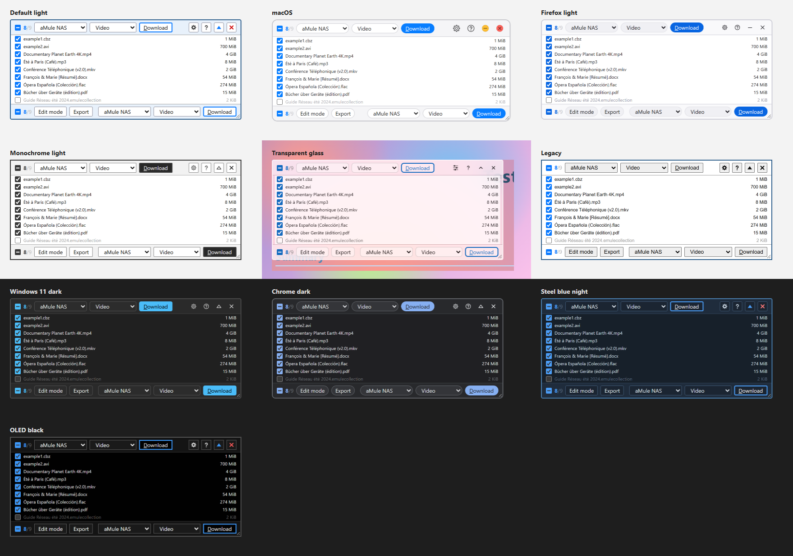
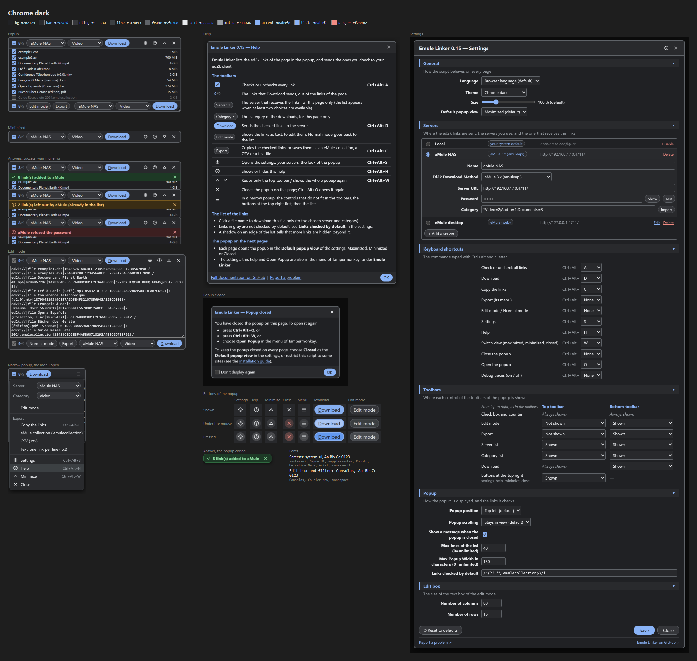

# Themes: modify them or create one

This guide is for anyone who wants to change the look of Emule Linker: adjust a color of an existing theme, or add a theme of their own. It needs no knowledge of the rest of the script: a theme is a table of values, in one place of `GM_EmuleLinker.user.js`.

The themes of the script, their popup side by side:

## Contents <!-- omit from toc -->

- [1. How the themes work](#1-how-the-themes-work)
- [2. What a theme holds](#2-what-a-theme-holds)
  - [Optional values](#optional-values)
- [3. Modify an existing theme](#3-modify-an-existing-theme)
- [4. Create a new theme](#4-create-a-new-theme)
- [5. Fonts, shapes and icons](#5-fonts-shapes-and-icons)
- [6. Check your theme](#6-check-your-theme)
- [7. Advice](#7-advice)

## 1. How the themes work

- The user chooses a theme in the settings (`Ctrl+Alt+S`), section **General**, field **Theme**. **Automatic**, the default, is not a theme of its own: it takes `THEME_AUTO_LIGHT` (Default light), or `THEME_AUTO_DARK` (Windows 11 dark) when Windows or the browser is in dark mode, and follows a change of mode at once.
- A theme colors every screen of the script: the popup, the band of the answers of the client, the message shown when the popup is closed, the help and the settings dialog. It never changes the page visited.
- The CSS of the script writes every color as a variable, `var(--eml-<name>)`. A theme gives the value of each variable. The function `applyTheme()` writes the values of the theme chosen on the boxes of the script only, in one style element of the page.
- Everything a theme needs is in the **PARAM block**, at the top of `GM_EmuleLinker.user.js`, before the CSS: the table `THEMES`, the fonts `THEME_FONTS`, the two themes of Automatic `THEME_AUTO_LIGHT` and `THEME_AUTO_DARK`, and the icons `ICONS`. The comment above `THEMES` lists what each value colors.

The rules are in [SPECIFICATIONS.md](SPECIFICATIONS.md), SF-13.

## 2. What a theme holds

A theme lists **every** value below, with no inheritance from another theme: a color is read and changed in one place. Here is the meaning of each one, with its value in Default light (`light`):

| Value | What it gives | Default light |
|---|---|---|
| `font` | The font of every screen, one of `THEME_FONTS` (§ 5) | `THEME_FONTS.segoe` |
| `radius` | The radius of the buttons and lists of the toolbars, of Download, OK, Save, and of the controls drawn in the help | `'3px'` |
| `icons` | The set of icons, one of `ICONS`: `'solid'`, `'outline'`, or a set of its own (§ 5) | `'solid'` |
| `scheme` | `'light'` or `'dark'`: the native controls (drop-down lists, edit box, scroll bars) drawn by the browser in that kind | `'light'` |
| `accentColor` | The color of the checked boxes; `'auto'` keeps the one of the browser | `'auto'` |
| `bg`, `bg2`, `text` | The background of the boxes, the background of the fields of a server in the settings, the text | `#ffffff`, `#f7f9fc`, `#000000` |
| `frame`, `title` | The frame of the boxes, their titles (also the titles and the left mark of the sections of the settings) | `#2b5c8a`, `#2b5c8a` |
| `bar`, `section` | The toolbars and the title bars; the titles of the sections of the settings and the helps of their fields | `#e8f1fb`, `#e4eef7` |
| `line`, `lineSoft`, `lineMid` | The separators: of the list and of the bars, of the rows of the help and of the settings, of the dialog and the list of the servers | `#a0a0a0`, `#e3e8ef`, `#c9d6e6` |
| `muted`, `faded`, `countTotal` | The secondary texts, the grayed-out texts (links left unchecked by default), the total of the counters (`8/9`) | `#555555`, `#999999`, `#bababa` |
| `icon`, `accent`, `danger` | The icons, the blue of Download, of the counter and of the links, the red of Close and Delete | `#333333`, `#0075ff`, `#d00000` |
| `linkHover`, `rowHover` | A file name, and a row of the list, under the mouse | `#0000ff`, `#e3f0fa` |
| `ctlBg`, `ctlText`, `ctlLine`, `ctlHover` | The buttons and the lists of the toolbars: background, text, border, under the mouse | `#ffffff`, `#000000`, `#8f8f9d`, `#f3f8fd` |
| `ctlOffBg`, `ctlOffText`, `ctlOffLine` | The same, grayed out | `#f5f5f5`, `#8a8a8a`, `#c8c8c8` |
| `chipBg` | The controls drawn in the help | `#efefef` |
| `primaryBg`, `primaryText`, `primaryHover` | Download, OK and Save (their border takes `accent`, or `primaryLine`): background, text, background under the mouse | `#ffffff`, `#000000`, `#0075ff` |
| `helpText`, `warn` | The text of the helps of the settings; the orange marks (a setting changed, a notice) | `#112233`, `#f0a000` |
| `shadow`, `backdrop` | The shadows of the list and of the band; the backdrop behind the dialogs, and their own shadow | `rgba(0,0,0,0.3)`, `rgba(0,0,0,0.35)` |
| `waitBg`, `waitLine`, `waitText` | The band of the answers while waiting | `#f2f2f2`, `#d0d0d0`, `#555555` |
| `okBg`, `okLine`, `okText` | The band after a success (also the result of Test and Import in the settings) | `#e6f4ea`, `#b7dfc3`, `#006600` |
| `koBg`, `koLine`, `koText` | The band after an error (also the errors of the settings) | `#fdecea`, `#f3c0c0`, `#cc0000` |
| `doubtBg`, `doubtLine`, `doubtText` | The band after a warning (links left out by the client) | `#fff4e5`, `#f0d2a6`, `#a65f00` |

### Optional values

A theme may also give the values below. Without them, a screen keeps the look given by the values above (the column **Without it**): a theme only lists what it changes.

| Value | What it gives | Without it |
|---|---|---|
| `frameRadius` | The radius of the frames of the boxes, and of the band of an answer floating against the popup | square; 4 px for the settings dialog |
| `opacity` | The opacity of the popup | `0.97` |
| `blur` | The page seen through the boxes, blurred (`backdrop-filter`, `'blur(18px) saturate(160%)'` for instance): for translucent backgrounds | none |
| `editBg`, `editText` | The edit box and the fields of the settings dialog | the colors of the fields of the browser |
| `iconBtnBg`, `iconBtnLine`, `iconBtnRadius` | The buttons at the top right of the popup, the close buttons of the dialogs, the buttons of the title of the settings: background, border, radius (`'transparent'` for no frame, `'50%'` for round ones) | `ctlBg`, `ctlLine`, `radius` |
| `iconBtnSize`, `iconSize` | Their size, the size of their icons | `22px`, `12px` |
| `iconBtnHover`, `iconBtnActive` | Their background under the mouse, pressed | `ctlHover` |
| `minColor`, `maxColor` | The icon of Minimize, the one of Maximize | `accent` |
| `closeColor`, `closeHoverBg`, `closeActiveBg`, `closeHoverColor` | Close: its icon; its background under the mouse, pressed; its icon under the mouse | `danger`; `iconBtnHover` |
| `glyph` | The symbols drawn on the colored dots of the icons `macos` | the text |
| `primaryLine`, `primaryBorder` | The frame of Download, OK and Save: color, width | `accent`, `2px` |
| `primaryHoverText` | Their text under the mouse | `primaryText` |
| `primaryActive`, `primaryActiveRing` | Their background pressed, a ring inside them pressed (`'inset 0 0 0 1px #ffffff'` for instance) | `primaryHover`, none |
| `ctlActive` | The other buttons pressed: their background | `ctlHover` |
| `ctlHoverLine`, `ctlActiveLine` | Every button: its border under the mouse, pressed | its border |
| `menuRadius`, `menuBg`, `menuLine` | The menu of a narrow popup (its folded controls, under the menu button): radius, background, border | `radius`, `bg`, `ctlLine` |
| `menuHover`, `menuHoverText` | Its row under the mouse: background, text | `rowHover`, `text` |

Each picture of a theme shows the buttons of the popup shown, under the mouse and pressed (the menu button included), a narrow popup with its menu open, and the fonts of the theme.

Each theme on every screen, with its main colors, shows where these values land. Chrome dark, for instance:

## 3. Modify an existing theme

1. Open `GM_EmuleLinker.user.js` and find `var THEMES = {`, in the PARAM block.
2. Change the values of the theme: its name is the key of its entry (`light`, `macos`, `firefox`, `mono`, `glass`, `legacy`, `win11`, `chrome`, `steel`, `oled`). Keep the format of each value: `'#rrggbb'` for a color, `'rgba(r,g,b,a)'` for a transparent one.
3. Reload a page with ed2k links: the popup takes the new values. Open the settings, the help, and close the popup, to see every screen.

A change of Default light also changes what the automated tests expect of it (they check its colors): run them (§ 6) and update the values they expect, or rather create a theme of your own.

## 4. Create a new theme

1. **Copy an entry** of `THEMES`, the one closest to your idea (a light one or a dark one), and give it a new key: a short name in small letters, without spaces, `sepia` for instance. It is the value stored in the settings, and the name of its picture.
2. **Set every value** (§ 2): its `scheme` first (`'light'` or `'dark'`), then its colors, its `font`, its `radius` and its `icons`; then the optional values it needs (the states of the buttons, the frames, the edit box…).
3. **Name it** in the English table of texts, `TEXTS.en`, next to the other themes: `'theme.sepia': 'Sepia',`. The setting **Theme** then offers it, with nothing else to change: its options are Automatic, then every theme of `THEMES`, in the order of the table. Its French name, in `TEXTS.fr` (`'theme.sepia': 'Sépia',`), is optional: without it, the French screens show the English one.
4. If it should be taken by **Automatic**, set `THEME_AUTO_LIGHT` or `THEME_AUTO_DARK` to its key.
5. **Make its picture**: `python tests/take_screenshots.py screenshots themes` draws `screenshots/theme/sepia.png` and adds it to `screenshots/theme/0_overview.png`. Every theme of the script must have its picture (a test checks it).
6. **Run the tests** (§ 6): they read the table `THEMES` of the script, and check that each theme is offered by the setting, named in English, and has its picture.
7. To share it, add it to the list of SF-13.1 in [SPECIFICATIONS.md](SPECIFICATIONS.md), to the line of the themes in [README.md](README.md), and to [CHANGELOG.md](CHANGELOG.md).

## 5. Fonts, shapes and icons

- **Fonts**: `THEME_FONTS` names a few lists of fonts, and a theme takes one of them (`font: THEME_FONTS.segoe`). Only fonts installed on the computer can be used: the script loads no file, and many sites forbid loading fonts from elsewhere. Each list ends with fallbacks, down to `sans-serif`, for the systems that lack the first ones. To add one, add a list to `THEME_FONTS`. The edit box and the filter of the links keep a monospace font, whatever the theme.
- **Shape**: `radius` is a CSS length: `'0'` for square corners, `'3px'` or `'4px'` for slightly rounded ones, `'11px'` for a pill (the buttons are 22 px high). Write the lengths in pixels for the size 100 %: at another size, every length of 3 px or more of the theme is multiplied by the factor of the size (Size / 100), so that a theme needs nothing else to follow the setting Size. The frames of the boxes take `frameRadius`, optional.
- **Icons**: `ICONS` holds two full sets, `solid` and `outline`, each one with the same seven icons (`settings`, `minimize`, `maximize`, `help`, `ok`, `warn`, `close`), drawn in SVG in a 12 × 12 box, in `currentColor` so that the theme colors them. The full sets also hold `menu`, the icon of the menu button of a narrow popup. The other sets (`macos`, `firefox`, `glass`, `mono`) list only the icons they change: the others are taken from `outline`. To add a set, add an entry to `ICONS` with the icons it changes, and name it in the `icons` of your theme. The colored dots of `macos` take the color of their button, and the symbol drawn on them the optional value `glyph`. When Automatic changes theme, the icons shown are drawn again in the set of the new one.

## 6. Check your theme

- **In a browser**: install the modified script in Tampermonkey or Violentmonkey, open [test_sample.html](test_sample.html), choose your theme in the settings, and look at every screen: the popup (normal, edit mode with `Ctrl+Alt+M`, minimized), the help (`?`), the message of the closed popup (Close), the settings with every help shown (their `?` button). Try a page that has a font and colors of its own: nothing of it must reach the screens of the script.
- **Its picture**: `python tests/take_screenshots.py <folder> themes` draws every theme on every screen, in that folder, without installing the script.
- **The automated tests** (Python 3 and Chrome; see § 7 of [SPECIFICATIONS.md](SPECIFICATIONS.md)): `python tests/run_tests.py theme` for the themes, `python tests/run_tests.py screenshots` for the pictures, then the whole suite, `python tests/run_tests.py --chrome --firefox`.
- **An editable mockup**: `python mockups/drawio_export.py --theme sepia` writes a draw.io file of every screen in this theme, to rework it before writing its values (`--language fr` for the French texts).

## 7. Advice

- **Contrast**: the text on its background, and the file names of the list, should stay readable (a contrast ratio of 4.5:1 at least is the usual rule); the grayed-out texts (`faded`, `ctlOffText`) less, but still readable.
- **A dark theme** needs `scheme: 'dark'`, so that the lists, the edit box and the scroll bars turn dark too, and an `accentColor` of its own, light enough on its background.
- **The bands of the answers** tell success, warning and error by their color: keep green, orange and red recognizable in your theme.
- **Shadows and backdrops** look better darker in a dark theme (`rgba(0,0,0,0.6)` or more).
- **Look at the settings dialog** too: it uses the same values as the popup (`section`, `bg2`, `lineSoft`…), and is easily forgotten.
- **The states of the buttons**: under the mouse and pressed, a button should change visibly (`ctlHover`, `ctlActive`, `ctlHoverLine`…); the picture of the theme shows them.
- **A translucent theme** (backgrounds in `rgba()`, with `blur`) needs a text dark or light enough to stay readable on any page: its picture shows it on a colorful page.
